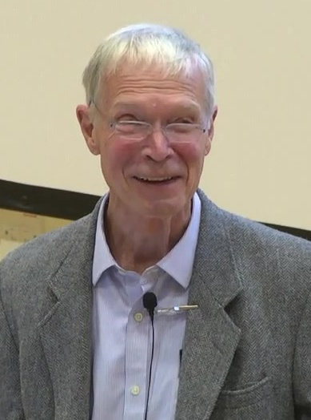
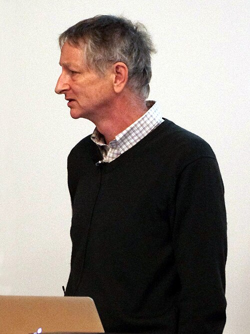
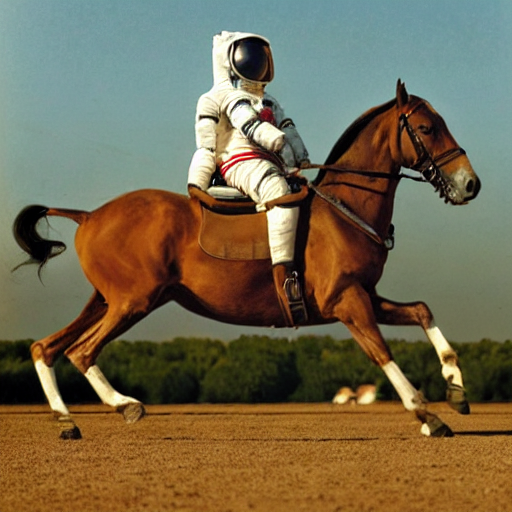
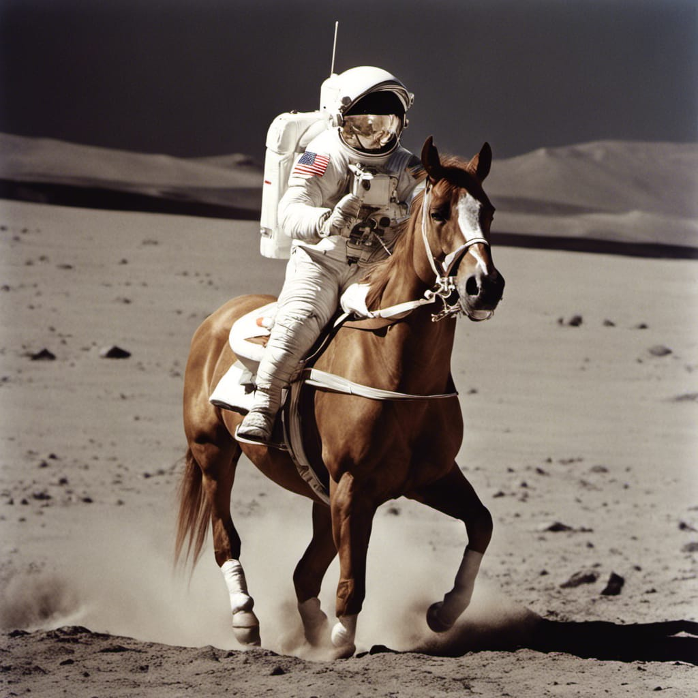
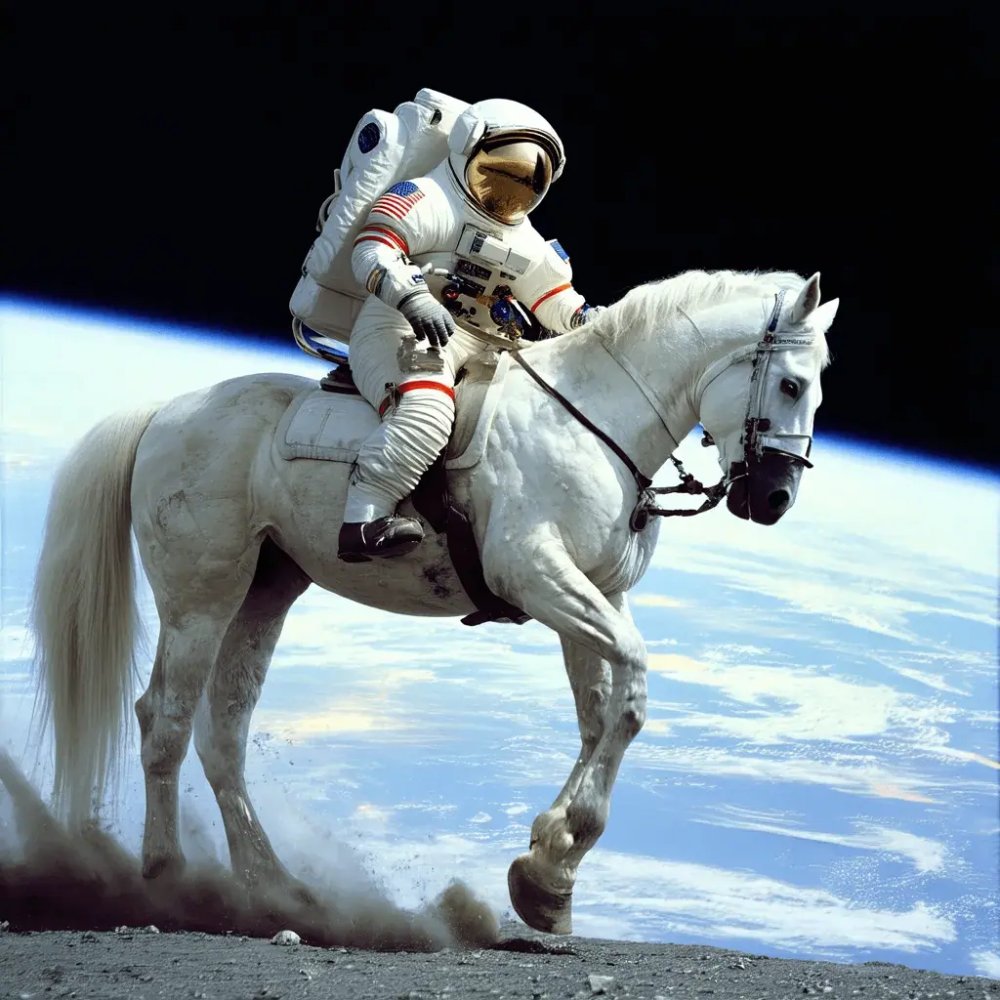
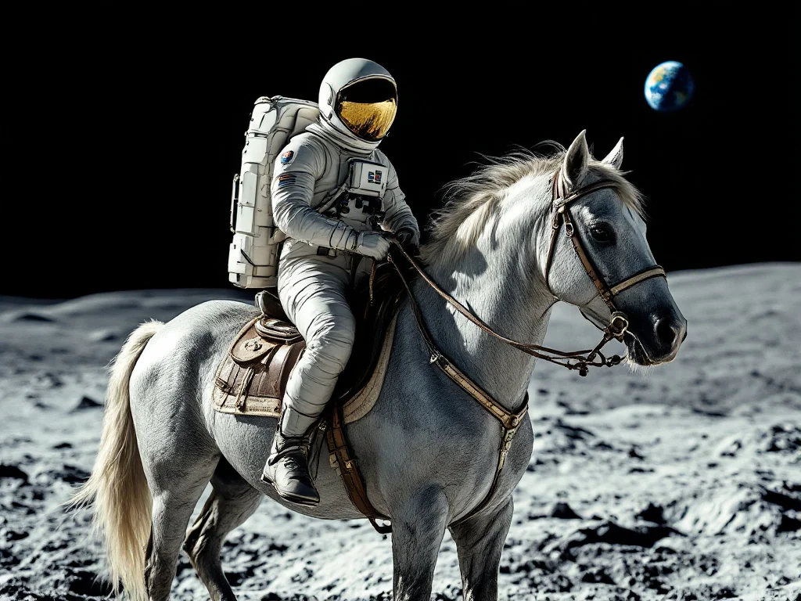
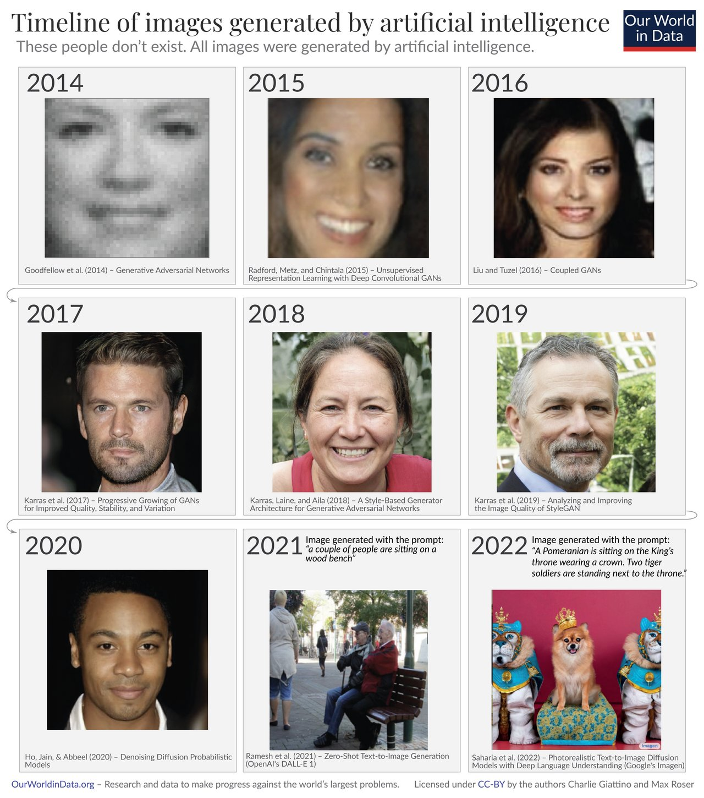
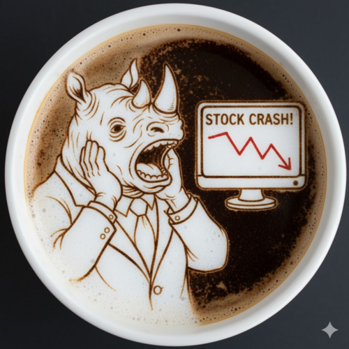
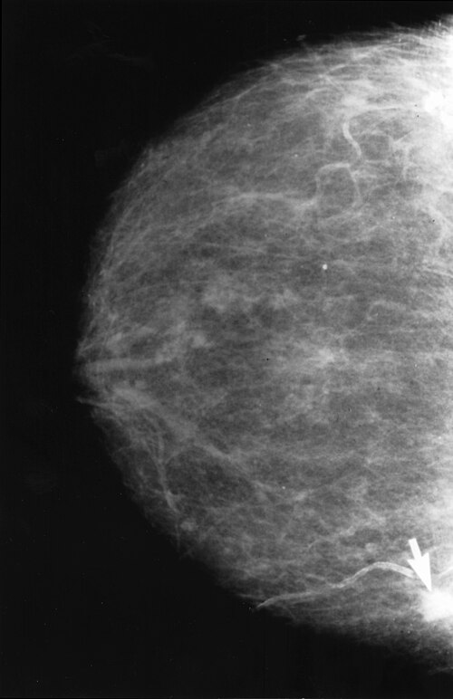

```{python}
from graficas import *
from programa import grafica_programa
```

## ¡Bienvenidas y bienvenidos! {.center}

:::: {.columns}
::: {.column width="58%"}
**Escuela de Machine Learning: teoría y aplicaciones**

- Universidad Nacional Autónoma de Honduras (UNAH), Ciudad Universitaria, Tegucigalpa
- 23 de noviembre – 4 de diciembre de 2026

::: {.caja .pequeno}
Organizan: ICTP – *Physics Without Frontiers*, UNAH y Tecnológico de Monterrey.
Coordinación: Edith Natalia Villegas García (ICTP), Carlos Soto (OGS), Joshua Lemus (U. de Módena y Reggio Emilia), Daniela Pinto (NYU); coordinación local: Lucio Villanueva y Melissa Cruz (UNAH).
:::
:::
::: {.column width="42%"}
::: {.definicion}
**Objetivos**

1. Aprender los fundamentos del aprendizaje automático (*machine learning*)
2. Practicar con herramientas reales: Linux, Python, scikit-learn, PyTorch, Hugging Face
3. Conocer investigación actual… y a quienes la hacen
4. Construir una red de contactos para su futuro académico
:::
:::
::::

::: {.notes}
Presentarse: biofísica y aprendizaje automático en el ICTP (Trieste, Italia).
Preguntar de qué carreras vienen y en qué año están.
:::

## El programa de la escuela

```{python}
grafica_programa()
```

::: aside
Pasen el cursor sobre cada bloque para ver el tema y quién lo imparte. Todo el material queda disponible en línea.
:::

## El mapa del curso

:::: {.columns}
::: {.column width="33%"}
::: {.tarjeta}
[Herramientas]{.titulo-tarjeta}

- Linux, terminal y git 
- Python, pandas, visualización *(Daniela Pinto)*
- Probabilidad *(Javier Aguilar)*
- Optimización iterativa *(Carlos Soto)*
:::
:::
::: {.column width="33%"}
::: {.tarjeta}
[Aprendizaje clásico]{.titulo-tarjeta}

- Regresión lineal y múltiple *(Carlos Soto)*
- Clasificación: regresión logística, k-vecinos, árboles, SVM *(Daniela Pinto)*
- Agrupamiento (*clustering*) *(Alex Rodriguez)*
- Reducción de dimensionalidad: PCA *(Carlos Soto)*
:::
:::
::: {.column width="33%"}
::: {.tarjeta}
[Aprendizaje profundo]{.titulo-tarjeta}

- Redes neuronales
- Redes convolucionales y autocodificadores
- Transformers y modelos de lenguaje
- Aprendizaje en grafos *(Alvaro Carbonero, Ana Rivera)*
- Agentes de IA *(Daniela Pinto)*
:::
:::
::::

::: {.fragment}
Y además: **aplicaciones** (medicina, demografía, políticas públicas, física de partículas, ecología, biología, neurociencia), **ética de la IA** *(Matteo Marsili)* y una **sesión de carreras** para planear su futuro.
:::

## Pregunta rápida {.center}

::: {.pregunta}
¿Quién ha usado ChatGPT, Claude, Gemini, Copilot o Meta AI **esta semana**?
:::

::: {.fragment}
¿Para qué lo usaron? ¿Les ha dado alguna respuesta **equivocada**?
:::

::: {.fragment}
¿Quién usó **otra** IA hoy sin darse cuenta?
:::

::: {.notes}
Dejar que respondan. Ejemplos de IA "invisible": el teclado del celular que sugiere palabras, el filtro de spam, Google Maps, las recomendaciones de TikTok/YouTube/Spotify, face ID. 
:::

# ¿Qué es la inteligencia artificial? {background-color="#053229" .seccion}

Definiciones, un poco de historia y por qué ahora

## Términos que se confunden {.compacta}

::: {.definicion .fragment}
**Inteligencia artificial (IA):** "la ciencia y la ingeniería de hacer máquinas inteligentes" — John McCarthy, quien acuñó el término en 1955 para la conferencia de Dartmouth (1956). Hoy: sistemas que realizan tareas que asociamos con la inteligencia humana (percibir, razonar, aprender, comunicarse, decidir).
:::

::: {.definicion .fragment}
**Aprendizaje automático (*machine learning*, ML):** "un programa *aprende* de la experiencia **E** respecto a una tarea **T** y una medida de desempeño **P**, si su desempeño en **T**, medido por **P**, mejora con la experiencia **E**" — Tom Mitchell (1997). En vez de programar las reglas, **las aprendemos de los datos**.
:::

::: {.definicion .fragment}
**Ciencia de datos:** campo interdisciplinario que combina estadística, computación y conocimiento del área para **extraer conocimiento y tomar decisiones a partir de datos** (limpiar, explorar, visualizar, modelar y comunicar).
:::

::: {.definicion .fragment}
**Aprendizaje profundo (*deep learning*):** aprendizaje automático con **redes neuronales de muchas capas**, que aprenden representaciones cada vez más abstractas de los datos.
:::

::: aside
McCarthy, J. *et al.* (1955). *A Proposal for the Dartmouth Summer Research Project on Artificial Intelligence*. · Mitchell, T. (1997). *Machine Learning*. McGraw-Hill. · LeCun, Y., Bengio, Y. & Hinton, G. (2015). Deep learning. *Nature* 521, 436–444.
:::

## ¿Cómo se relacionan?

```{python}
fig = go.Figure()
elipses = [
    ("Inteligencia artificial", 0, 0, 6.2, 4.0, mezclar(ARTICO, 0.5), "IA: sistemas que realizan tareas «inteligentes». Incluye métodos sin aprendizaje: búsqueda, lógica, sistemas expertos, planificación."),
    ("Aprendizaje automático", 0.6, -0.5, 4.6, 3.0, ARTICO, "ML: algoritmos que aprenden patrones a partir de datos (regresión, árboles, k-vecinos, SVM, clustering, PCA…)."),
    ("Aprendizaje profundo", 1.2, -1.0, 3.0, 2.0, ZAFIRO, "Deep learning: redes neuronales con muchas capas (redes convolucionales, transformers…)."),
    ("IA generativa y LLM", 1.6, -1.45, 1.6, 1.05, ABETO, "Modelos que generan texto, imágenes, audio o video: ChatGPT, Claude, Gemini, Stable Diffusion, Sora…"),
]
for nombre, cx, cy, a, b, color, desc in elipses:
    fig.add_shape(type="circle", x0=cx - a, x1=cx + a, y0=cy - b, y1=cy + b,
                  fillcolor=color, opacity=0.9, line=dict(color="white", width=3), layer="below")
# Ciencia de datos: se traslapa con IA/ML y con estadística
fig.add_shape(type="circle", x0=-8.6, x1=-0.4, y0=-3.0, y1=2.6, fillcolor=CORAL, opacity=0.22,
              line=dict(color=CORAL_OSCURO, width=3, dash="dot"))
etiquetas = [("Inteligencia artificial", -1.0, 3.2, PAVO_REAL), ("Aprendizaje automático", 0.0, 1.85, PAVO_REAL),
             ("Aprendizaje profundo", 1.0, 0.55, PAVO_REAL), ("IA generativa<br>y LLM", 1.6, -1.45, "white"),
             ("Ciencia de datos", -6.0, 1.6, CORAL_OSCURO), ("estadística,<br>visualización,<br>bases de datos", -6.2, -0.6, CORAL_OSCURO)]
for texto, x, y, color in etiquetas:
    fig.add_annotation(x=x, y=y, text=f"<b>{texto}</b>", showarrow=False, font=dict(size=22, color=color))
fig.add_trace(go.Scatter(
    x=[-1.0, 0.0, 1.0, 1.6, -6.0], y=[3.2, 1.85, 0.55, -1.45, 1.6], mode="markers",
    marker=dict(size=60, opacity=0), hoverinfo="text",
    hovertext=[e[6] for e in elipses] + ["Ciencia de datos: usa estadística, ML, visualización y conocimiento del área para responder preguntas con datos."],
    showlegend=False))
fig.update_layout(xaxis=dict(visible=False, range=[-9, 6.6]), yaxis=dict(visible=False, range=[-4.3, 4.3], scaleanchor="x"),
                  plot_bgcolor="rgba(0,0,0,0)", margin=dict(l=0, r=0, t=0, b=0))
mostrar(fig, 1300, 700)
```

## Programación tradicional vs. aprendizaje automático

:::: {.columns}
::: {.column width="50%"}
[Programación tradicional]{.titulo-tarjeta}

```{python}
def diagrama(entradas, salida, color):
    fig = go.Figure()
    for i, t in enumerate(entradas):
        fig.add_annotation(x=0, y=1 - i * 0.9, text=f"<b>{t}</b>", showarrow=False, font=dict(size=24, color=texto_sobre(color)),
                           bgcolor=color, borderpad=14)
        fig.add_annotation(x=1.55, y=0.55, ax=0.45, ay=1 - i * 0.9, xref="x", yref="y", axref="x", ayref="y",
                           showarrow=True, arrowhead=3, arrowsize=1.5, arrowwidth=3, arrowcolor=GRIS, text="")
    fig.add_annotation(x=2.0, y=0.55, text="<b>Computadora</b>", showarrow=False, font=dict(size=24, color=PAVO_REAL),
                       bgcolor=ARTICO, borderpad=18)
    fig.add_annotation(x=3.45, y=0.55, ax=2.5, ay=0.55, xref="x", yref="y", axref="x", ayref="y",
                       showarrow=True, arrowhead=3, arrowsize=1.5, arrowwidth=3, arrowcolor=GRIS, text="")
    fig.add_annotation(x=3.95, y=0.55, text=f"<b>{salida}</b>", showarrow=False, font=dict(size=24, color=texto_sobre(CORAL)),
                       bgcolor=CORAL, borderpad=14)
    fig.update_layout(xaxis=dict(visible=False, range=[-0.6, 4.6]), yaxis=dict(visible=False, range=[-0.4, 1.5]),
                      plot_bgcolor="rgba(0,0,0,0)", margin=dict(l=0, r=0, t=0, b=0))
    mostrar(fig, 760, 300)

diagrama(["Reglas", "Datos"], "Respuestas", ABETO)
```

```python
def es_spam(correo):
    if "GANASTE" in correo or "$$$" in correo:
        return True
    return False
```
Alguien tuvo que **escribir las reglas** a mano.
:::
::: {.column width="50%"}
[Aprendizaje automático]{.titulo-tarjeta}

```{python}
diagrama(["Datos", "Respuestas"], "Reglas<br>(modelo)", ZAFIRO)
```

```python
modelo = LogisticRegression()
modelo.fit(correos, etiquetas)   # aprende
modelo.predict(correo_nuevo)     # predice
```
El algoritmo **descubre las reglas** a partir de miles de ejemplos etiquetados.
:::
::::

::: aside
Diagrama adaptado de Chollet, F. (2021). *Deep Learning with Python* (2.ª ed.). Manning.
:::

## Un ejemplo con la definición de Mitchell

| | Filtro de spam | Detección del bosón de Higgs (LHC) | Diagnóstico en mamografías |
|---|---|---|---|
| **Tarea T** | clasificar correos: spam / no spam | separar colisiones con Higgs del "ruido" de fondo | decidir si hay sospecha de cáncer |
| **Experiencia E** | millones de correos marcados por usuarios | simulaciones de colisiones etiquetadas | imágenes con diagnóstico confirmado |
| **Desempeño P** | % de correos bien clasificados | eficiencia de señal vs. rechazo de fondo | sensibilidad y especificidad |

::: {.fragment .caja}
**Ejercicio mental:** elijan un problema de su carrera o de Honduras (café, clima, salud, tráfico…). ¿Cuáles son T, E y P?
:::

## Una historia breve (y con inviernos)

```{python}
hitos = [
    (1943, "Neurona artificial", "McCulloch y Pitts: primer modelo matemático de una neurona.", 2),
    (1950, "Prueba de Turing", "Alan Turing pregunta: «¿Pueden pensar las máquinas?»", 0),
    (1956, "Dartmouth", "Conferencia de Dartmouth: nace el término «inteligencia artificial».", 0),
    (1958, "Perceptrón", "Frank Rosenblatt construye el perceptrón, una red neuronal que aprende.", 2),
    (1959, "Machine learning", "Arthur Samuel: un programa que aprende a jugar damas mejor que su creador.", 1),
    (1969, "«Perceptrons»", "Minsky y Papert muestran los límites del perceptrón simple (no puede aprender XOR).", 2),
    (1982, "Redes de Hopfield", "John Hopfield: memoria asociativa inspirada en la física de los vidrios de espín.", 2),
    (1986, "Retropropagación", "Rumelhart, Hinton y Williams popularizan el entrenamiento de redes multicapa.", 2),
    (1989, "Redes convolucionales", "Yann LeCun: redes convolucionales para leer códigos postales escritos a mano.", 2),
    (1995, "SVM", "Cortes y Vapnik: máquinas de vectores de soporte.", 1),
    (1997, "Deep Blue", "La computadora de IBM vence al campeón mundial de ajedrez Garry Kasparov.", 0),
    (2001, "Bosques aleatorios", "Leo Breiman: random forests.", 1),
    (2009, "ImageNet", "Fei-Fei Li y colaboradores: 14 millones de imágenes etiquetadas.", 1),
    (2012, "AlexNet", "Krizhevsky, Sutskever y Hinton ganan ImageNet con una red convolucional profunda en GPU.", 2),
    (2014, "GANs", "Goodfellow et al.: redes generativas adversarias.", 2),
    (2016, "AlphaGo", "DeepMind vence a Lee Sedol en Go.", 0),
    (2017, "Transformer", "Vaswani et al.: «Attention is all you need».", 2),
    (2018, "BERT y GPT", "Modelos de lenguaje preentrenados con aprendizaje autosupervisado.", 2),
    (2020, "AlphaFold 2", "Predicción de la estructura de proteínas con precisión experimental (CASP14).", 1),
    (2022, "ChatGPT", "OpenAI lanza ChatGPT (30 de noviembre). También Stable Diffusion y DALL·E 2.", 0),
    (2023, "GPT-4, Claude, Llama", "Modelos de lenguaje multimodales; modelos abiertos.", 0),
    (2024, "Premios Nobel", "Física: Hopfield y Hinton. Química: Baker, Hassabis y Jumper.", 1),
    (2025, "Razonamiento<br>y agentes", "Modelos que «piensan» antes de responder; nivel de medalla de oro en la Olimpiada Internacional de Matemáticas.", 0),
    (2026, "¡Esta escuela!", "Escuela de Machine Learning en Tegucigalpa, Honduras", 1),
]
# Posición de algunas etiquetas para que no se encimen (las demás alternan arriba/abajo)
posiciones = {1982: "bottom left", 1989: "bottom right", 2022: "top left", 2025: "top right"}
carriles = ["IA en general", "Aprendizaje automático y ciencia", "Redes neuronales"]
colores = [ABETO, ZAFIRO, CORAL]
fig = go.Figure()
for c, (nombre, color) in enumerate(zip(carriles, colores)):
    h = [x for x in hitos if x[3] == c]
    fig.add_trace(go.Scatter(
        x=[x[0] for x in h], y=[c] * len(h), mode="markers+text", name=nombre,
        marker=dict(size=20, color=color, line=dict(color="white", width=2)),
        text=[x[1] for x in h],
        textposition=[posiciones.get(x[0], "top center" if i % 2 == 0 else "bottom center") for i, x in enumerate(h)],
        textfont=dict(size=14, color=PAVO_REAL),
        customdata=[[x[2]] for x in h],
        hovertemplate="<b>%{x}: %{text}</b><br>%{customdata[0]}<extra></extra>"))
for x0, x1, t in [(1974, 1980, "1.er invierno de la IA"), (1987, 1993, "2.º invierno de la IA")]:
    fig.add_vrect(x0=x0, x1=x1, fillcolor=ARTICO, opacity=0.35, line_width=0,
                  annotation_text=t, annotation_position="top left", annotation_font=dict(size=14, color=GRIS))
fig.update_layout(yaxis=dict(visible=False, range=[-0.7, 2.7]), xaxis=dict(range=[1938, 2033], dtick=10, title=None),
                  legend=dict(orientation="h", y=1.08, x=0), margin=dict(t=50, b=40))
mostrar(fig, 1500, 640)
```

## Física e IA: los Premios Nobel de 2024 {.compacta}

:::: {.columns}
::: {.column width="50%"}
[Física]{.titulo-tarjeta}

::: {layout-ncol=2 .fotos-nobel}
{height="150"}

{height="150"}
:::

**John J. Hopfield** y **Geoffrey E. Hinton**: "por descubrimientos e invenciones fundamentales que permiten el aprendizaje automático con redes neuronales artificiales"

- Red de Hopfield (1982): memoria asociativa descrita con la **energía de un sistema de espines** (como el modelo de Ising)
- Máquina de Boltzmann (1985): usa la **física estadística** para aprender distribuciones
:::
::: {.column width="50%"}
[Química]{.titulo-tarjeta}

::: {layout-ncol=3 .fotos-nobel}
{height="150"}

{height="150"}

{height="150"}
:::

**David Baker**, **Demis Hassabis** y **John Jumper**: "por el diseño computacional de proteínas" (Baker) y "por la predicción de la estructura de proteínas" (Hassabis y Jumper)

- AlphaFold 2 predice la forma 3D de una proteína a partir de su secuencia
- Baker diseña proteínas nuevas que no existen en la naturaleza
:::
::::

[Más adelante: la física estadística reaparece en **probabilidad** (Javier Aguilar), **redes neuronales** y **neurociencia** (Joshua Lemus)]{.adelante}

::: aside
Fuente: The Nobel Prize (2024), nobelprize.org. Fotos (Wikimedia Commons): Hopfield — bhadeshia123, CC BY 3.0; Hinton — Eviatar Bach, CC BY-SA 3.0; Baker — Arthur Petron, CC BY-SA 4.0; Hassabis — John Sears, CC BY-SA 4.0; Jumper — Jay Dixit, CC BY-SA 4.0.
:::

## ¿Por qué ahora? Datos + cómputo + algoritmos

:::: {.columns}
::: {.column width="30%"}
::: {.incremental}
- **Datos:** internet, celulares, sensores, ImageNet (14 millones de imágenes), libros y páginas web digitalizados
- **Cómputo:** tarjetas gráficas (GPU), centros de datos
- **Algoritmos:** retropropagación, redes convolucionales, transformers
- **Ciencia abierta:** artículos en arXiv, código abierto (PyTorch, scikit-learn), modelos abiertos
:::
:::
::: {.column width="70%"}
```{python}
#| label: computo-entrenamiento
# Estimaciones de cómputo de entrenamiento (FLOP). Fuente: Epoch AI, base de datos "AI Models" (consultada en nov. 2026).
modelos = [
    ("AlexNet", 2012, 4.7e17),
    ("Transformer", 2017, 7.4e18),
    ("BERT-Large", 2018, 2.85e20),
    ("GPT-2", 2019, 1.9e21),
    ("GPT-3", 2020, 3.14e23),
    ("PaLM", 2022, 2.53e24),
    ("GPT-4", 2023, 2.1e25),
    ("Llama 3.1 405B", 2024, 3.8e25),
    ("Grok 3", 2025, 3.5e26),
    ("GPT-6 Astra", 2026, 9.4e26),
]
fig = go.Figure(go.Scatter(
    x=[m[1] for m in modelos], y=[m[2] for m in modelos], mode="markers+text",
    text=[m[0] for m in modelos], textfont=dict(size=15),
    textposition=["bottom right" if m[0].startswith("Llama") else "top left" for m in modelos],
    marker=dict(size=16, color=ABETO, line=dict(color="white", width=2)),
    hovertemplate="<b>%{text}</b> (%{x})<br>%{y:.1e} operaciones de punto flotante<extra></extra>"))
fig.update_layout(yaxis=dict(type="log", title="cómputo de entrenamiento (FLOP)", exponentformat="power"),
                  xaxis=dict(title="año", range=[2010, 2028]), showlegend=False,
                  title="De AlexNet (2012) a hoy: ~2 000 millones de veces más cómputo")
mostrar(fig, 1020, 540)
```
:::
::::

::: aside
Epoch AI, base de datos *AI Models* (epoch.ai/data/ai-models, consultada en noviembre de 2026). Desde 2020 el cómputo de los modelos de frontera crece ~5× por año (se duplica cada ~5 meses). Las cifras de modelos cerrados son estimaciones.
:::

# La IA en nuestra vida diaria {background-color="#053229" .seccion}

De la búsqueda en Google a los videos que no son reales

## IA que usamos sin darnos cuenta

:::: {.columns}
::: {.column width="33%"}
::: {.tarjeta}
[Filtros de spam]{.titulo-tarjeta}
Clasificación de textos (uno de los primeros éxitos del ML).

[Recomendaciones]{.titulo-tarjeta}
TikTok, YouTube, Netflix, Spotify: predicen qué vas a querer ver o escuchar.
:::
:::
::: {.column width="33%"}
::: {.tarjeta}
[Mapas y tráfico]{.titulo-tarjeta}
Google Maps y Waze predicen el tiempo de llegada.

[Traducción automática]{.titulo-tarjeta}
Google Translate, DeepL: redes neuronales (transformers).

[Teclado del celular]{.titulo-tarjeta}
Predice la siguiente palabra: ¡un pequeño modelo de lenguaje!
:::
:::
::: {.column width="33%"}
::: {.tarjeta}
[Cámara del celular]{.titulo-tarjeta}
Reconocimiento de caras, modo retrato, mejora de fotos.

[Bancos]{.titulo-tarjeta}
Detección de fraude en tarjetas, evaluación de crédito.

[Búsqueda]{.titulo-tarjeta}
Google combina su buscador con resúmenes generados por IA (*AI Overviews*, desde 2024).
:::
:::
::::

## Asistentes conversacionales (modelos de lenguaje) {.compacta}

:::: {.columns}
::: {.column width="55%"}
- **ChatGPT** (OpenAI, noviembre de 2022): llegó a 100 millones de usuarios en ~2 meses y a más de 800 millones **por semana** en 2025
- **Claude** (Anthropic, 2023)
- **Gemini** (Google, 2023) — los resúmenes con IA de la búsqueda de Google llegan a más de 2 500 millones de personas al mes (2026)
- **Llama** (Meta), **Mistral** (Francia), **DeepSeek** y **Qwen** (China): modelos abiertos
- **Copilot** (Microsoft/GitHub), **Claude Code**, **Cursor**: asistentes para programar

::: {.fragment .caja}
¿Cómo funcionan? Predicen **el siguiente token** (pedazo de palabra), una y otra vez. Lo veremos en la sesión de **transformers y modelos de lenguaje**.
:::

:::
::: {.column width="45%"}
```{python}
apps = [("Instagram", 30), ("TikTok", 9), ("ChatGPT", 2)]
fig = go.Figure(go.Bar(
    y=[a[0] for a in apps], x=[a[1] for a in apps], orientation="h",
    marker=dict(color=[ARTICO, ARTICO, CORAL], line=dict(width=0)),
    text=[f"{a[1]} meses" for a in apps], textposition="outside", textfont=dict(size=20),
    hovertemplate="%{y}: %{x} meses<extra></extra>"))
fig.update_layout(title="Meses para llegar a 100 millones de usuarios", xaxis=dict(range=[0, 36], title="meses"),
                  showlegend=False, margin=dict(l=110))
mostrar(fig, 680, 330)
```
::: {.credito}
Fuente: análisis de UBS citado por Reuters (2 de febrero de 2023).
:::
:::
::::

## Demostración en vivo: un asistente que habla español {.smaller}

<iframe class="demo" data-src="https://coherelabs-tiny-aya.hf.space" height="640" loading="lazy" allow="clipboard-write"></iframe>

::: {.credito}
Tiny Aya (Cohere Labs), modelo multilingüe pequeño (~70 idiomas), en un *Space* de Hugging Face. Si no carga: [abrir en otra pestaña](https://huggingface.co/spaces/CohereLabs/tiny-aya).
:::

::: {.notes}
Sugerencias de preguntas:
1. "Explícame qué es una red neuronal como si tuviera 10 años."
2. "Escribe un poema corto sobre Tegucigalpa y el café."
3. "¿Cuántas letras r hay en la palabra ferrocarril?" (los modelos de lenguaje suelen fallar en contar letras porque ven tokens, no letras).
4. "¿Quién ganó el Mundial de 2030?" (para mostrar alucinaciones / invención de datos).
Plan B si el Space no funciona: https://huggingface-projects-gemma-4-12b-it.hf.space o abrir claude.ai / chatgpt.com.
:::

## Imágenes generadas por IA: mismo pedido, cuatro modelos

*"Un astronauta montando a caballo"*

::: {layout-ncol=4 .galeria}







:::

::: {.pequeno}
Los generadores de imágenes son **modelos de difusión**: aprenden a quitar ruido de una imagen poco a poco, guiados por el texto. Hitos: DALL·E (2021), DALL·E 2, Midjourney y Stable Diffusion (2022), DALL·E 3 (2023), FLUX (2024), generación de imágenes en ChatGPT y Gemini "Nano Banana" (2025), Z-Image (2025)…
:::

::: {.credito}
Imágenes generadas por IA, dominio público, tomadas de Wikimedia Commons (usuarios Asanagi y VulcanSphere).
:::

::: {.notes}
Mostrar cómo en pocos años se pasó de imágenes con defectos (manos, caras, letras) a imágenes casi indistinguibles de fotos.
:::

## Estas personas no existen

:::: {.columns}
::: {.column width="55%"}
{height="690"}
:::
::: {.column width="45%"}
- **2014:** las *redes generativas adversarias* (GANs, Goodfellow *et al.*) producen caras borrosas en blanco y negro
- **2017–2019:** StyleGAN (NVIDIA) genera retratos fotorrealistas de personas que **nunca existieron**
- **2020–2022:** los **modelos de difusión** (Ho *et al.*, 2020) y los modelos de texto a imagen (DALL·E, Imagen) generan **cualquier escena** a partir de una frase

::: {.caja .pequeno}
Un generador y un discriminador compiten: uno intenta engañar, el otro intenta detectar lo falso. Los modelos de difusión, en cambio, aprenden a **quitar ruido**. Los veremos un poco en la sesión de autocodificadores.
:::
:::
::::

::: {.credito}
Charlie Giattino y Max Roser, Our World in Data, CC BY 4.0 (vía Wikimedia Commons).
:::

## ¿Arte? ¿Foto? ¿Quién es el autor?

:::: {.columns}
::: {.column width="40%"}


::: {.pequeno}
Ganó el primer premio de arte digital de la Feria Estatal de Colorado (2022)… y la Oficina de Derechos de Autor de EE. UU. **negó** registrarla: una obra hecha por IA no tiene autor humano suficiente.
:::
:::
::: {.column width="60%"}
::: {layout-ncol=3 .galeria}



:::

::: {.pequeno}
*"Una señal de alto volando en el cielo azul"* con DALL·E 2 y con GPT Image 1.5 (OpenAI). A la derecha: arte latte de un rinoceronte (Gemini 2.5 Flash Image).
:::
:::
::::

::: {.credito}
Wikimedia Commons: *Théâtre D'opéra Spatial* (Jason M. Allen, dominio público según la USCO); señales de alto (Yug, CC BY-SA 4.0; Meow, dominio público); Nano Banana (dominio público).
:::

## Demostración en vivo: generar una imagen

:::: {.columns}
::: {.column width="72%"}
<iframe class="demo" data-src="https://mrfakename-z-image-turbo.hf.space" height="640" loading="lazy"></iframe>
:::
::: {.column width="28%"}
::: {.pequeno}
**Z-Image-Turbo** (Tongyi-MAI, Alibaba, 2025): modelo de difusión con licencia abierta (Apache 2.0) que genera imágenes en pocos pasos.

Ideas para probar:

- *"Una guacamaya roja programando en una laptop frente a las ruinas de Copán, acuarela"*
- *"Estudiantes de física en Tegucigalpa mirando una red neuronal gigante hecha de luces, estilo póster retro"*
- *"Una taza de café hondureño con la fórmula de la entropía en la espuma"*
:::

::: {.credito}
Si no carga: [abrir el Space](https://huggingface.co/spaces/mrfakename/Z-Image-Turbo).
:::
:::
::::

::: {.notes}
El Space usa "ZeroGPU": las personas sin sesión iniciada tienen una cuota diaria pequeña de GPU, contada por dirección IP (todo el salón comparte la misma IP). Iniciar sesión en Hugging Face en el navegador antes de la clase y generar una imagen de respaldo con anticipación.
:::

## Video generado por IA: Will Smith comiendo espaguetis

:::: {.columns}
::: {.column width="50%"}
[Marzo de 2023 (ModelScope)]{.titulo-tarjeta}
<video data-src="img/will_smith_2023_modelscope.webm" controls loop muted height="430" style="border-radius:12px;display:block;margin:auto"></video>
:::
::: {.column width="50%"}
[Mayo de 2025 (Google Veo 3)]{.titulo-tarjeta}
<video data-src="img/will_smith_2025_veo3.webm" controls loop muted height="430" style="border-radius:12px;display:block;margin:auto"></video>
:::
::::

::: {.fragment .caja}
En **dos años** el mismo meme pasó de pesadilla a casi realista… **con audio**. Desde entonces: Veo 3 y Gemini Omni (Google), Seedance 2.0 (ByteDance), Kling (Kuaishou), Runway… Esto es impresionante — y también un problema (deepfakes): lo discutiremos en la Parte 2.
:::

::: {.credito}
Videos en dominio público (generados por IA) tomados de Wikimedia Commons: *Will Smith Eating Spaghetti Original* (u/chaindrop, ModelScope, 2023) y *Will Smith eating spaghetti Google Veo 3* (Javi López, 2025).
:::

## La IA generativa no solo hace texto e imágenes

:::: {.columns}
::: {.column width="25%"}
::: {.tarjeta}
[Música]{.titulo-tarjeta}
Suno, Udio: canciones completas a partir de una descripción.
:::
:::
::: {.column width="25%"}
::: {.tarjeta}
[Voz]{.titulo-tarjeta}
Síntesis y clonación de voz; transcripción (Whisper) y traducción en tiempo real.
:::
:::
::: {.column width="25%"}
::: {.tarjeta}
[Código]{.titulo-tarjeta}
Asistentes que escriben, revisan y depuran programas completos.
:::
:::
::: {.column width="25%"}
::: {.tarjeta}
[Agentes]{.titulo-tarjeta}
Modelos que usan herramientas, navegan la web y ejecutan tareas de varios pasos.
:::
:::
::::

[Más adelante: agentes de IA con **Daniela Pinto**]{.adelante}

# La IA en la ciencia {background-color="#053229" .seccion}

De las proteínas a los huracanes

## AlphaFold: el problema del plegamiento de proteínas {.compacta}

:::: {.columns}
::: {.column width="40%"}
- Una proteína es una cadena de aminoácidos que se **pliega** en una forma 3D; la forma determina su función
- Determinar la estructura experimentalmente puede tardar **meses o años**
- **AlphaFold 2** (DeepMind, 2020–2021) la predice en minutos con precisión cercana a la experimental
- La base de datos de AlphaFold tiene **más de 214 millones** de estructuras predichas, gratis para todo el mundo
- AlphaFold 3 (2024) predice también complejos con ADN, ARN y fármacos

::: {.caja .pequeno}
A la derecha: la enzima que **fabrica la cafeína** en la planta de café (*Coffea arabica*), predicha por AlphaFold. ¡Pueden girarla con el ratón!
:::
:::
::: {.column width="60%"}
<iframe class="demo" data-src="https://alphafold.ebi.ac.uk/entry/Q8H0D3" height="640" loading="lazy"></iframe>
:::
::::

::: aside
Jumper, J. *et al.* (2021). Highly accurate protein structure prediction with AlphaFold. *Nature* 596, 583–589. · Varadi, M. *et al.* (2024). AlphaFold Protein Structure Database in 2024. *Nucleic Acids Research* 52, D368–D375.
:::

## Diseñar proteínas nuevas con IA

:::: {.columns}
::: {.column width="55%"}
- Los modelos de **difusión** que generan imágenes también pueden generar **proteínas** (RFdiffusion, laboratorio de David Baker)
- 2025: proteínas diseñadas desde cero que **neutralizan toxinas de veneno de serpiente** y protegieron a ratones en experimentos de laboratorio
:::
::: {.column width="45%"}
::: {.definicion}
**Idea clave:** el mismo tipo de modelo que "imagina" una foto a partir de ruido puede "imaginar" una molécula que cumpla una función.
:::
:::
::::

::: aside
Watson, J. L. *et al.* (2023). De novo design of protein structure and function with RFdiffusion. *Nature* 620, 1089–1100. · Vázquez Torres, S. *et al.* (2025). De novo designed proteins neutralize lethal snake venom toxins. *Nature* 639, 225–231.
:::

## Medicina: detección de cáncer y más {.compacta}

:::: {.columns}
::: {.column width="50%"}
- **Mamografías:** en el ensayo clínico aleatorizado MASAI (Suecia, ~106 000 mujeres), la lectura apoyada por IA detectó **29 % más cánceres**, redujo **44 %** la carga de trabajo de los radiólogos y no aumentó los falsos positivos
- **Dermatología:** redes convolucionales clasifican lesiones de piel al nivel de dermatólogos (Esteva *et al.*, 2017)
- **Retina:** detección de retinopatía diabética en fotografías del ojo
- **Patología digital**, descubrimiento de fármacos, análisis de historias clínicas
:::
::: {.column width="50%"}
{height="210" .redondeada}

::: {.caja-naranja}
**Pero:** los modelos médicos pueden funcionar **peor en mujeres, en personas de ascendencia no europea o en poblaciones subrepresentadas** en los datos. Lo veremos en la Parte 2.
:::

[Más adelante: análisis de datos médicos con **Juan Calderón Santamaría**]{.adelante}
:::
::::

::: aside
Lång, K. *et al.* (2023). *Lancet Oncology* 24, 936–944. · Hernström, V. *et al.* (2025). Screening performance and characteristics of breast cancer detected in the MASAI trial. *Lancet Digital Health* 7, e175–e183. · Esteva, A. *et al.* (2017). Dermatologist-level classification of skin cancer with deep neural networks. *Nature* 542, 115–118.
:::

## Clima y huracanes {.compacta}

:::: {.columns}
::: {.column width="55%"}
- **GraphCast** (Google DeepMind, 2023): pronóstico global a 10 días en menos de un minuto; supera al mejor sistema operativo en el 90 % de 1 380 objetivos de verificación
- **GenCast** (2024): pronósticos probabilísticos (*ensambles*) a 15 días, mejores que el sistema europeo en el 97 % de los casos
- 2025: el Centro Nacional de Huracanes de EE. UU. usó por primera vez un modelo de IA (DeepMind) en su trabajo operativo; fue de los mejores de la temporada en trayectoria e intensidad (p. ej. el huracán **Melissa**, categoría 5)
:::
::: {.column width="45%"}
::: {.definicion}
**¿Por qué funciona?** Décadas de datos meteorológicos (reanálisis ERA5) + redes neuronales sobre **grafos** que representan la Tierra.
:::

[Más adelante: aprendizaje en grafos con **Alvaro Carbonero** y **Ana Rivera**]{.adelante}
:::
::::

::: aside
Lam, R. *et al.* (2023). *Science* 382, 1416–1421. · Price, I. *et al.* (2025). *Nature* 637, 84–90. · Alet, F. *et al.* (2026). Operational tropical cyclone forecasting with AI. *Nature* 657, 680–688.
:::

## Física, materiales y matemáticas

:::: {.columns}
::: {.column width="50%"}
::: {.tarjeta}
[Física de partículas]{.titulo-tarjeta}
En el LHC (CERN) el ML filtra colisiones en tiempo real, identifica partículas y "chorros" (*jets*) y busca anomalías.

[Más adelante: física de partículas con **Edgar Carrera**]{.adelante}

[Fusión nuclear]{.titulo-tarjeta}
Aprendizaje por refuerzo para controlar el plasma de un tokamak (Degrave *et al.*, 2022).
:::
:::
::: {.column width="50%"}
::: {.tarjeta}
[Materiales]{.titulo-tarjeta}
GNoME (2023) propuso ~2.2 millones de cristales nuevos, ~380 000 de ellos estables.

[Matemáticas]{.titulo-tarjeta}
2025: Gemini Deep Think obtiene 35/42 puntos, **medalla de oro** certificada en la Olimpiada Internacional de Matemáticas (OpenAI reporta el mismo puntaje). AlphaEvolve multiplica matrices complejas 4×4 con 48 multiplicaciones (récord de 1969: 49).
:::
:::
::::

::: aside
Degrave, J. *et al.* (2022). *Nature* 602, 414–419. · Merchant, A. *et al.* (2023). Scaling deep learning for materials discovery. *Nature* 624, 80–85.
:::

## ¿La IA ya escribe artículos científicos? {.compacta}

:::: {.columns}
::: {.column width="55%"}
::: {.incremental}
- **Física de partículas (MIT + CERN, 2026):** agentes de IA (Claude Code) hicieron un análisis **completo** con datos abiertos de LEP y CMS —selección de eventos, fondos, incertidumbres, inferencia estadística— y **redactaron el artículo**; un humano solo aprueba antes de "abrir la caja" (*unblinding*)
- **AI Scientist (Sakana, 2025):** un artículo 100 % generado por IA pasó la revisión por pares de un taller de ICLR (luego fue retirado, como estaba acordado); publicado en *Nature* en 2026
- **Agents4Science (Stanford, 2025):** primer congreso donde la IA **debía** ser primera autora: 48 artículos aceptados
- **Física teórica (2026):** GPT-5.2 conjeturó y ayudó a demostrar una fórmula para amplitudes de gluones que se creían nulas
:::
:::
::: {.column width="45%"}
::: {.caja-naranja .fragment}
**Para discutir:**

- ¿Quién es autor/a? ¿Quién es **responsable** si hay un error?
- ¿Cómo verificamos resultados que nadie hizo "a mano"?
- ¿Qué pasa con la formación de nuevos científicos y científicas?
:::

::: {.caja .fragment .pequeno}
La mayoría son **preprints** o pruebas de concepto: los propios autores advierten que los resultados no están validados como mediciones oficiales.
:::
:::
::::

::: aside
Moreno, E. A. *et al.* (2026). AI Agents Can Already Autonomously Perform Experimental High Energy Physics. arXiv:2603.20179. · Badea, A. *et al.* (2026). *HiHEP* 2(3), 10. · Lu, C. *et al.* (2026). Towards end-to-end automation of AI research. *Nature* 651, 914–919. · Bianchi, F. *et al.* (2025). arXiv:2511.15534. · Guevara, A. *et al.* (2026). Single-minus gluon tree amplitudes are nonzero. arXiv:2602.12176.
:::

## La IA en los temas de esta escuela

:::: {.columns}
::: {.column width="50%"}
- **Biología y ML** — Manuel Vasquez
- **Ecología y comportamiento colectivo** — Arshed Nabeel
- **Datos médicos** — Juan Calderón Santamaría
- **Datos demográficos** — Luis Benjamín Rodríguez Aguilar
:::
::: {.column width="50%"}
- **ML para políticas públicas** — Elena Villalobos Nolasco
- **Neurociencia** — Joshua Lemus
- **Física de partículas** — Edgar Carrera
- **Charlas invitadas:** Eleonora Bergamin, Alessio Ansuini, Irene Rubia-Rodríguez, Vora Arhan Jesal
:::
::::

::: {.fragment .caja}
**Pregunta para la Parte 2:** todos estos sistemas *aprenden de datos*. ¿Qué significa exactamente "aprender"? ¿Qué tipos de aprendizaje hay? ¿Y qué puede salir mal?
:::

## Resumen de la Parte 1

::: {style="max-width: 78%;"}
::: {.incremental}
- **IA** ⊃ **aprendizaje automático** ⊃ **aprendizaje profundo** ⊃ **IA generativa**; la **ciencia de datos** usa todas estas herramientas para responder preguntas con datos
- El aprendizaje automático **aprende reglas a partir de ejemplos** (tarea, experiencia, desempeño)
- La revolución actual viene de **datos + cómputo + algoritmos + ciencia abierta**
- La IA ya está en la vida diaria (asistentes, búsqueda, imágenes, video) y en la ciencia (proteínas, clima, medicina, física, matemáticas)
:::
:::

::: {.absolute bottom="0" right="0" width="200" style="text-align: center;"}
{width="180" fig-alt="Código QR que lleva a edithvillegas.github.io"}

::: {.qr-url style="font-size: 0.45em;"}
[edithvillegas.github.io](https://edithvillegas.github.io)
:::
:::
