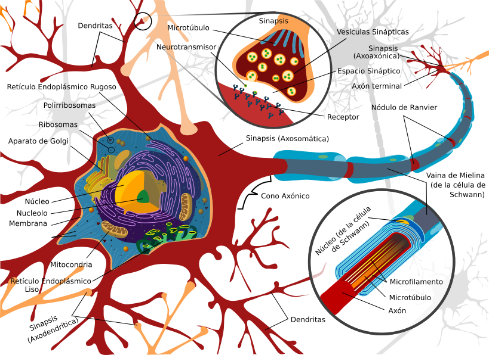
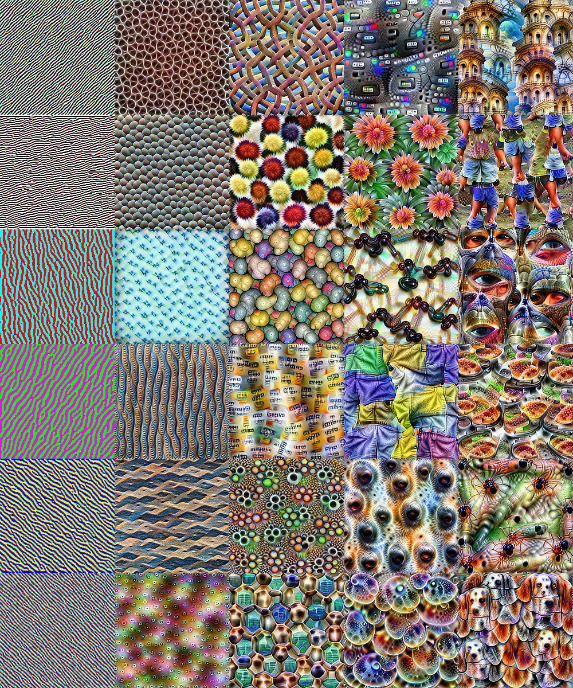

```{python}
from graficas import *
from sklearn.datasets import load_digits, make_moons, make_circles, make_blobs
from sklearn.neighbors import KNeighborsClassifier
from sklearn.linear_model import LogisticRegression, LinearRegression
from sklearn.preprocessing import StandardScaler
from sklearn.semi_supervised import LabelSpreading
from sklearn.ensemble import RandomForestClassifier
from sklearn.model_selection import train_test_split
rng = np.random.default_rng(7)
```

## ¿Qué significa "aprender de datos"?

:::: {.columns}
::: {.column width="55%"}
Todo problema de aprendizaje automático tiene los mismos ingredientes:

::: {.incremental}
1. **Datos** $X$: cada fila es una *observación*, cada columna una *característica* (*feature*)
2. A veces, **etiquetas** $y$: la respuesta que queremos predecir
3. Un **modelo** $f_\theta(x)$ con parámetros $\theta$
4. Una **función de pérdida** $L(\theta)$ que mide qué tan mal predice
5. Un método de **optimización** que ajusta $\theta$ para reducir $L$
:::

[Más adelante: optimización con **Carlos Soto**]{.adelante}
:::
::: {.column width="45%"}
::: {.definicion .fragment}
$$
\theta^* = \arg\min_\theta \; \frac{1}{N}\sum_{i=1}^{N} L\big(f_\theta(x_i),\, y_i\big)
$$

"Aprender" = encontrar los parámetros que **minimizan el error** en los datos de entrenamiento… esperando que **generalice** a datos nuevos.
:::
:::
::::

## Para una computadora, todo son números

```{python}
digitos = load_digits()
img = digitos.images[0]
fig = make_subplots(rows=1, cols=2, column_widths=[0.42, 0.58], horizontal_spacing=0.08,
                    subplot_titles=["Lo que vemos: un «0» escrito a mano", "Lo que ve la computadora: 8×8 = 64 números"])
fig.add_trace(go.Heatmap(z=img[::-1], colorscale=[[0, "white"], [1, PAVO_REAL]], showscale=False,
                         hovertemplate="intensidad %{z:.0f}<extra></extra>"), 1, 1)
fig.add_trace(go.Heatmap(z=img[::-1], colorscale=[[0, "white"], [1, ZAFIRO]], showscale=False,
                         text=img[::-1].astype(int), texttemplate="%{text}", textfont=dict(size=18),
                         hovertemplate="fila %{y}, columna %{x}: %{z:.0f}<extra></extra>"), 1, 2)
ejes_imagen(fig, 1, 2)
mostrar(fig, 1350, 560)
```

:::: {.columns .pequeno}
::: {.column width="33%"}
**Imágenes:** matrices de píxeles (×3 colores)
:::
::: {.column width="33%"}
**Texto:** secuencias de *tokens* → vectores
:::
::: {.column width="33%"}
**Tablas, audio, series de tiempo, grafos, moléculas…**
:::
::::

## Los grandes tipos de aprendizaje

:::: {.columns}
::: {.column width="25%"}
::: {.tarjeta}
[Supervisado]{.titulo-tarjeta}
Datos **con etiquetas** $(x, y)$. Aprender a predecir $y$.

*Ej.: ¿spam o no? ¿precio de una casa?*
:::
:::
::: {.column width="25%"}
::: {.tarjeta}
[No supervisado]{.titulo-tarjeta}
Datos **sin etiquetas**. Descubrir estructura.

*Ej.: grupos de clientes; resumir 1000 variables en 2.*
:::
:::
::: {.column width="25%"}
::: {.tarjeta}
[Autosupervisado]{.titulo-tarjeta}
Las etiquetas **salen de los propios datos** (tapar una palabra y adivinarla).

*Ej.: entrenar ChatGPT, Claude, BERT.*
:::
:::
::: {.column width="25%"}
::: {.tarjeta}
[Semisupervisado]{.titulo-tarjeta}
**Pocas** etiquetas + **muchos** datos sin etiquetar.

*Ej.: 100 radiografías diagnosticadas + 100 000 sin diagnóstico.*
:::
:::
::::

::: {.fragment .caja}
Y además: **aprendizaje por refuerzo** — un *agente* aprende por prueba y error a partir de **recompensas** (AlphaGo, robots, y el ajuste fino de los chatbots con retroalimentación humana).
:::

# Aprendizaje supervisado {background-color="#053229" .seccion}

Clasificación y regresión

## Clasificación vs. regresión

```{python}
X, y = make_blobs(n_samples=160, centers=[(-1.5, -1), (1.5, 1.2)], cluster_std=1.0, random_state=3)
clf = LogisticRegression().fit(X, y)
gx, gy, gz = frontera_decision(lambda P: clf.predict_proba(P)[:, 1], (-5, 5), (-4.5, 5))
xr = rng.uniform(0, 10, 60)
yr = 1.8 * xr + 5 + rng.normal(0, 2.5, 60)
reg = LinearRegression().fit(xr[:, None], yr)
fig = make_subplots(rows=1, cols=2, horizontal_spacing=0.1,
                    subplot_titles=["<b>Clasificación</b>: predecir una <b>categoría</b>",
                                    "<b>Regresión</b>: predecir un <b>número</b>"])
fig.add_trace(go.Contour(x=gx, y=gy, z=gz, colorscale=DIVERGENTE, opacity=0.45, showscale=False,
                         contours=dict(start=0, end=1, size=0.1), hoverinfo="skip"), 1, 1)
for c, (nombre, color) in enumerate([("clase 0: benigno", ABETO), ("clase 1: maligno", CORAL)]):
    fig.add_trace(go.Scatter(x=X[y == c, 0], y=X[y == c, 1], mode="markers", name=nombre,
                             marker=dict(color=color, size=11, line=dict(color="white", width=1.5))), 1, 1)
fig.add_trace(go.Scatter(x=xr, y=yr, mode="markers", name="datos", marker=dict(color=ZAFIRO, size=11,
                         line=dict(color="white", width=1.5)), showlegend=False), 1, 2)
xs = np.linspace(0, 10, 50)
fig.add_trace(go.Scatter(x=xs, y=reg.predict(xs[:, None]), mode="lines", name="modelo",
                         line=dict(color=PAVO_REAL, width=3), showlegend=False), 1, 2)
fig.update_xaxes(title_text="característica 1 (p. ej. tamaño del tumor)", row=1, col=1)
fig.update_yaxes(title_text="característica 2 (p. ej. textura)", row=1, col=1)
fig.update_xaxes(title_text="área de la casa (×10 m²)", row=1, col=2)
fig.update_yaxes(title_text="precio (×100 000 L)", row=1, col=2)
fig.update_layout(legend=dict(x=0.01, y=0.99, font=dict(size=15)))
mostrar(fig, 1450, 620)
```

## ¿Clasificación o regresión?

| Problema | Respuesta |
|---|---|
| ¿Este correo es spam? | [**Clasificación** (2 clases)]{.fragment} |
| ¿Cuánto costará una casa en la colonia Palmira? | [**Regresión**]{.fragment} |
| ¿Qué dígito (0–9) está escrito en esta imagen? | [**Clasificación** (10 clases)]{.fragment} |
| ¿Qué temperatura hará mañana en San Pedro Sula? | [**Regresión**]{.fragment} |
| ¿Este tumor es benigno o maligno? | [**Clasificación**]{.fragment} |
| ¿Qué energía tiene la partícula que llegó al detector? | [**Regresión**]{.fragment} |
| ¿Qué tipo de galaxia es: espiral, elíptica o irregular? | [**Clasificación** (3 clases)]{.fragment} |
| ¿Cuántos quintales de café producirá esta finca? | [**Regresión**]{.fragment} |

## Regresión: ¿qué tan complejo debe ser el modelo?

```{python}
n = 18
xe = np.sort(rng.uniform(0, 1, n))
ye = np.sin(2 * np.pi * xe) + rng.normal(0, 0.25, n)
xp = np.sort(rng.uniform(0, 1, 200))
yp = np.sin(2 * np.pi * xp) + rng.normal(0, 0.25, 200)
xs = np.linspace(0, 1, 300)
grados = [0, 1, 3, 5, 9, 15]
fig = go.Figure()
fig.add_trace(go.Scatter(x=xe, y=ye, mode="markers", name="entrenamiento",
                         marker=dict(color=ABETO, size=13, line=dict(color="white", width=1.5))))
fig.add_trace(go.Scatter(x=xp, y=yp, mode="markers", name="datos nuevos (prueba)",
                         marker=dict(color=ARTICO, size=7)))
titulos = []
for g in grados:
    V = np.vander(xe, g + 1)
    coef = np.linalg.lstsq(V, ye, rcond=None)[0]
    pred = lambda x: np.vander(x, g + 1) @ coef  # noqa: E731
    err_e = np.mean((pred(xe) - ye) ** 2)
    err_p = np.mean((pred(xp) - yp) ** 2)
    fig.add_trace(go.Scatter(x=xs, y=pred(xs), mode="lines", name=f"polinomio de grado {g}",
                             line=dict(color=CORAL, width=4), visible=(g == 3)))
    diag = "subajuste" if g <= 1 else ("¡bien!" if g <= 5 else "sobreajuste")
    titulos.append({"title.text": f"Grado {g}: error entrenamiento = {err_e:.3f} · error prueba = {err_p:.2f} → {diag}"})
fig.data[0].visible = True
fig.update_layout(title=titulos[2]["title.text"], yaxis=dict(range=[-2, 2], title="y"), xaxis=dict(title="x"),
                  sliders=deslizador(pasos_visibilidad(1, grados, fijas=2, extras=titulos), prefijo="grado: ", activo=2),
                  legend=dict(x=0.75, y=0.98))
mostrar(fig, 1400, 640)
```

[Más adelante: regresión lineal y múltiple con **Carlos Soto**]{.adelante}

## Clasificación: k vecinos más cercanos

```{python}
Xm, ym = make_moons(n_samples=220, noise=0.3, random_state=1)
ks = [1, 3, 7, 15, 40, 100]
fig = go.Figure()
for i, k in enumerate(ks):
    knn = KNeighborsClassifier(k).fit(Xm, ym)
    gx, gy, gz = frontera_decision(lambda P: knn.predict_proba(P)[:, 1], (-2, 3), (-1.6, 2.1), n=120)
    fig.add_trace(go.Contour(x=gx, y=gy, z=gz, colorscale=DIVERGENTE, opacity=0.5, showscale=False,
                             contours=dict(start=0, end=1, size=0.1), hoverinfo="skip", visible=(k == 7)))
for c, color in enumerate([ABETO, CORAL]):
    fig.add_trace(go.Scatter(x=Xm[ym == c, 0], y=Xm[ym == c, 1], mode="markers", name=f"clase {c}",
                             marker=dict(color=color, size=10, line=dict(color="white", width=1.5))))
n_k = len(ks)
pasos = []
for i, k in enumerate(ks):
    vis = [j == i for j in range(n_k)] + [True, True]
    pasos.append(dict(method="update", label=str(k), args=[{"visible": vis}]))
fig.update_layout(sliders=deslizador(pasos, prefijo="k = ", activo=2), xaxis=dict(title="x₁"), yaxis=dict(title="x₂"),
                  title="Cada punto nuevo toma la clase de la mayoría de sus k vecinos")
mostrar(fig, 1250, 660)
```

[Más adelante: clasificación (regresión logística, k-NN, árboles, SVM) con **Daniela Pinto**]{.adelante}

## Generalizar: la meta real

:::: {.columns}
::: {.column width="50%"}
- El modelo se **entrena** con unos datos, pero lo que importa es cómo funciona con **datos nuevos**
- Por eso separamos los datos:
  - **Entrenamiento** (~70 %): para ajustar los parámetros
  - **Validación** (~15 %): para elegir hiperparámetros (grado, $k$…)
  - **Prueba** (~15 %): ¡se usa **una sola vez** al final!
- **Subajuste:** el modelo es demasiado simple
- **Sobreajuste:** el modelo memoriza el ruido
:::
::: {.column width="50%"}
```{python}
comp = np.linspace(0, 10, 100)
err_ent = 1.2 * np.exp(-0.45 * comp) + 0.05
err_pru = 1.2 * np.exp(-0.45 * comp) + 0.012 * comp ** 2 + 0.12
fig = go.Figure()
fig.add_trace(go.Scatter(x=comp, y=err_ent, name="error de entrenamiento", line=dict(color=ABETO, width=4)))
fig.add_trace(go.Scatter(x=comp, y=err_pru, name="error en datos nuevos", line=dict(color=CORAL, width=4)))
opt = comp[np.argmin(err_pru)]
fig.add_vline(x=opt, line=dict(color=GRIS, dash="dot", width=2))
fig.add_annotation(x=1.2, y=1.15, text="subajuste", showarrow=False, font=dict(size=20, color=GRIS))
fig.add_annotation(x=8.8, y=1.15, text="sobreajuste", showarrow=False, font=dict(size=20, color=GRIS))
fig.add_annotation(x=opt, y=0.05, text="punto óptimo", showarrow=False, yshift=-12, font=dict(size=18, color=PAVO_REAL))
fig.update_layout(xaxis=dict(title="complejidad del modelo", showticklabels=False),
                  yaxis=dict(title="error", showticklabels=False, range=[0, 1.3]), legend=dict(x=0.3, y=0.98))
mostrar(fig, 700, 520)
```
:::
::::

# Aprendizaje no supervisado {background-color="#053229" .seccion}

Encontrar estructura sin etiquetas

## Agrupamiento (*clustering*): k-medias paso a paso

```{python}
Xb, _ = make_blobs(n_samples=300, centers=[(-3, -2), (0, 3), (3.5, -1.5)], cluster_std=1.1, random_state=5)
cent = np.array([[-4.0, 4.0], [-3.5, 3.0], [-2.5, 4.5]])
colores_k = [ABETO, CORAL, ZAFIRO]
estados = []
for it in range(7):
    asign = np.argmin(((Xb[:, None, :] - cent[None]) ** 2).sum(-1), axis=1)
    estados.append((cent.copy(), asign.copy()))
    cent = np.array([Xb[asign == j].mean(0) if np.any(asign == j) else cent[j] for j in range(3)])
fig = go.Figure()
for it, (c, a) in enumerate(estados):
    for j in range(3):
        fig.add_trace(go.Scatter(x=Xb[a == j, 0], y=Xb[a == j, 1], mode="markers", name=f"grupo {j + 1}",
                                 marker=dict(color=colores_k[j], size=9, opacity=0.75), visible=(it == 0),
                                 showlegend=False))
    fig.add_trace(go.Scatter(x=c[:, 0], y=c[:, 1], mode="markers", name="centroides",
                             marker=dict(color=colores_k, size=26, symbol="x", line=dict(color=PAVO_REAL, width=3)),
                             visible=(it == 0), showlegend=False))
etq = ["inicio"] + [str(i) for i in range(1, 7)]
fig.update_layout(sliders=deslizador(pasos_visibilidad(4, etq), prefijo="iteración: "),
                  xaxis=dict(range=[-7, 7.5], title="x₁"), yaxis=dict(range=[-6, 7], title="x₂"),
                  title="1) asignar cada punto al centroide más cercano · 2) mover cada centroide al promedio de su grupo")
mostrar(fig, 1250, 660)
```

[Más adelante: agrupamiento con **Alex Rodriguez**]{.adelante}

## Reducción de dimensionalidad: PCA

```{python}
t = rng.normal(0, 2.0, 400)
s = rng.normal(0, 0.8, 400)
X3 = np.c_[t + 0.4 * s, 0.6 * t - 0.8 * s, 0.3 * t + rng.normal(0, 0.25, 400)]
color3 = t
X3c = X3 - X3.mean(0)
U, S, Vt = np.linalg.svd(X3c, full_matrices=False)
Z = X3c @ Vt[:2].T
fig = make_subplots(rows=1, cols=2, specs=[[{"type": "scene"}, {"type": "xy"}]], column_widths=[0.55, 0.45],
                    subplot_titles=["Datos en 3 dimensiones (¡gírenlos!)", "Proyección en las 2 componentes principales"])
fig.add_trace(go.Scatter3d(x=X3[:, 0], y=X3[:, 1], z=X3[:, 2], mode="markers",
                           marker=dict(size=4, color=color3, colorscale=SECUENCIAL), hoverinfo="skip", showlegend=False), 1, 1)
for k, color in enumerate([CORAL, ZAFIRO]):
    v = Vt[k] * S[k] / np.sqrt(len(X3)) * 2.5
    fig.add_trace(go.Scatter3d(x=[0, v[0]], y=[0, v[1]], z=[0, v[2]], mode="lines",
                               line=dict(color=color, width=10), name=f"componente {k + 1}"), 1, 1)
fig.add_trace(go.Scatter(x=Z[:, 0], y=Z[:, 1], mode="markers", marker=dict(size=7, color=color3, colorscale=SECUENCIAL),
                         showlegend=False, hoverinfo="skip"), 1, 2)
fig.update_xaxes(title_text="componente principal 1", row=1, col=2)
fig.update_yaxes(title_text="componente principal 2", row=1, col=2, scaleanchor="x2")
fig.update_layout(scene=dict(xaxis_title="x₁", yaxis_title="x₂", zaxis_title="x₃", aspectmode="data"),
                  legend=dict(orientation="h", x=0.0, y=-0.06), showlegend=True, margin=dict(b=70))
mostrar(fig, 1450, 640)
```

::: {.pequeno}
PCA encuentra las direcciones de **máxima varianza**. Otros métodos no lineales: t-SNE, UMAP. [Más adelante: PCA con **Carlos Soto**]{.adelante}
:::

## Aprendizaje autosupervisado: las etiquetas salen de los datos {.compacta}

:::: {.columns}
::: {.column width="40%"}
Tapamos una parte de los datos y le pedimos al modelo que la **adivine**:

- Texto: "Tegucigalpa es la ____ de Honduras"
- Texto: "Había una vez un ____" (siguiente palabra)
- Imágenes: tapar parches, colorear fotos en blanco y negro

::: {.caja}
No hace falta que un humano etiquete: ¡internet entero sirve como datos de entrenamiento! Así se entrenan **BERT, GPT, Claude, Gemini…**
:::

[Más adelante: transformers y modelos de lenguaje]{.adelante}
:::
::: {.column width="60%"}
```{python}
mlm = cargar("mlm_beto.json")
ejemplos = mlm["ejemplos"][:3]
fig = go.Figure()
for i, e in enumerate(ejemplos):
    fig.add_trace(go.Bar(x=e["probs"][::-1], y=e["tokens"][::-1], orientation="h", visible=(i == 0),
                         marker=dict(color=ABETO), text=[f"{p:.0%}" for p in e["probs"][::-1]],
                         textposition="outside", hovertemplate="%{y}: %{x:.1%}<extra></extra>"))
botones = [dict(label=e["frase"].replace("[MASK]", "____"), method="update",
                args=[{"visible": [j == i for j in range(len(ejemplos))]}]) for i, e in enumerate(ejemplos)]
fig.update_layout(updatemenus=[dict(buttons=botones, direction="down", x=0, y=1.18, xanchor="left",
                                    font=dict(size=17), bgcolor="white")],
                  xaxis=dict(title="probabilidad según BETO", tickformat=".0%", range=[0, 1.05]),
                  margin=dict(t=110, l=140), showlegend=False)
mostrar(fig, 880, 600)
```
::: {.credito}
Predicciones reales de BETO, un BERT entrenado en español en la Universidad de Chile (Cañete *et al.*, 2020).
:::
:::
::::

## Aprendizaje semisupervisado

```{python}
Xs, ys = make_circles(n_samples=300, noise=0.05, factor=0.4, random_state=2)
# Solo 2 puntos etiquetados: uno del círculo exterior (clase 0) y uno del interior (clase 1)
i0 = np.argmin(np.linalg.norm(Xs[ys == 0] - [1.0, 0.0], axis=1)); i0 = np.where(ys == 0)[0][i0]
i1 = np.argmin(np.linalg.norm(Xs[ys == 1] - [0.0, 0.4], axis=1)); i1 = np.where(ys == 1)[0][i1]
etiquetados = np.array([i0, i1])
y_parcial = np.full_like(ys, -1)
y_parcial[etiquetados] = ys[etiquetados]
sin_etiqueta = y_parcial == -1
solo = KNeighborsClassifier(1).fit(Xs[etiquetados], ys[etiquetados])
semi = LabelSpreading(kernel="knn", n_neighbors=10, alpha=0.9, tol=1e-10, max_iter=3000).fit(Xs, y_parcial)
fig = go.Figure()
for modelo, nombre in [(solo, "solo"), (semi, "semi")]:
    gx, gy, gz = frontera_decision(lambda P: modelo.predict(P).astype(float), (-1.5, 1.5), (-1.5, 1.5), n=120)
    fig.add_trace(go.Contour(x=gx, y=gy, z=gz, colorscale=DIVERGENTE, opacity=0.4, showscale=False,
                             contours=dict(start=0, end=1, size=0.5), hoverinfo="skip", visible=(nombre == "solo")))
fig.add_trace(go.Scatter(x=Xs[:, 0], y=Xs[:, 1], mode="markers", name="sin etiqueta",
                         marker=dict(color=mezclar(GRIS, 0.3), size=8)))
for c, color in enumerate([ABETO, CORAL]):
    idx = etiquetados[ys[etiquetados] == c]
    fig.add_trace(go.Scatter(x=Xs[idx, 0], y=Xs[idx, 1], mode="markers", name=f"etiquetado: clase {c}",
                             marker=dict(color=color, size=22, symbol="star", line=dict(color=PAVO_REAL, width=1.5))))
acc_solo = (solo.predict(Xs[sin_etiqueta]) == ys[sin_etiqueta]).mean()
acc_semi = (semi.predict(Xs[sin_etiqueta]) == ys[sin_etiqueta]).mean()
botones = [dict(label=f"Solo 2 puntos etiquetados (exactitud {acc_solo:.0%})", method="update",
                args=[{"visible": [True, False, True, True, True]}]),
           dict(label=f"Semisupervisado: usa también los 298 sin etiqueta (exactitud {acc_semi:.0%})", method="update",
                args=[{"visible": [False, True, True, True, True]}])]
fig.update_layout(updatemenus=[dict(type="buttons", direction="right", buttons=botones, x=0, y=1.13, xanchor="left",
                                    font=dict(size=16), bgcolor="white")],
                  xaxis=dict(title="x₁"), yaxis=dict(title="x₂", scaleanchor="x"), margin=dict(t=90), legend=dict(x=0.78, y=0.98))
mostrar(fig, 1350, 650)
```

::: {.credito}
Propagación de etiquetas (*label spreading*, Zhou *et al.*, 2004): las etiquetas "fluyen" hacia los vecinos a través de los datos sin etiquetar.
:::

# Del dato al modelo {background-color="#053229" .seccion}

Preprocesamiento e ingeniería de características

## El flujo de trabajo real

```{python}
etapas = ["Pregunta", "Recolectar<br>datos", "Limpiar y<br>preprocesar", "Explorar y<br>visualizar",
          "Ingeniería de<br>características", "Entrenar<br>modelos", "Evaluar", "Desplegar y<br>monitorear"]
fig = go.Figure()
for i, e in enumerate(etapas):
    x = i % 4
    yv = 1 - i // 4
    color = CORAL if i in (2, 4) else ABETO
    fig.add_shape(type="rect", x0=x - 0.42, x1=x + 0.42, y0=yv - 0.3, y1=yv + 0.3, fillcolor=color,
                  line=dict(width=0), layer="below")
    fig.add_annotation(x=x, y=yv, text=f"<b>{i + 1}. {e}</b>", showarrow=False, font=dict(size=21, color=texto_sobre(color)))
    if i < len(etapas) - 1 and i != 3:
        fig.add_annotation(x=x + 0.56, y=yv, ax=x + 0.44, ay=yv, xref="x", yref="y", axref="x", ayref="y",
                           showarrow=True, arrowhead=3, arrowwidth=3, arrowcolor=GRIS, text="")
fig.add_annotation(x=0, y=0.32, ax=3, ay=0.68, xref="x", yref="y", axref="x", ayref="y", showarrow=True,
                   arrowhead=3, arrowwidth=3, arrowcolor=GRIS, text="")
fig.add_annotation(x=1.5, y=-0.55, text="↺ en la práctica se regresa a pasos anteriores muchas veces",
                   showarrow=False, font=dict(size=20, color=GRIS))
fig.update_layout(xaxis=dict(visible=False, range=[-0.5, 3.5]), yaxis=dict(visible=False, range=[-0.75, 1.4]),
                  plot_bgcolor="rgba(0,0,0,0)", margin=dict(l=0, r=0, t=0, b=0))
mostrar(fig, 1450, 520)
```

::: {.caja .fragment}
"Basura entra, basura sale" (*garbage in, garbage out*): un modelo nunca es mejor que sus datos. En la práctica, **la mayor parte del tiempo** se va en los pasos 2–5.
:::

## Preprocesamiento de datos: lista de revisión {.compacta}

:::: {.columns}
::: {.column width="50%"}
- **Valores faltantes:** ¿eliminar filas? ¿imputar con la mediana?
- **Duplicados y errores:** edades de 250 años, fechas imposibles
- **Valores atípicos** (*outliers*): ¿error o fenómeno real?
- **Unidades:** ¿libras o kilogramos? ¿lempiras o dólares?
- **Variables categóricas → números** (*one-hot*)
- **Escalar** las variables numéricas
- **Desbalance de clases:** 99 % sanos, 1 % enfermos
:::
::: {.column width="50%"}
```python
import pandas as pd
from sklearn.model_selection import train_test_split
from sklearn.preprocessing import StandardScaler

df = pd.read_csv("pacientes.csv")
df = df.drop_duplicates()
df["edad"] = df["edad"].fillna(df["edad"].median())
df = pd.get_dummies(df, columns=["departamento"])

X = df.drop(columns="diagnostico")
y = df["diagnostico"]
X_ent, X_pru, y_ent, y_pru = train_test_split(
    X, y, test_size=0.2, stratify=y, random_state=0)

escalador = StandardScaler().fit(X_ent)  # ¡solo con entrenamiento!
X_ent = escalador.transform(X_ent)
X_pru = escalador.transform(X_pru)
```
:::
::::

::: {.caja-naranja .pequeno .fragment}
**Fuga de datos** (*data leakage*): si usan información del conjunto de prueba al preparar los datos (o una variable que "delata" la respuesta), el modelo parece excelente… y falla en la vida real.
:::

## ¿Por qué escalar? Un ejemplo con k vecinos

```{python}
n = 400
edad = rng.uniform(18, 70, n)
ingreso = rng.uniform(5_000, 80_000, n)
yb = ((edad - 44) / 26 + rng.normal(0, 0.35, n) > 0).astype(int)
Xe = np.c_[edad, ingreso]
Xa, Xt, ya, yt = train_test_split(Xe, yb, test_size=0.3, random_state=0)
sin = KNeighborsClassifier(5).fit(Xa, ya)
esc = StandardScaler().fit(Xa)
con = KNeighborsClassifier(5).fit(esc.transform(Xa), ya)
acc_sin, acc_con = sin.score(Xt, yt), con.score(esc.transform(Xt), yt)
fig = go.Figure()
for modelo, transformar in [(sin, lambda P: P), (con, esc.transform)]:
    gx, gy, gz = frontera_decision(lambda P: modelo.predict(transformar(P)).astype(float), (18, 70), (5_000, 80_000), n=120)
    fig.add_trace(go.Contour(x=gx, y=gy, z=gz, colorscale=DIVERGENTE, opacity=0.4, showscale=False,
                             contours=dict(start=0, end=1, size=0.5), hoverinfo="skip", visible=(modelo is sin)))
for c, (nombre, color) in enumerate([("no compra", ABETO), ("compra", CORAL)]):
    fig.add_trace(go.Scatter(x=edad[yb == c], y=ingreso[yb == c], mode="markers", name=nombre,
                             marker=dict(color=color, size=9, line=dict(color="white", width=1))))
botones = [dict(label=f"Sin escalar (exactitud {acc_sin:.0%})", method="update",
                args=[{"visible": [True, False, True, True]}]),
           dict(label=f"Estandarizado (exactitud {acc_con:.0%})", method="update",
                args=[{"visible": [False, True, True, True]}])]
fig.update_layout(updatemenus=[dict(type="buttons", direction="right", buttons=botones, x=0, y=1.13, xanchor="left",
                                    font=dict(size=17), bgcolor="white")],
                  xaxis=dict(title="edad (años)"), yaxis=dict(title="ingreso mensual (lempiras)"),
                  margin=dict(t=90), title=None)
mostrar(fig, 1300, 620)
```

::: {.pequeno}
Sin escalar, la "distancia" está dominada por el ingreso (miles) e ignora la edad (decenas), ¡aunque la respuesta depende solo de la edad! Estandarizar: $z = (x - \mu)/\sigma$.
:::

## Ingeniería de características {.compacta}

:::: {.columns}
::: {.column width="45%"}
Crear **nuevas variables** a partir de las existentes, usando lo que sabemos del problema:

- Fecha → día de la semana, mes, ¿es feriado?
- Peso y estatura → índice de masa corporal $\text{IMC} = m/h^2$
- Coordenadas → distancia al centro de la ciudad
- Hora del día → $(\sin \frac{2\pi h}{24},\ \cos \frac{2\pi h}{24})$ para que las 23:00 queden cerca de las 00:00
- Texto → número de palabras, presencia de "GRATIS"

::: {.caja .fragment}
En el ejemplo de la derecha, añadir $r^2 = x_1^2 + x_2^2$ convierte un problema **imposible para una recta** en uno que **un plano** separa perfectamente.
:::
:::
::: {.column width="55%"}
```{python}
Xc, yc = make_circles(n_samples=400, noise=0.08, factor=0.45, random_state=4)
r2 = (Xc ** 2).sum(1)
fig = make_subplots(rows=1, cols=2, specs=[[{"type": "xy"}, {"type": "scene"}]], column_widths=[0.42, 0.58],
                    subplot_titles=["Original: (x₁, x₂)", "Con la nueva característica r²"])
for c, color in enumerate([ABETO, CORAL]):
    fig.add_trace(go.Scatter(x=Xc[yc == c, 0], y=Xc[yc == c, 1], mode="markers", showlegend=False,
                             marker=dict(color=color, size=6)), 1, 1)
    fig.add_trace(go.Scatter3d(x=Xc[yc == c, 0], y=Xc[yc == c, 1], z=r2[yc == c], mode="markers",
                               name=f"clase {c}", marker=dict(color=color, size=3.5)), 1, 2)
pp = np.linspace(-1.2, 1.2, 10)
PX, PY = np.meshgrid(pp, pp)
fig.add_trace(go.Surface(x=PX, y=PY, z=np.full_like(PX, 0.5), showscale=False, opacity=0.35,
                         colorscale=[[0, ZAFIRO], [1, ZAFIRO]], hoverinfo="skip"), 1, 2)
fig.update_yaxes(scaleanchor="x", row=1, col=1)
fig.update_layout(scene=dict(xaxis_title="x₁", yaxis_title="x₂", zaxis_title="r²",
                             camera=dict(eye=dict(x=1.6, y=1.4, z=0.6))),
                  legend=dict(orientation="h", x=0.5, y=-0.04, xanchor="left"), margin=dict(l=10, r=10, t=50, b=40))
mostrar(fig, 820, 560)
```
:::
::::

## De diseñar características… a aprenderlas

:::: {.columns}
::: {.column width="50%"}
[Aprendizaje automático clásico]{.titulo-tarjeta}
Datos → **características diseñadas por humanos** → modelo (regresión, árboles, SVM…)

Funciona muy bien con **datos tabulares** y pocos datos.
:::
::: {.column width="50%"}
[Aprendizaje profundo]{.titulo-tarjeta}
Datos crudos (píxeles, texto, audio) → **red neuronal que aprende sus propias características** → predicción

Brilla con **muchos datos** no estructurados.
:::
::::

::: {.fragment .caja}
Esta idea —**aprender las representaciones**— es el corazón de las redes neuronales. Veamos un adelanto en tres diapositivas.
:::

# Redes neuronales en tres diapositivas {background-color="#053229" .seccion}

Un adelanto de lo que veremos en las próximas sesiones

## 1. Inspiradas (vagamente) en el cerebro {.compacta}

:::: {.columns}
::: {.column width="50%"}
{height="190"}

::: {.credito}
Diagrama: LadyofHats (traducción: Josell7), dominio público, Wikimedia Commons.
:::
- Las neuronas reciben señales por las **dendritas**, las integran y, si superan un umbral, **disparan** por el axón
- Una **neurona artificial** hace una suma ponderada de sus entradas y le aplica una función no lineal:

$$
a = \sigma\Big(\sum_i w_i x_i + b\Big)
$$

- Muchas neuronas en **capas** forman una **red neuronal**; los pesos $w_i$ se **aprenden** de los datos
:::
::: {.column width="50%"}
```{python}
capas = [3, 5, 5, 2]
fig = go.Figure()
pos = {}
for l, n_l in enumerate(capas):
    for j in range(n_l):
        pos[(l, j)] = (l * 1.6, (j - (n_l - 1) / 2) * 0.9)
for l in range(len(capas) - 1):
    for j in range(capas[l]):
        for k in range(capas[l + 1]):
            (x0, y0), (x1, y1) = pos[(l, j)], pos[(l + 1, k)]
            w = rng.normal()
            fig.add_trace(go.Scatter(x=[x0, x1], y=[y0, y1], mode="lines", hoverinfo="skip", showlegend=False,
                                     line=dict(color=CORAL if w > 0 else ABETO, width=1 + 2.5 * min(abs(w), 1.5)),
                                     opacity=0.55))
nombres_c = ["entrada", "capa oculta 1", "capa oculta 2", "salida"]
for l, n_l in enumerate(capas):
    xs_ = [pos[(l, j)][0] for j in range(n_l)]
    ys_ = [pos[(l, j)][1] for j in range(n_l)]
    fig.add_trace(go.Scatter(x=xs_, y=ys_, mode="markers", showlegend=False, hovertext=nombres_c[l], hoverinfo="text",
                             marker=dict(size=38, color="white", line=dict(color=PAVO_REAL, width=3))))
    fig.add_annotation(x=l * 1.6, y=-2.6, text=nombres_c[l], showarrow=False, font=dict(size=18, color=GRIS))
fig.update_layout(xaxis=dict(visible=False), yaxis=dict(visible=False, range=[-2.9, 2.3]),
                  plot_bgcolor="rgba(0,0,0,0)", margin=dict(l=0, r=0, t=10, b=0))
mostrar(fig, 760, 560)
```
::: {.credito}
Coral: pesos positivos; verde oscuro: pesos negativos; grosor: magnitud.
:::
:::
::::

[Más adelante: teoría de redes neuronales]{.adelante}

## 2. Redes convolucionales: filtros que "ven"

```{python}
from scipy.signal import convolve2d
from PIL import Image
foto = np.asarray(Image.open("img/foto_convolucion.jpg").convert("L").resize((320, 240)), dtype=float) / 255
filtros = {
    "Original": None,
    "Bordes verticales": np.array([[1, 0, -1], [2, 0, -2], [1, 0, -1]]),
    "Bordes horizontales": np.array([[1, 2, 1], [0, 0, 0], [-1, -2, -1]]),
    "Desenfoque": np.ones((5, 5)) / 25,
    "Realce": np.array([[0, -1, 0], [-1, 5, -1], [0, -1, 0]]),
}
fig = go.Figure()
for i, (nombre, k) in enumerate(filtros.items()):
    if k is None:
        z, esc, zmin, zmax = foto, GRISES, 0, 1
    else:
        z = convolve2d(foto, k, mode="same", boundary="symm")
        if nombre.startswith("Bordes"):
            z, esc, zmin, zmax = np.abs(z), [[0, "black"], [1, "white"]], 0, np.percentile(np.abs(z), 99)
        else:
            z, esc, zmin, zmax = np.clip(z, 0, 1), GRISES, 0, 1
    fig.add_trace(go.Heatmap(z=a_uint8(z[::-1], zmin, zmax), colorscale=esc, zmin=0, zmax=255, showscale=False, visible=(i == 0),
                             hoverinfo="skip"))
botones = [dict(label=nombre, method="update", args=[{"visible": [j == i for j in range(len(filtros))]}])
           for i, nombre in enumerate(filtros)]
fig.update_layout(updatemenus=[dict(type="buttons", direction="right", buttons=botones, x=0, y=1.1, xanchor="left",
                                    font=dict(size=17), bgcolor="white")], margin=dict(t=70, l=0, r=0, b=0))
ejes_imagen(fig)
mostrar(fig, 1000, 680)
```

::: {.pequeno}
*Foto: Charles J. Sharp, guacamaya roja en Copán, CC BY-SA 4.0.* Un **filtro** (matriz pequeña) recorre la imagen y detecta un patrón. Una red convolucional **aprende** sus filtros: primero bordes, luego texturas, partes y objetos. [Más adelante: redes convolucionales]{.adelante}
:::

## 3. Transformers: predecir la siguiente palabra {.compacta}

:::: {.columns}
::: {.column width="40%"}
- Un **modelo de lenguaje** calcula la probabilidad de cada posible **siguiente token** dado el texto anterior
- Para generar texto: elegir un token, agregarlo y repetir
- El **transformer** (2017) usa un mecanismo de **atención**: cada palabra "mira" a las demás para entender el contexto
- ChatGPT, Claude y Gemini son transformers gigantes entrenados con billones de tokens

[Más adelante: transformers y modelos de lenguaje]{.adelante}
:::
::: {.column width="60%"}
```{python}
sig = cargar("siguiente_token.json")
temps = [0.3, 0.7, 1.0, 1.5, 2.5]
ej = next(e for e in sig["ejemplos"] if e["frase"].startswith("Había"))
logits = np.array(ej["logits"])
fig = go.Figure()
for T in temps:
    p = np.exp((logits - logits.max()) / T)
    p = p / p.sum()
    fig.add_trace(go.Bar(x=[t.replace(" ", "␣") for t in ej["tokens"]], y=p, marker=dict(color=ABETO),
                         visible=(T == 1.0), hovertemplate="«%{x}»: %{y:.1%}<extra></extra>"))
fig.update_layout(sliders=deslizador(pasos_visibilidad(1, temps), prefijo="temperatura: ", activo=2),
                  title=f"«{ej['frase']} ___»", yaxis=dict(title="probabilidad", tickformat=".0%"),
                  xaxis=dict(tickangle=-40), showlegend=False, margin=dict(b=120))
mostrar(fig, 900, 600)
```
::: {.credito}
Probabilidades reales del modelo Qwen2.5-0.5B (Alibaba). Temperatura baja: más predecible; alta: más "creativo".
:::
:::
::::

# Ética: el lado humano del aprendizaje automático {background-color="#053229" .seccion}

"La tecnología no es buena ni mala; tampoco es neutral." — Melvin Kranzberg (1986)

## La tecnología no es neutral

:::: {.columns}
::: {.column width="55%"}
- Un algoritmo no "tiene" intenciones… pero **las personas que lo diseñan toman decisiones éticas** todo el tiempo:
  - ¿qué datos recolectar (y de quién)?
  - ¿qué variable predecir? ¿qué error es más grave?
  - ¿para qué se va a usar? ¿quién se beneficia y quién se perjudica?
- Los modelos aprenden de datos producidos por **sociedades con desigualdades**, y pueden **reproducirlas y amplificarlas** a gran escala
:::
::: {.column width="45%"}
::: {.definicion}
**Primera ley de Kranzberg:** "La tecnología no es buena ni mala; tampoco es neutral."

Sus efectos dependen del contexto social en el que se usa — y de quienes la construyen.
:::
:::
::::

[Más adelante: ética de la IA con **Matteo Marsili** · políticas públicas con **Elena Villalobos**]{.adelante}

::: aside
Kranzberg, M. (1986). Technology and History: "Kranzberg's Laws". *Technology and Culture* 27(3), 544–560. · Winner, L. (1980). Do artifacts have politics? *Daedalus* 109(1), 121–136.
:::

## Los modelos aprenden nuestros prejuicios {.compacta}

:::: {.columns}
::: {.column width="50%"}
**Vectores de palabras (GloVe, entrenado con Wikipedia y noticias):**

```{python}
an = cargar("analogias_glove.json")
filas = []
traducir = {"king": "rey", "woman": "mujer", "man": "hombre", "queen": "reina", "doctor": "médico",
            "nurse": "enfermera/o", "programmer": "programador", "paris": "París", "italy": "Italia",
            "france": "Francia", "rome": "Roma", "physician": "médico", "educator": "educadora",
            "monarch": "monarca", "milan": "Milán", "surgeon": "cirujano", "officer": "oficial"}
for q in an["consultas"]:
    if q["positivo"][0] in ("king", "doctor", "nurse", "programmer"):
        a, b = q["positivo"]
        c = q["negativo"][0]
        res = q["resultado"][0][0]
        filas.append(f"<tr><td><b>{traducir.get(a, a)}</b> − {traducir.get(c, c)} + {traducir.get(b, b)}</td>"
                     f"<td>≈ <b style='color:{CORAL_OSCURO}'>{traducir.get(res, res)}</b></td></tr>")
display(HTML("<table style='font-size:0.85em'><tr><th>Operación con vectores</th><th>Resultado más cercano</th></tr>"
             + "".join(filas) + "</table>"))
```

::: {.credito}
Cálculo propio con GloVe 6B-100d (Pennington *et al.*, 2014). Ver también Bolukbasi *et al.* (2016), "Man is to computer programmer as woman is to homemaker?".
:::
:::
::: {.column width="50%"}
**Modelo de lenguaje en español (BETO):**

```{python}
e_el, e_ella = mlm["ejemplos"][3], mlm["ejemplos"][4]
fig = make_subplots(rows=1, cols=2, subplot_titles=["«<b>Él</b> trabaja como ___ en el hospital.»",
                                                    "«<b>Ella</b> trabaja como ___ en el hospital.»"],
                    horizontal_spacing=0.25)
for c, (e, color) in enumerate([(e_el, ABETO), (e_ella, CORAL)]):
    fig.add_trace(go.Bar(x=e["probs"][:6][::-1], y=e["tokens"][:6][::-1], orientation="h", marker=dict(color=color),
                         hovertemplate="%{y}: %{x:.1%}<extra></extra>", showlegend=False), 1, c + 1)
fig.update_xaxes(tickformat=".0%")
fig.update_layout(margin=dict(l=110, t=60), font=dict(size=17))
fig.update_annotations(font_size=17)
mostrar(fig, 760, 420)
```
:::
::::

::: {.fragment .caja}
Nadie programó estos estereotipos: el modelo los **aprendió de los textos** que escribimos los humanos. Caliskan *et al.* (2017) mostraron que los vectores de palabras asocian nombres europeo-estadounidenses con palabras "agradables" más que nombres afroestadounidenses.
:::

::: aside
Caliskan, A., Bryson, J. J. & Narayanan, A. (2017). Semantics derived automatically from language corpora contain human-like biases. *Science* 356, 183–186.
:::

## Sesgo por nombre: trabajos, becas y créditos {.compacta}

:::: {.columns}
::: {.column width="50%"}
**Los humanos ya discriminaban por el nombre…**

- Currículums idénticos enviados en EE. UU.: los nombres "blancos" recibieron **50 % más** llamadas para entrevista que los nombres afroestadounidenses (Bertrand y Mullainathan, 2004)
- Créditos hipotecarios: a solicitantes **latinos** se les negó **40 % más** que a solicitantes blancos con perfiles financieros similares (The Markup, 2021)

**…y los algoritmos aprenden de esas decisiones**

- Amazon abandonó (2018) una herramienta de selección que **penalizaba** currículums con la palabra "women's": había aprendido de 10 años de contrataciones mayoritariamente masculinas
:::
::: {.column width="50%"}
**Auditorías de modelos de lenguaje (2024):**

- Más de 2 millones de decisiones simuladas: los nombres **hispanos masculinos** obtuvieron la **tasa de aceptación más baja** (An *et al.*, 2024)
- GPT-3.5 calificó peor currículums idénticos con nombres hispanos que con nombres blancos, y al *generar* currículums para nombres hispanos les agregó "habla español" en el 65 % de los casos (Armstrong *et al.*, 2024)
- En recomendaciones de salario, las **mujeres hispanas** fueron siempre el grupo peor o segundo peor pagado (Nghiem *et al.*, 2024)

::: {.caja-naranja .pequeno}
Para quienes apliquen a **becas, posgrados o trabajos en el extranjero**: cada vez más filtros automáticos leen su nombre. Las diferencias son pequeñas pero sistemáticas, y dependen mucho de cómo se formula la instrucción.
:::
:::
::::

::: aside
Bertrand, M. & Mullainathan, S. (2004). *American Economic Review* 94(4), 991–1013. · Martinez, E. & Kirchner, L. (2021). The secret bias hidden in mortgage-approval algorithms. *The Markup*. · Dastin, J. (2018). Reuters. · An, H. *et al.* (2024). Do LLMs discriminate in hiring decisions on the basis of race, ethnicity, and gender? *ACL 2024*. · Armstrong, L. *et al.* (2024). The Silicon Ceiling. *EAAMO '24*. · Nghiem, H. *et al.* (2024). "You Gotta be a Doctor, Lin". *EMNLP 2024*.
:::

## Sesgo en la investigación médica: el "paciente estándar" {.compacta}

:::: {.columns}
::: {.column width="50%"}
Durante décadas, el paciente "por defecto" de la investigación fue un **hombre de ascendencia europea**:

- 1977–1993: la FDA recomendó **excluir a mujeres** en edad fértil de las primeras fases de los ensayos clínicos; en 2013 tuvo que **reducir a la mitad** la dosis recomendada de zolpidem (un somnífero) para mujeres
- Genómica: **~88 %** de las personas en estudios de asociación genómica (GWAS) son de ascendencia europea; solo **~1.3 %** hispanas o latinoamericanas
- Por eso los puntajes de riesgo poligénico son **~2 veces** menos precisos en personas de ascendencia asiática oriental y **~4.5 veces** menos en personas de ascendencia africana
:::
::: {.column width="50%"}
Y la IA médica hereda esos datos:

- Clasificadores de radiografías de tórax **subdiagnostican** más a mujeres, pacientes jóvenes, afroestadounidenses, **hispanos** y de bajos ingresos — y aún más en grupos interseccionales como **mujeres hispanas** (Seyyed-Kalantari *et al.*, 2021)
- Modelos de dermatología pierden 27–36 % de su desempeño en imágenes diversas y fallan más en **piel oscura** (Daneshjou *et al.*, 2022)
- Un algoritmo usado en ~200 millones de personas en EE. UU. usaba el **gasto médico** como indicador de necesidad y subestimaba a pacientes afroestadounidenses; corregirlo subiría su atención extra de 17.7 % a 46.5 % (Obermeyer *et al.*, 2019)
- Reconocimiento facial comercial: error de hasta **34.7 %** en mujeres de piel oscura vs. **0.8 %** en hombres de piel clara (Buolamwini y Gebru, 2018)
:::
::::

::: aside
GWAS Diversity Monitor (consultado en nov. 2026). · Popejoy, A. & Fullerton, S. (2016). *Nature* 538, 161–164. · Martin, A. R. *et al.* (2019). *Nature Genetics* 51, 584–591. · Seyyed-Kalantari, L. *et al.* (2021). *Nature Medicine* 27, 2176–2182. · Daneshjou, R. *et al.* (2022). *Science Advances* 8, eabq6147. · Obermeyer, Z. *et al.* (2019). *Science* 366, 447–453. · Buolamwini, J. & Gebru, T. (2018). Gender Shades. *PMLR* 81, 77–91.
:::

## Paridad de género en los datos

:::: {.columns}
::: {.column width="55%"}
- Un grupo argentino (Larrazabal *et al.*, 2020) entrenó redes para diagnosticar 14 enfermedades en radiografías variando el **% de mujeres** en los datos de entrenamiento: de 0 % a 100 %
- Resultado: el desempeño **cae siempre para el sexo subrepresentado**
- Con datos **50/50**, el modelo funciona igual de bien para ambos sexos que un modelo entrenado solo con uno
:::
::: {.column width="45%"}
::: {.definicion}
**Buenas prácticas**

1. Registrar sexo/género, edad, ascendencia y región en los datos (con consentimiento y privacidad)
2. Revisar la **representación** de cada grupo
3. Reportar las métricas **desagregadas** por grupo
4. Preguntar: ¿el modelo predice igual de bien para **mujeres y hombres**? ¿Para personas de ascendencia **no europea**? ¿Para **Honduras**?
:::
:::
::::

::: aside
Larrazabal, A. J., Nieto, N., Peterson, V., Milone, D. H. & Ferrante, E. (2020). Gender imbalance in medical imaging datasets produces biased classifiers for computer-aided diagnosis. *PNAS* 117(23), 12592–12594.
:::

## ¿Por qué hay que medir el desempeño **por grupo**?

```{python}
def datos_grupo(n, grupo):
    if grupo == "A":
        X = rng.normal([0, 0], 1.0, (n, 2))
        y = (X[:, 0] + 0.5 * X[:, 1] > 0).astype(int)
    else:
        X = rng.normal([2.2, 2.2], 1.0, (n, 2))
        y = ((X[:, 1] - 2.2) - (X[:, 0] - 2.2) > 0).astype(int)
    voltear = rng.random(n) < 0.05
    y[voltear] = 1 - y[voltear]
    return X, y

fracciones = [0.02, 0.05, 0.1, 0.2, 0.35, 0.5]
XA_t, yA_t = datos_grupo(1500, "A")
XB_t, yB_t = datos_grupo(1500, "B")
res = []
for f in fracciones:
    nB = int(2000 * f)
    XA, yA = datos_grupo(2000 - nB, "A")
    XB, yB = datos_grupo(nB, "B")
    m = RandomForestClassifier(n_estimators=150, min_samples_leaf=3, random_state=0).fit(np.r_[XA, XB], np.r_[yA, yB])
    aA, aB = m.score(XA_t, yA_t), m.score(XB_t, yB_t)
    res.append((f, (1 - f) * aA + f * aB, aA, aB))
fig = go.Figure()
for f, glob, aA, aB in res:
    fig.add_trace(go.Bar(x=["Exactitud global", "Grupo A (mayoría)", "Grupo B (minoría)"], y=[glob, aA, aB],
                         marker=dict(color=[PISTACHO, ABETO, CORAL]), text=[f"{v:.0%}" for v in (glob, aA, aB)],
                         textposition="outside", textfont=dict(size=22), visible=(f == 0.05),
                         hovertemplate="%{x}: %{y:.1%}<extra></extra>"))
fig.update_layout(sliders=deslizador(pasos_visibilidad(1, [f"{f:.0%}" for f in fracciones]),
                                     prefijo="% del grupo B en los datos de entrenamiento: ", activo=1),
                  yaxis=dict(range=[0, 1.12], tickformat=".0%", title="exactitud"), showlegend=False,
                  title="Datos simulados: la regla que relaciona variables y resultado es distinta en cada grupo")
mostrar(fig, 1250, 600)
```

::: {.pequeno}
Con pocos datos del grupo B, la exactitud **global** se ve excelente… y oculta que el modelo **falla para la minoría**. Por eso hay que reportar métricas **por sexo/género, ascendencia, edad, región…** y cuidar la **paridad** en los datos.
:::

## Corregir el sesgo: técnica… y ley {.compacta}

:::: {.columns}
::: {.column width="50%"}
[Algoritmos para mitigar el sesgo]{.titulo-tarjeta}

- **Antes** de entrenar: re-pesar o re-muestrear los datos (Kamiran y Calders, 2012)
- **Durante** el entrenamiento: penalizar la dependencia del grupo, p. ej. con un "adversario" que intenta adivinar el grupo (Zhang *et al.*, 2018)
- **Después**: ajustar umbrales para igualar tasas de error entre grupos (*igualdad de oportunidades*, Hardt *et al.*, 2016)
- En vectores de palabras: eliminar la "dirección de género" (Bolukbasi *et al.*, 2016)
- Herramientas libres en Python: **Fairlearn**, **AIF360**

::: {.caja .pequeno}
Ojo: hay **varias definiciones matemáticas** de "justo" y en general **no se pueden cumplir todas a la vez** (Kleinberg *et al.*, 2016; Chouldechova, 2017). Elegir una es una decisión ética, no solo técnica.
:::
:::
::: {.column width="50%"}
[Leyes: los modelos deben no discriminar]{.titulo-tarjeta}

- **Ley de IA de la Unión Europea** (Reglamento 2024/1689, vigente desde agosto de 2024): los sistemas de **alto riesgo** —contratación, educación y admisiones, crédito, servicios públicos, migración, justicia— deben usar datos "pertinentes y suficientemente representativos" y **examinar y mitigar sesgos** (art. 10)
- Prohíbe, desde 2025, la "puntuación social" y la identificación biométrica remota en tiempo real en espacios públicos (salvo excepciones)
- **UNESCO** (2021): Recomendación sobre la ética de la IA, adoptada por los 193 Estados miembros, incluida Honduras
- América Latina: Perú tiene una ley de IA (2023); Brasil la discute en el Congreso
:::
::::

::: aside
Kamiran, F. & Calders, T. (2012). *Knowledge and Information Systems* 33, 1–33. · Zhang, B. H., Lemoine, B. & Mitchell, M. (2018). *AIES '18*. · Hardt, M., Price, E. & Srebro, N. (2016). *NeurIPS*. · Kleinberg, J., Mullainathan, S. & Raghavan, M. (2016). arXiv:1609.05807. · Chouldechova, A. (2017). *Big Data* 5(2). · Reglamento (UE) 2024/1689 (modificado por el Reglamento (UE) 2026/1744). · fairlearn.org · github.com/Trusted-AI/AIF360
:::

## ¿Es real esta foto? {.compacta}

:::: {.columns}
::: {.column width="40%"}
{height="560" .redondeada}
:::
::: {.column width="60%"}
::: {.fragment}
**No.** Fue generada con **Midjourney** en marzo de 2023 por un usuario de Reddit y circuló por todo el mundo como si fuera real.
:::

::: {.fragment}
Otros casos:

- **Enero de 2024:** una llamada automática con la **voz clonada** del presidente Biden pidió a votantes de New Hampshire no votar en las primarias (el consultor que la encargó recibió una multa de 6 millones de dólares)
- **Septiembre de 2023:** dos días antes de las elecciones en Eslovaquia circuló un **audio falso** de un candidato "planeando un fraude", durante el periodo de silencio electoral
- Imágenes sexuales **no consentidas** creadas con IA: un daño real que afecta sobre todo a mujeres; la UE prohíbe desde diciembre de 2026 las aplicaciones que las crean
:::

::: {.fragment .caja .pequeno}
Defensas: marcas de agua (*SynthID*), credenciales de contenido (*C2PA*), detectores… y sobre todo **pensamiento crítico**: ¿quién lo publicó? ¿hay otra fuente?
:::
:::
::::

::: {.credito}
Imagen generada con Midjourney (2023), dominio público, Wikimedia Commons. Se muestra únicamente como ejemplo de desinformación.
:::

## Otras preocupaciones éticas de la IA

:::: {.columns}
::: {.column width="33%"}
::: {.tarjeta}
[Discriminación]{.titulo-tarjeta}
Absorbe los sesgos de la sociedad y los aplica **a escala**, con apariencia de objetividad.

[Artistas y autores]{.titulo-tarjeta}
Modelos entrenados con obras **sin consentimiento** ni pago. Demandas: *Andersen v. Stability AI*, *Getty v. Stability AI*; Anthropic pagó **1 500 millones USD** (~3 000 USD por libro) en *Bartz v. Anthropic* (2025–2026). Ilustradores y escritores *freelance* ya ven menos trabajo e ingresos.
:::
:::
::: {.column width="33%"}
::: {.tarjeta}
[Vigilancia]{.titulo-tarjeta}
Reconocimiento facial masivo: Clearview AI recibió multas de 20–30 millones de euros en Italia, Grecia, Francia y Países Bajos por recopilar fotos de internet sin permiso.

[Desinformación y deepfakes]{.titulo-tarjeta}
El "Papa con abrigo blanco" (Midjourney, 2023); una llamada falsa con la voz de Biden pidiendo no votar (2024); audios falsos días antes de las elecciones de Eslovaquia (2023). Contenido sexual no consentido.
:::
:::
::: {.column width="33%"}
::: {.tarjeta}
[Trabajo]{.titulo-tarjeta}
FMI (2024): ~**40 %** del empleo mundial está expuesto a la IA. OIT (2025): la exposición más alta afecta a casi el **doble de mujeres** que de hombres (trabajo administrativo).

[Medio ambiente]{.titulo-tarjeta}
Electricidad y agua de los centros de datos (siguiente diapositiva).

[Transparencia]{.titulo-tarjeta}
¿Por qué el modelo decidió eso? Las redes neuronales son "cajas negras".
:::
:::
::::

::: aside
Hui, X., Reshef, O. & Zhou, L. (2024). *Organization Science* 35(6). · Cazzaniga, M. *et al.* (2024). *Gen-AI: Artificial Intelligence and the Future of Work*. FMI. · Gmyrek, P. *et al.* (2025). *Generative AI and Jobs: A Refined Global Index of Occupational Exposure*. OIT. · Shan, S. *et al.* (2023). Glaze. *USENIX Security* (una herramienta para proteger el estilo de artistas).
:::

## La huella ambiental de la IA

:::: {.columns}
::: {.column width="55%"}
```{python}
fig = go.Figure()
fig.add_trace(go.Bar(x=["2024", "2030 (proyección)"], y=[415, 945], marker=dict(color=[ABETO, CORAL]),
                     text=["415 TWh<br>~1.5 % de la electricidad mundial", "~945 TWh<br>≈ todo el consumo de Japón hoy"],
                     textposition="outside", textfont=dict(size=19), width=0.55,
                     hovertemplate="%{x}: %{y} TWh<extra></extra>"))
fig.update_layout(title="Electricidad que consumen los centros de datos del mundo",
                  yaxis=dict(title="teravatios-hora por año", range=[0, 1200]), showlegend=False)
mostrar(fig, 820, 560)
```
::: {.credito}
Fuente: Agencia Internacional de Energía (2025), *Energy and AI*.
:::
:::
::: {.column width="45%"}
- Entrenar GPT-3 evaporó directamente unos **700 000 litros** de agua dulce para enfriar los servidores; 10–50 respuestas de un chatbot ≈ una botella de 500 ml (Li *et al.*, 2025)
- Generar **una imagen** gasta en promedio ~1 450 veces más energía que **clasificar un texto** (Luccioni *et al.*, 2024)
- Los centros de datos compiten por agua y electricidad con las comunidades locales

::: {.caja .pequeno}
¿Qué podemos hacer? Usar el modelo **más pequeño** que resuelva el problema, reutilizar modelos preentrenados, medir y reportar el consumo.
:::
:::
::::

::: aside
IEA (2025). *Energy and AI*. · Li, P., Yang, J., Islam, M. A. & Ren, S. (2025). Making AI less "thirsty". *Communications of the ACM* 68(7), 54–61. · Luccioni, S., Jernite, Y. & Strubell, E. (2024). Power hungry processing. *FAccT '24*.
:::

## Transparencia: ¿qué pasa dentro de la "caja negra"? {.compacta}

:::: {.columns}
::: {.column width="58%"}
- Las redes neuronales tienen **millones o miles de millones** de parámetros: no sabemos "leer" directamente por qué deciden algo
- Eso es un problema para la **medicina**, la **justicia**, el **crédito**… y para la **seguridad** de la IA
- La **interpretabilidad** busca entender los mecanismos internos de los modelos, como una "neurociencia" de las redes artificiales

::: {.fragment}
**Dos ejemplos:**

- **Visualización de características** (Distill, 2017): ¿qué imagen "excita" más a cada neurona? → a la derecha
- **Autocodificadores dispersos** en Claude (Anthropic, 2024): se encontraron millones de "conceptos" internos, como el **puente Golden Gate**, el **código con errores** o los **elogios aduladores**; al "amplificar" el del Golden Gate, ¡el modelo empezó a decir que *era* el puente!
:::
:::
::: {.column width="42%"}
{height="400" .redondeada}

::: {.credito}
Lo que "buscan" neuronas de capas cada vez más profundas de una red de imágenes (GoogLeNet): bordes → texturas → patrones → partes → objetos. Olah, Mordvintsev y Schubert (2017), *Feature Visualization*, Distill, CC BY 4.0. · Templeton, A. *et al.* (2024). Scaling Monosemanticity: Extracting Interpretable Features from Claude 3 Sonnet. *Transformer Circuits Thread* (Anthropic).
:::

[Más adelante: interpretabilidad de redes convolucionales y de transformers · charla invitada de **Alessio Ansuini**]{.adelante}
:::
::::

## Para llevar a casa

::: {style="max-width: 78%;"}
::: {.incremental}
- **Supervisado** (clasificación y regresión), **no supervisado** (agrupamiento y reducción de dimensionalidad), **autosupervisado** y **semisupervisado**
- Lo que importa es **generalizar** a datos nuevos: cuidado con el sobreajuste y con la fuga de datos
- Los **datos** y su **preparación** (preprocesamiento, características) importan tanto como el algoritmo
- Las redes neuronales **aprenden sus propias características**: convolucionales para imágenes, transformers para lenguaje
- Los modelos heredan los **sesgos** de los datos: midan por grupo, documenten sus datos y pregunten **a quién afecta** su modelo
- Quienes construimos la tecnología **tomamos decisiones éticas** — ustedes también las tomarán
:::

::: {.fragment .center .grande}
¡Gracias! ¿Preguntas?
:::
:::

::: {.absolute bottom="0" right="0" width="200" style="text-align: center;"}
{width="180" fig-alt="Código QR que lleva a edithvillegas.github.io"}

::: {.qr-url style="font-size: 0.45em;"}
[edithvillegas.github.io](https://edithvillegas.github.io)
:::
:::
