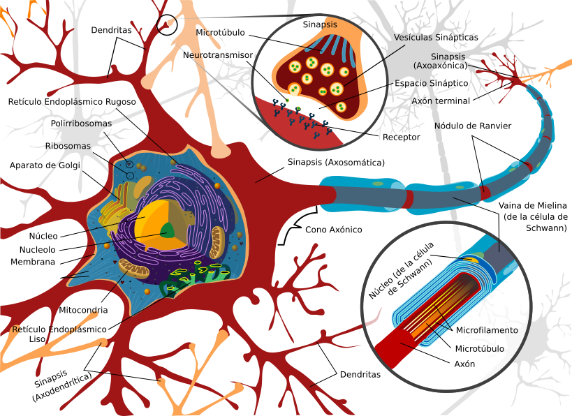
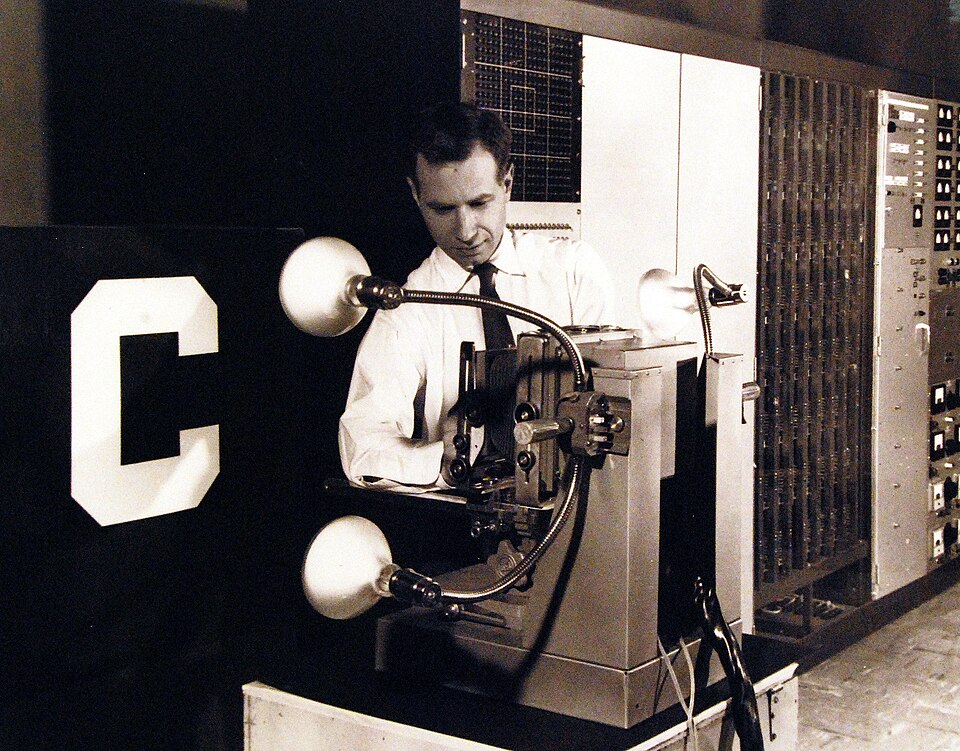
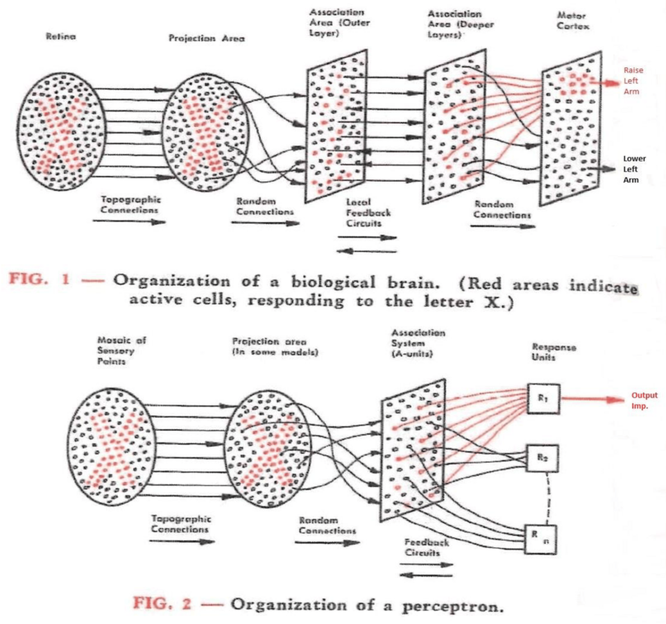
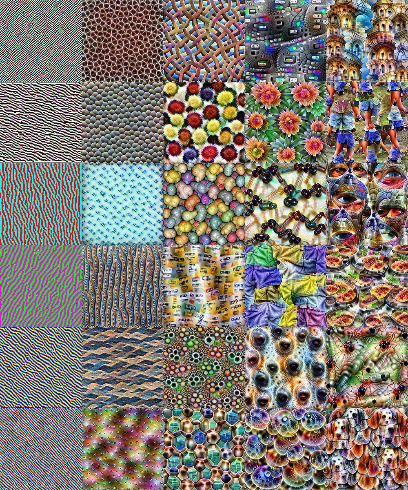

```{python}
from graficas import *
from sklearn.datasets import make_moons, make_circles
from sklearn.neural_network import MLPClassifier
from sklearn.model_selection import train_test_split
import warnings
warnings.filterwarnings("ignore")
rng = np.random.default_rng(11)
sigmoide = lambda z: 1 / (1 + np.exp(-z))  # noqa: E731
```

## Dónde estamos

:::: {.columns}
::: {.column width="50%"}
En otras sesiones de la escuela:

- **Regresión lineal** y múltiple (Carlos Soto)
- **Clasificación**: regresión logística, k-vecinos, árboles… (Daniela Pinto)
- **Optimización iterativa**: descenso de gradiente (Carlos Soto)
- **Probabilidad** (Javier Aguilar)
- **Agrupamiento** y **PCA** (Alex Rodriguez, Carlos Soto)
:::
::: {.column width="50%"}
::: {.definicion}
Hoy juntamos todo:

**Una red neuronal es una composición de muchas regresiones logísticas** cuyos parámetros se ajustan con **descenso de gradiente** para minimizar una **función de pérdida**.

¡Ya conocen todas las piezas!
:::
:::
::::

# La neurona {background-color="#053229" .seccion}

Una idea de 1943

## Inspiración biológica

:::: {.columns}
::: {.column width="55%"}
{width="100%"}

::: {.credito}
Diagrama: LadyofHats (traducción: Josell7), dominio público, Wikimedia Commons.
:::
:::
::: {.column width="45%"}
- Una neurona recibe señales químicas en sus **dendritas**
- Si la suma de estímulos supera un **umbral**, "dispara" un pulso eléctrico por el **axón**
- Las **sinapsis** pueden ser más fuertes o más débiles: ahí se guarda el aprendizaje

::: {.definicion}
**McCulloch y Pitts (1943):** una neurona como una función matemática: suma de entradas ponderadas y un umbral → 0 o 1. ¡Mostraron que redes de estas neuronas pueden calcular funciones lógicas!
:::
:::
::::

::: aside
McCulloch, W. S. & Pitts, W. (1943). A logical calculus of the ideas immanent in nervous activity. *Bulletin of Mathematical Biophysics* 5, 115–133.
:::

## La neurona artificial

:::: {.columns}
::: {.column width="40%"}
$$
z = \sum_{i=1}^{n} w_i x_i + b = \mathbf{w}\cdot\mathbf{x} + b
$$
$$
a = \sigma(z)
$$

- $\mathbf{x}$: entradas (características)
- $\mathbf{w}$: **pesos** — qué tanto importa cada entrada
- $b$: **sesgo** (*bias*) — mueve el umbral
- $\sigma$: **función de activación** no lineal

::: {.caja .pequeno}
Con $\sigma$ = sigmoide, ¡una neurona es exactamente una **regresión logística**!
:::
:::
::: {.column width="60%"}
```{python}
xx = np.linspace(-4, 4, 70)
X1, X2 = np.meshgrid(xx, xx)
angulos = list(range(0, 360, 30))
fig = go.Figure()
for ang in angulos:
    t = np.radians(ang)
    w = 2.0 * np.array([np.cos(t), np.sin(t)])
    Z = sigmoide(w[0] * X1 + w[1] * X2 - 1.0)
    fig.add_trace(go.Heatmap(x=xx, y=xx, z=Z, colorscale=DIVERGENTE, zmin=0, zmax=1, visible=(ang == 30),
                             colorbar=dict(title="a", len=0.8), hovertemplate="x₁=%{x:.1f}, x₂=%{y:.1f}<br>a=%{z:.2f}<extra></extra>"))
    fig.add_trace(go.Scatter(x=[0, w[0]], y=[0, w[1]], mode="lines+markers", visible=(ang == 30), showlegend=False,
                             line=dict(color=PAVO_REAL, width=5), marker=dict(size=[0, 16], symbol="arrow", angleref="previous",
                                                                       color=PAVO_REAL), hoverinfo="skip"))
fig.update_layout(sliders=deslizador(pasos_visibilidad(2, [f"{a}°" for a in angulos]), prefijo="dirección de w: ", activo=1),
                  xaxis=dict(title="x₁", range=[-4, 4]), yaxis=dict(title="x₂", range=[-4, 4], scaleanchor="x"),
                  title="a = σ(w₁x₁ + w₂x₂ + b): la neurona «se enciende» de un lado de una recta")
mostrar(fig, 860, 680)
```
:::
::::

## Funciones de activación

```{python}
z = np.linspace(-5, 5, 400)
from scipy.special import erf
funciones = [
    ("Escalón (perceptrón, 1958)", np.where(z >= 0, 1.0, 0.0), GRIS),
    ("Sigmoide", sigmoide(z), ABETO),
    ("Tangente hiperbólica", np.tanh(z), ZAFIRO),
    ("ReLU = max(0, z)", np.maximum(0, z), CORAL),
    ("GELU (transformers)", 0.5 * z * (1 + erf(z / np.sqrt(2))), PISTACHO),
]
fig = go.Figure()
for nombre, y, color in funciones:
    fig.add_trace(go.Scatter(x=z, y=y, name=nombre, line=dict(color=color, width=4, dash="dot" if color == GRIS else "solid"),
                             visible=True if nombre.startswith(("Sigmoide", "ReLU")) else "legendonly"))
fig.update_layout(xaxis=dict(title="z"), yaxis=dict(title="σ(z)", range=[-1.3, 3]),
                  legend=dict(x=0.01, y=0.98, font=dict(size=18)),
                  title="Hagan clic en la leyenda para mostrar u ocultar funciones")
mostrar(fig, 1300, 600)
```

::: {.pequeno}
Sin una función **no lineal**, apilar capas no sirve de nada: una composición de funciones lineales sigue siendo lineal. **ReLU** (2010s) hizo posible entrenar redes profundas porque su gradiente no se "apaga".
:::

## El perceptrón (Rosenblatt, 1958) {.compacta}

:::: {.columns}
::: {.column width="38%"}
{width="100%" .redondeada}
:::
::: {.column width="62%"}
- Frank Rosenblatt (Cornell) construyó una **máquina que aprendía** a reconocer formas simples
- Regla de aprendizaje del perceptrón: si se equivoca, **mover los pesos** hacia la respuesta correcta
$$
\mathbf{w} \leftarrow \mathbf{w} + \eta\,(y - \hat{y})\,\mathbf{x}
$$
- Si los datos son **linealmente separables**, el algoritmo converge (teorema de convergencia del perceptrón)
- La prensa de la época prometió máquinas que pronto caminarían, hablarían y serían conscientes de sí mismas…

{height="190"}
:::
::::

::: {.credito}
Fotos: National Museum of the U.S. Navy (330-PSA-80-60), dominio público; F. Rosenblatt, *The Design of an Intelligent Automaton* (1958), dominio público. Vía Wikimedia Commons. · Rosenblatt, F. (1958). The perceptron. *Psychological Review* 65(6), 386–408.
:::

## El problema XOR

```{python}
puntos = np.array([[0, 0], [0, 1], [1, 0], [1, 1]])
tablas = {"Y (AND)": [0, 0, 0, 1], "O (OR)": [0, 1, 1, 1], "O exclusivo (XOR)": [0, 1, 1, 0]}
rectas = {"Y (AND)": ([-0.2, 1.7], [1.7, -0.2]), "O (OR)": ([-0.2, 0.7], [0.7, -0.2]), "O exclusivo (XOR)": None}
fig = go.Figure()
for i, (nombre, y) in enumerate(tablas.items()):
    y = np.array(y)
    for c, color in [(0, ABETO), (1, CORAL)]:
        fig.add_trace(go.Scatter(x=puntos[y == c, 0], y=puntos[y == c, 1], mode="markers", name=f"salida {c}",
                                 marker=dict(size=40, color=color, line=dict(color="white", width=3)),
                                 visible=(i == 0), showlegend=(i == 0)))
    r = rectas[nombre]
    fig.add_trace(go.Scatter(x=r[0] if r else [None], y=r[1] if r else [None], mode="lines", showlegend=False,
                             line=dict(color=PAVO_REAL, width=4, dash="dash"), visible=(i == 0)))
titulos = [{"title.text": "AND: una recta separa las clases ✅"}, {"title.text": "OR: una recta separa las clases ✅"},
           {"title.text": "XOR: ¡ninguna recta puede separarlas! ❌"}]
botones = []
for i, nombre in enumerate(tablas):
    vis = [False] * 9
    vis[3 * i:3 * i + 3] = [True] * 3
    botones.append(dict(label=nombre, method="update", args=[{"visible": vis}, titulos[i]]))
fig.update_layout(updatemenus=[dict(type="buttons", direction="right", buttons=botones, x=0, y=1.3, xanchor="left",
                                    font=dict(size=18), bgcolor="white")],
                  title=dict(text=titulos[0]["title.text"], y=0.86), margin=dict(t=150),
                  xaxis=dict(title="x₁", range=[-0.4, 1.4], dtick=1), yaxis=dict(title="x₂", range=[-0.4, 1.4], dtick=1, scaleanchor="x"))
mostrar(fig, 900, 640)
```

::: {.pequeno}
Minsky y Papert (1969) mostraron que un perceptrón de una capa **no puede** aprender XOR. El entusiasmo se enfrió… hasta que se supo entrenar redes **con capas ocultas**.
:::

# Redes multicapa {background-color="#053229" .seccion}

Apilar neuronas para representar funciones complicadas

## El perceptrón multicapa {.compacta}

:::: {.columns}
::: {.column width="45%"}
Cada capa transforma la salida de la anterior:

$$
\begin{aligned}
\mathbf{h}^{(1)} &= \sigma\big(W^{(1)}\mathbf{x} + \mathbf{b}^{(1)}\big)\\
\mathbf{h}^{(2)} &= \sigma\big(W^{(2)}\mathbf{h}^{(1)} + \mathbf{b}^{(2)}\big)\\
\hat{y} &= W^{(3)}\mathbf{h}^{(2)} + \mathbf{b}^{(3)}
\end{aligned}
$$

- Las capas intermedias se llaman **ocultas**
- "Profundo" = **muchas** capas ocultas
- Los parámetros son **todas** las matrices $W$ y vectores $\mathbf{b}$

::: {.caja .pequeno}
**¿Cuántos parámetros?** Entrada de 784 píxeles → 128 neuronas → 10 clases: $784\times128 + 128 + 128\times10 + 10 = 101\,770$. GPT-3: 175 000 millones.
:::
:::
::: {.column width="55%"}
```{python}
capas = [4, 6, 6, 3]
nombres_c = ["entrada x", "oculta h⁽¹⁾", "oculta h⁽²⁾", "salida ŷ"]
fig = go.Figure()
pos = {(l, j): (l * 1.7, (j - (n - 1) / 2) * 0.85) for l, n in enumerate(capas) for j in range(n)}
for l in range(len(capas) - 1):
    for j in range(capas[l]):
        for k in range(capas[l + 1]):
            (x0, y0), (x1, y1) = pos[(l, j)], pos[(l + 1, k)]
            w = rng.normal()
            fig.add_trace(go.Scatter(x=[x0, x1], y=[y0, y1], mode="lines", hoverinfo="skip", showlegend=False,
                                     line=dict(color=CORAL if w > 0 else ABETO, width=0.8 + 2 * min(abs(w), 1.5)), opacity=0.5))
for l, n in enumerate(capas):
    fig.add_trace(go.Scatter(x=[pos[(l, j)][0] for j in range(n)], y=[pos[(l, j)][1] for j in range(n)], mode="markers",
                             marker=dict(size=34, color="white", line=dict(color=PAVO_REAL, width=3)), showlegend=False,
                             hovertext=nombres_c[l], hoverinfo="text"))
    fig.add_annotation(x=l * 1.7, y=-3.0, text=nombres_c[l], showarrow=False, font=dict(size=19, color=GRIS))
fig.update_layout(xaxis=dict(visible=False), yaxis=dict(visible=False, range=[-3.3, 2.6]),
                  plot_bgcolor="rgba(0,0,0,0)", margin=dict(l=0, r=0, t=0, b=0))
mostrar(fig, 820, 600)
```
:::
::::

## Una capa oculta resuelve XOR

```{python}
# Pesos elegidos a mano: h1 = OR, h2 = AND, salida = h1 AND NOT h2
W1 = np.array([[20, 20], [20, 20]])
b1 = np.array([-10, -30])
yxor = np.array([0, 1, 1, 0])
H = sigmoide(puntos @ W1.T + b1)
fig = make_subplots(rows=1, cols=2, subplot_titles=["Espacio de entrada (x₁, x₂)", "Espacio oculto (h₁, h₂)"],
                    horizontal_spacing=0.15)
for c, color in [(0, ABETO), (1, CORAL)]:
    fig.add_trace(go.Scatter(x=puntos[yxor == c, 0], y=puntos[yxor == c, 1], mode="markers+text", name=f"XOR = {c}",
                             text=[f"({a},{b})" for a, b in puntos[yxor == c]], textposition="top center",
                             marker=dict(size=36, color=color, line=dict(color="white", width=3))), 1, 1)
    fig.add_trace(go.Scatter(x=H[yxor == c, 0], y=H[yxor == c, 1] + rng.normal(0, 0.012, (yxor == c).sum()),
                             mode="markers+text", showlegend=False,
                             text=[f"({a},{b})" for a, b in puntos[yxor == c]],
                             # (0,1) y (1,0) caen en el mismo punto: una etiqueta arriba y otra abajo
                             textposition=["top center", "bottom center"] if c == 1 else "top center",
                             marker=dict(size=36, color=color, line=dict(color="white", width=3))), 1, 2)
fig.add_trace(go.Scatter(x=[-0.1, 1.1], y=[-0.05, 1.15], mode="lines", line=dict(color=PAVO_REAL, width=4, dash="dash"),
                         showlegend=False), 1, 2)
fig.update_xaxes(range=[-0.3, 1.3], title_text="x₁", row=1, col=1)
fig.update_yaxes(range=[-0.3, 1.4], title_text="x₂", row=1, col=1)
fig.update_xaxes(range=[-0.3, 1.3], title_text="h₁ ≈ x₁ OR x₂", row=1, col=2)
fig.update_yaxes(range=[-0.3, 1.4], title_text="h₂ ≈ x₁ AND x₂", row=1, col=2)
mostrar(fig, 1400, 600)
```

::: {.caja}
La capa oculta **cambia la representación** de los datos: en el espacio $(h_1, h_2)$, XOR **sí** es separable por una recta. Esta es la idea central del aprendizaje profundo.
:::

## Las capas ocultas "doblan" el espacio

:::: {.columns}
::: {.column width="40%"}
- Datos: dos círculos concéntricos (no separables con una recta)
- Red: 2 entradas → **3 neuronas ocultas** (tanh) → 1 salida
- A la derecha: cada punto dibujado en las coordenadas de las **3 neuronas ocultas** después de entrenar

::: {.caja .pequeno}
¡Gírenlo! En el espacio oculto, un **plano** separa las dos clases. La red **aprendió sola** una característica parecida al $r^2$ que diseñamos a mano en la introducción.
:::
:::
::: {.column width="60%"}
```{python}
Xc, yc = make_circles(n_samples=500, noise=0.07, factor=0.4, random_state=3)
red = MLPClassifier(hidden_layer_sizes=(3,), activation="tanh", solver="lbfgs", max_iter=3000, random_state=3).fit(Xc, yc)
Hc = np.tanh(Xc @ red.coefs_[0] + red.intercepts_[0])
fig = go.Figure()
for c, (nombre, color) in enumerate([("clase 0 (círculo exterior)", ABETO), ("clase 1 (círculo interior)", CORAL)]):
    fig.add_trace(go.Scatter3d(x=Hc[yc == c, 0], y=Hc[yc == c, 1], z=Hc[yc == c, 2], mode="markers", name=nombre,
                               marker=dict(size=4, color=color)))
fig.update_layout(scene=dict(xaxis_title="h₁", yaxis_title="h₂", zaxis_title="h₃", camera=dict(eye=dict(x=1.5, y=1.5, z=0.9))),
                  legend=dict(x=0, y=0.97), margin=dict(l=0, r=0, t=60, b=0),
                  title=dict(text=f"Exactitud: {red.score(Xc, yc):.0%}", y=0.97))
mostrar(fig, 880, 660)
```
:::
::::

## Teorema de aproximación universal

```{python}
x = np.linspace(-3, 3, 400)
objetivo = np.sin(2 * x) + 0.4 * x ** 2 - 0.3 * np.cos(5 * x)
n_neuronas = [1, 2, 4, 8, 16, 64]
fig = go.Figure()
fig.add_trace(go.Scatter(x=x, y=objetivo, name="función objetivo", line=dict(color=GRIS, width=6)))
titulos = []
for n in n_neuronas:
    quiebres = np.linspace(-3, 3, n + 2)[1:-1] if n > 1 else np.array([0.0])
    Phi = np.c_[np.ones_like(x), x, np.maximum(0, x[:, None] - quiebres[None, :]),
                np.maximum(0, quiebres[None, :] - x[:, None])]
    coef = np.linalg.lstsq(Phi, objetivo, rcond=None)[0]
    aprox = Phi @ coef
    fig.add_trace(go.Scatter(x=x, y=aprox, name=f"red con {n} neuronas ReLU", line=dict(color=CORAL, width=4),
                             visible=(n == 4)))
    titulos.append({"title.text": f"{n} neurona{'s' if n > 1 else ''} ReLU · error cuadrático medio = {np.mean((aprox - objetivo) ** 2):.4f}"})
fig.update_layout(sliders=deslizador(pasos_visibilidad(1, n_neuronas, fijas=1, extras=titulos), prefijo="neuronas ocultas: ", activo=2),
                  title=titulos[2]["title.text"], xaxis=dict(title="x"), yaxis=dict(title="f(x)"),
                  legend=dict(x=0.02, y=0.03, yanchor="bottom"))
mostrar(fig, 1350, 600)
```

::: {.pequeno}
Una red con **una sola capa oculta** y suficientes neuronas puede aproximar cualquier función continua tan bien como queramos (Cybenko, 1989; Hornik, 1991). Pero el teorema no dice **cuántas** neuronas ni **cómo encontrar** los pesos: en la práctica, las redes **profundas** lo logran con muchos menos parámetros.
:::

# ¿Cómo aprende una red? {background-color="#053229" .seccion}

Pérdida, gradientes y retropropagación

## Paso 1: medir el error con una función de pérdida

:::: {.columns}
::: {.column width="50%"}
[Regresión: error cuadrático medio]{.titulo-tarjeta}
$$
L = \frac{1}{N}\sum_{i=1}^{N}\big(\hat{y}_i - y_i\big)^2
$$

[Clasificación: entropía cruzada]{.titulo-tarjeta}
$$
L = -\frac{1}{N}\sum_{i=1}^{N}\sum_{c} y_{ic}\,\log \hat{p}_{ic}
$$
donde $\hat{p}_{ic}$ es la probabilidad que la red asigna a la clase correcta (salida **softmax**).
:::
::: {.column width="50%"}
```{python}
p = np.linspace(0.01, 1, 200)
fig = go.Figure(go.Scatter(x=p, y=-np.log(p), line=dict(color=CORAL, width=5),
                           hovertemplate="p = %{x:.2f}<br>pérdida = %{y:.2f}<extra></extra>"))
fig.update_layout(title="Entropía cruzada: castiga mucho estar seguro y equivocarse",
                  xaxis=dict(title="probabilidad asignada a la clase correcta"), yaxis=dict(title="pérdida −log p"))
mostrar(fig, 760, 520)
```
:::
::::

[Más en la sesión de probabilidad con **Javier Aguilar**]{.adelante}

## Paso 2: bajar la montaña con descenso de gradiente

```{python}
def perdida(w):
    return 0.5 * (w[..., 0] ** 2 + 8 * w[..., 1] ** 2)
def gradiente(w):
    return np.array([w[0], 8 * w[1]])
g = np.linspace(-3.2, 3.2, 120)
G0, G1 = np.meshgrid(g, g)
Lmap = perdida(np.stack([G0, G1], -1))
tasas = [0.02, 0.08, 0.2, 0.24, 0.26]
desc = {0.02: "muy pequeña: avanza lentísimo", 0.08: "adecuada", 0.2: "grande: oscila", 0.24: "casi diverge", 0.26: "demasiado grande: ¡diverge!"}
fig = go.Figure()
fig.add_trace(go.Contour(x=g, y=g, z=np.log1p(Lmap), colorscale=SECUENCIAL, showscale=False, ncontours=25,
                         hoverinfo="skip", line=dict(width=0.5)))
titulos = []
for eta in tasas:
    w = np.array([-2.8, 1.2])
    camino = [w.copy()]
    for _ in range(30):
        w = w - eta * gradiente(w)
        camino.append(w.copy())
    camino = np.clip(np.array(camino), -3.5, 3.5)
    fig.add_trace(go.Scatter(x=camino[:, 0], y=camino[:, 1], mode="lines+markers", line=dict(color=CORAL, width=3),
                             marker=dict(size=9, color=CORAL, line=dict(color="white", width=1)), visible=(eta == 0.08),
                             showlegend=False, hovertemplate="paso %{pointNumber}<extra></extra>"))
    titulos.append({"title.text": f"Tasa de aprendizaje η = {eta}: {desc[eta]}"})
fig.add_trace(go.Scatter(x=[0], y=[0], mode="markers", marker=dict(symbol="star", size=24, color=PAVO_REAL), showlegend=False,
                         hovertext="mínimo", hoverinfo="text"))
pasos = []
for i, eta in enumerate(tasas):
    vis = [True] + [j == i for j in range(len(tasas))] + [True]
    pasos.append(dict(method="update", label=str(eta), args=[{"visible": vis}, titulos[i]]))
fig.update_layout(sliders=deslizador(pasos, prefijo="η = ", activo=1), title=titulos[1]["title.text"],
                  xaxis=dict(title="peso w₁", range=[-3.2, 3.2]), yaxis=dict(title="peso w₂", range=[-3.2, 3.2], scaleanchor="x"))
mostrar(fig, 1000, 680)
```

::: {.pequeno}
$\mathbf{w} \leftarrow \mathbf{w} - \eta\,\nabla_{\mathbf{w}} L$. La **tasa de aprendizaje** $\eta$ es el hiperparámetro más importante. [Más en la sesión de optimización con **Carlos Soto**]{.adelante}
:::

## Paso 3: calcular el gradiente con retropropagación

:::: {.columns}
::: {.column width="50%"}
Una red es una **composición de funciones**: $L = \ell(f_3(f_2(f_1(x))))$

La **regla de la cadena** da el gradiente respecto a *cualquier* peso:

$$
\frac{\partial L}{\partial w^{(1)}} = \frac{\partial L}{\partial \hat y}\cdot\frac{\partial \hat y}{\partial h^{(2)}}\cdot\frac{\partial h^{(2)}}{\partial h^{(1)}}\cdot\frac{\partial h^{(1)}}{\partial w^{(1)}}
$$

- **Hacia adelante:** calcular la predicción y la pérdida
- **Hacia atrás:** propagar los gradientes desde la salida hasta la entrada, reutilizando cálculos

::: {.credito}
Rumelhart, D. E., Hinton, G. E. & Williams, R. J. (1986). Learning representations by back-propagating errors. *Nature* 323, 533–536.
:::
:::
::: {.column width="50%"}
En **PyTorch** la retropropagación es automática (*autograd*):

```python
import torch

x = torch.tensor([1.5, -0.3])
w = torch.tensor([0.2, 0.8], requires_grad=True)
b = torch.tensor(0.1, requires_grad=True)
y = torch.tensor(1.0)

y_hat = torch.sigmoid(w @ x + b)   # hacia adelante
L = (y_hat - y) ** 2
L.backward()                       # hacia atrás

print(w.grad, b.grad)   # ∂L/∂w, ∂L/∂b
```

[Lo programaremos en la **práctica con PyTorch**]{.adelante}
:::
::::

## El ciclo de entrenamiento

:::: {.columns}
::: {.column width="45%"}
1. Tomar un **lote** (*mini-batch*) de ejemplos
2. **Hacia adelante:** predicciones y pérdida
3. **Hacia atrás:** gradientes
4. **Actualizar** los pesos (SGD, Adam…)
5. Repetir; una pasada por todos los datos = una **época**

```python
for epoca in range(n_epocas):
    for x, y in cargador_datos:
        perdida = criterio(modelo(x), y)
        optimizador.zero_grad()
        perdida.backward()
        optimizador.step()
```
:::
::: {.column width="55%"}
```{python}
Xm, ym = make_moons(n_samples=400, noise=0.2, random_state=0)
red = MLPClassifier(hidden_layer_sizes=(16, 16), activation="relu", learning_rate_init=0.01, random_state=1)
epocas_mostrar = [1, 3, 10, 30, 100, 300]
gx = np.linspace(-1.8, 2.8, 110)
gy = np.linspace(-1.3, 1.8, 90)
GX, GY = np.meshgrid(gx, gy)
fig = go.Figure()
ep = 0
for objetivo_ep in epocas_mostrar:
    while ep < objetivo_ep:
        red.partial_fit(Xm, ym, classes=[0, 1])
        ep += 1
    Z = red.predict_proba(np.c_[GX.ravel(), GY.ravel()])[:, 1].reshape(GX.shape)
    fig.add_trace(go.Contour(x=gx, y=gy, z=Z, colorscale=DIVERGENTE, opacity=0.4, showscale=False,
                             contours=dict(start=0, end=1, size=0.1), visible=(objetivo_ep == 30), hoverinfo="skip"))
for c, color in [(0, ABETO), (1, CORAL)]:
    fig.add_trace(go.Scatter(x=Xm[ym == c, 0], y=Xm[ym == c, 1], mode="markers", showlegend=False,
                             marker=dict(color=color, size=7, line=dict(color="white", width=1))))
pasos = [dict(method="update", label=str(e), args=[{"visible": [j == i for j in range(len(epocas_mostrar))] + [True, True]}])
         for i, e in enumerate(epocas_mostrar)]
fig.update_layout(sliders=deslizador(pasos, prefijo="época: ", activo=3), title="Red 2 → 16 → 16 → 1 aprendiendo",
                  xaxis=dict(range=[-1.8, 2.8]), yaxis=dict(range=[-1.3, 1.8]))
mostrar(fig, 820, 600)
```
:::
::::

## Sobreajuste y regularización {.compacta}

:::: {.columns}
::: {.column width="55%"}
```{python}
Xs, ys = make_moons(n_samples=160, noise=0.35, random_state=4)
Xa, Xv, ya, yv = train_test_split(Xs, ys, test_size=0.5, random_state=0)
red = MLPClassifier(hidden_layer_sizes=(128, 128), learning_rate_init=0.01, alpha=0.0, random_state=0)
from sklearn.metrics import log_loss
pe, pv = [], []
for e in range(400):
    red.partial_fit(Xa, ya, classes=[0, 1])
    pe.append(log_loss(ya, red.predict_proba(Xa)))
    pv.append(log_loss(yv, red.predict_proba(Xv)))
mejor = int(np.argmin(pv))
fig = go.Figure()
fig.add_trace(go.Scatter(y=pe, name="pérdida en entrenamiento", line=dict(color=ABETO, width=4)))
fig.add_trace(go.Scatter(y=pv, name="pérdida en validación", line=dict(color=CORAL, width=4)))
fig.add_vline(x=mejor, line=dict(color=GRIS, dash="dot", width=2))
fig.add_annotation(x=mejor, y=max(pv) * 0.9, text="parada temprana", showarrow=False, xshift=70, font=dict(size=18))
fig.update_layout(xaxis=dict(title="época"), yaxis=dict(title="entropía cruzada", type="log"),
                  legend=dict(x=0.45, y=0.98), title="Red grande con pocos datos (80 ejemplos)")
mostrar(fig, 860, 560)
```
:::
::: {.column width="45%"}
La red empieza a **memorizar** los datos de entrenamiento: la pérdida de entrenamiento sigue bajando, pero la de validación **sube**.

**Remedios (regularización):**

- **Más datos** y aumento de datos (rotar, recortar imágenes…)
- **Parada temprana**: quedarse con la época de menor error de validación
- **Penalizar pesos grandes** (*weight decay*, $L_2$)
- ***Dropout***: apagar neuronas al azar durante el entrenamiento (Srivastava *et al.*, 2014)
- Arquitecturas con la **simetría** adecuada (¡convoluciones para imágenes!)
:::
::::

## ¡Jueguen ustedes! TensorFlow Playground

<iframe class="demo" data-src="https://playground.tensorflow.org/#activation=tanh&batchSize=10&dataset=spiral&regDataset=reg-plane&learningRate=0.03&regularizationRate=0&noise=0&networkShape=4,2&seed=0.5&showTestData=false&discretize=false&percTrainData=50&x=true&y=true&xTimesY=false&xSquared=false&ySquared=false&cosX=false&sinX=false&cosY=false&sinY=false&collectStats=false&problem=classification&initZero=false&hideText=true" height="640" loading="lazy"></iframe>

::: {.notes}
Retos: (1) la espiral con 0 capas ocultas: imposible. (2) Agregar capas y neuronas hasta resolverla. (3) Usar como entradas sin(X1) y sin(X2): ingeniería de características. (4) Subir el ruido y ver el sobreajuste. (5) Tasa de aprendizaje 3 o 10: diverge.
:::

# ¿Por qué "profundo"? {background-color="#053229" .seccion}

Representaciones jerárquicas

## 2012: el año en que todo cambió

```{python}
imagenet = [(2010, 28.2, "NEC-UIUC"), (2011, 25.8, "XRCE"), (2012, 16.4, "AlexNet (red convolucional, GPU)"),
            (2013, 11.7, "Clarifai / ZFNet"), (2014, 6.7, "GoogLeNet"), (2015, 3.57, "ResNet (152 capas)"),
            (2016, 2.99, "Trimps-Soushen"), (2017, 2.25, "SENet")]
fig = go.Figure(go.Bar(x=[a for a, _, _ in imagenet], y=[e for _, e, _ in imagenet],
                       marker=dict(color=[ARTICO, ARTICO] + [CORAL] + [ABETO] * 5),
                       text=[f"{e}%" for _, e, _ in imagenet], textposition="outside", textfont=dict(size=20),
                       customdata=[m for _, _, m in imagenet], hovertemplate="%{x}: %{customdata}<br>error top-5 = %{y}%<extra></extra>"))
fig.add_hline(y=5.1, line=dict(color=PAVO_REAL, dash="dash", width=3), layer="below")
fig.add_annotation(x=2010.2, y=5.1, text="humano (≈5.1 %)", showarrow=False, yshift=16, xanchor="left", font=dict(size=18))
fig.update_layout(title="Error en ImageNet (1000 categorías, 1.2 millones de imágenes de entrenamiento)",
                  yaxis=dict(title="error top-5 (%)", range=[0, 32]), xaxis=dict(dtick=1, title=None), showlegend=False)
mostrar(fig, 1350, 600)
```

::: aside
Russakovsky, O. *et al.* (2015). ImageNet Large Scale Visual Recognition Challenge. *IJCV* 115, 211–252. · Krizhevsky, A., Sutskever, I. & Hinton, G. (2012). *NeurIPS*. · He, K. *et al.* (2016). Deep residual learning. *CVPR*.
:::

## ¿Qué aprende cada capa? {.compacta}

:::: {.columns}
::: {.column width="58%"}
{height="640" .redondeada}

```{python}
etiquetas_capas = ["Bordes", "Texturas", "Patrones", "Partes", "Objetos"]
display(HTML("<div style='display:flex;justify-content:space-around;font-size:0.6em;font-weight:700;color:#355E58;margin-top:-0.4em'>"
             + "".join(f"<span>{e}</span>" for e in etiquetas_capas) + "</div>"))
```
:::
::: {.column width="42%"}
- Cada cuadrito es la imagen **sintética** que más activa a una neurona de GoogLeNet (una red convolucional entrenada con ImageNet)
- Se obtiene con **descenso de gradiente sobre la imagen** (no sobre los pesos): ¿qué entrada maximiza esta neurona?
- De izquierda a derecha, capas cada vez más **profundas**: la red construye una **jerarquía** de conceptos

::: {.caja .pequeno}
Nadie le dijo a la red que usara bordes ni ojos de perro: lo **descubrió** porque le sirve para clasificar. Más en la sesión de redes convolucionales, con **circuitos** dentro de las redes.
:::
:::
::::

::: {.credito}
Olah, C., Mordvintsev, A. & Schubert, L. (2017). Feature Visualization. *Distill*. doi:10.23915/distill.00007. Figura con licencia CC BY 4.0.
:::

## Física y redes neuronales: la red de Hopfield {.compacta}

:::: {.columns}
::: {.column width="40%"}
- Neuronas binarias $s_i = \pm 1$ (¡como espines!)
- **Energía**, igual que en el modelo de Ising:
$$
E = -\frac{1}{2}\sum_{i\neq j} w_{ij}\, s_i s_j
$$
- **Aprendizaje de Hebb** ("neuronas que se activan juntas se conectan"): $w_{ij} = \frac{1}{N}\sum_\mu \xi_i^\mu \xi_j^\mu$
- Cada actualización $s_i \leftarrow \text{signo}\big(\sum_j w_{ij} s_j\big)$ **baja la energía** → la red "cae" al recuerdo más cercano: **memoria asociativa**

::: {.credito}
Hopfield, J. J. (1982). Neural networks and physical systems with emergent collective computational abilities. *PNAS* 79, 2554–2558.
:::
:::
::: {.column width="60%"}
```{python}
letras = {
    "H": ["#......#", "#......#", "#......#", "########", "########", "#......#", "#......#", "#......#"],
    "N": ["#......#", "##.....#", "#.#....#", "#..#...#", "#...#..#", "#....#.#", "#.....##", "#......#"],
    "D": ["######..", "#.....#.", "#......#", "#......#", "#......#", "#......#", "#.....#.", "######.."],
}
patrones = np.array([[1 if ch == "#" else -1 for fila in letras[k] for ch in fila] for k in letras])
Nh = patrones.shape[1]
W = patrones.T @ patrones / Nh
np.fill_diagonal(W, 0)
estado = patrones[0].copy()
voltear = rng.choice(Nh, 22, replace=False)
estado[voltear] *= -1
energia = lambda s: -0.5 * s @ W @ s  # noqa: E731
instantaneas, energias = [estado.copy()], [energia(estado)]
orden = rng.permutation(np.repeat(np.arange(Nh), 3))
for paso, i in enumerate(orden):
    estado[i] = 1 if W[i] @ estado >= 0 else -1
    if (paso + 1) % 16 == 0:
        instantaneas.append(estado.copy())
        energias.append(energia(estado))
instantaneas = instantaneas[:9]
energias = energias[:9]
fig = make_subplots(rows=1, cols=2, column_widths=[0.5, 0.5], horizontal_spacing=0.12,
                    subplot_titles=["Estado de la red (8×8 neuronas)", "Energía"])
for k, s in enumerate(instantaneas):
    fig.add_trace(go.Heatmap(z=s.reshape(8, 8)[::-1], colorscale=[[0, "white"], [1, PAVO_REAL]], zmin=-1, zmax=1,
                             showscale=False, visible=(k == 0), xgap=2, ygap=2, hoverinfo="skip"), 1, 1)
    fig.add_trace(go.Scatter(x=list(range(k + 1)), y=energias[:k + 1], mode="lines+markers", visible=(k == 0),
                             line=dict(color=CORAL, width=4), marker=dict(size=10), showlegend=False), 1, 2)
etq = [str(16 * k) for k in range(len(instantaneas))]
fig.update_layout(sliders=deslizador(pasos_visibilidad(2, etq), prefijo="actualizaciones de neuronas: "), margin=dict(t=50))
fig.update_xaxes(visible=False, row=1, col=1)
fig.update_yaxes(visible=False, scaleanchor="x", row=1, col=1)
fig.update_xaxes(title_text="paso", range=[-0.3, len(instantaneas) - 0.7], row=1, col=2)
fig.update_yaxes(title_text="E", range=[min(energias) - 2, max(energias) + 2], row=1, col=2)
mostrar(fig, 900, 560)
```
::: {.credito}
Recuerdos guardados: las letras **H**, **N** y **D**. Mueve el deslizador: la red recupera la **H** a partir de una versión con ruido.
:::
:::
::::

## El zoológico de arquitecturas

| Arquitectura | Para qué datos | Idea clave | En esta escuela |
|---|---|---|---|
| **Perceptrón multicapa** | tablas, vectores | capas densas | esta sesión |
| **Red convolucional (CNN)** | imágenes, señales | filtros locales compartidos | redes convolucionales |
| **Autocodificador** | cualquier dato | comprimir y reconstruir | redes convolucionales |
| **Red recurrente (RNN, LSTM)** | secuencias | memoria que se actualiza paso a paso | transformers |
| **Transformer** | texto, y ya casi todo | atención | transformers · práctica |
| **Red de grafos (GNN)** | redes, moléculas, mallas | mensajes entre vecinos | aprendizaje en grafos |
| **Modelos de difusión, GANs** | generar imágenes, audio, proteínas | aprender a quitar ruido | — |

::: {.caja .pequeno}
**¿Y el cerebro?** ~86 mil millones de neuronas, ~10^14^ sinapsis, consume ~20 W. Las redes artificiales son una **inspiración muy simplificada**. [Más en la sesión de neurociencia con **Joshua Lemus**]{.adelante}
:::

## Para llevar a casa

::: {.incremental}
- Una **neurona** = suma ponderada + función no lineal (≈ regresión logística)
- Las **capas ocultas** transforman la representación de los datos hasta que el problema se vuelve fácil
- Entrenar = minimizar una **pérdida** con **descenso de gradiente**; los gradientes se calculan con **retropropagación**
- Cuidado con el **sobreajuste**: validación, regularización, más datos
- Las redes **profundas** aprenden **jerarquías** de características: bordes → texturas → partes → objetos
- La física estadística está en el origen de todo esto (Hopfield, Boltzmann, Nobel 2024)
:::

::: {.fragment .center .grande}
Próximas sesiones: **redes convolucionales**, **autocodificadores** y **transformers**. ¡Traigan su cuenta de Google para Colab!
:::

::: {.absolute bottom="0" right="0" width="200" style="text-align: center;"}
{width="180" fig-alt="Código QR que lleva a edithvillegas.github.io"}

::: {.qr-url style="font-size: 0.45em;"}
[edithvillegas.github.io](https://edithvillegas.github.io)
:::
:::
