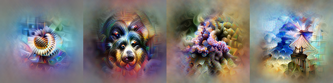
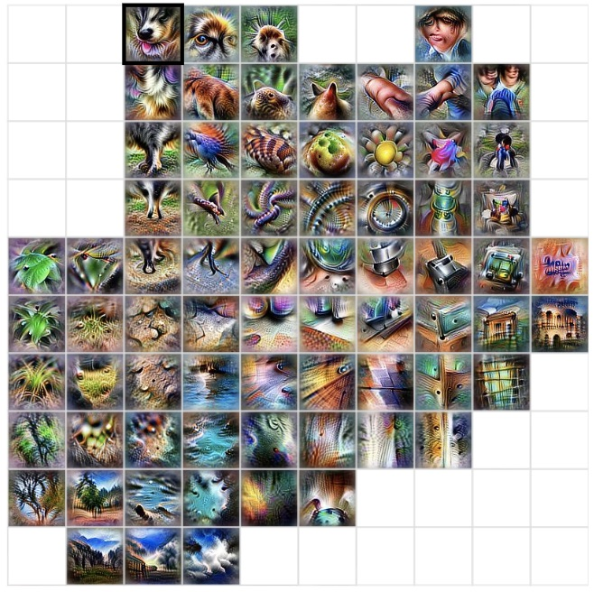
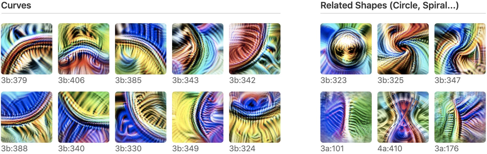
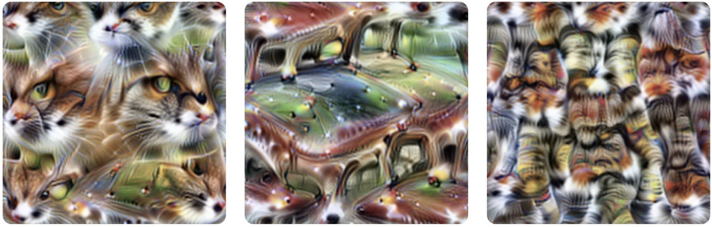

```{python}
from graficas import *
from PIL import Image
from scipy.signal import correlate2d
rng = np.random.default_rng(5)
foto_rgb = np.round(np.asarray(Image.open("img/foto_convolucion.jpg").convert("RGB").resize((360, 270)), dtype=float) / 255, 3)
foto = np.round(foto_rgb.mean(axis=2), 3)
cnn = cargar("cnn_mnist.json")
ae = cargar("autocodificador.json")
```

## Plan de la sesión

:::: {.columns}
::: {.column width="50%"}
1. ¿Por qué no basta un perceptrón multicapa para imágenes?
2. La **convolución**: filtros que recorren la imagen
3. *Pooling* y arquitectura de una red convolucional
4. ¿Qué **aprenden** las redes convolucionales? (interpretabilidad)
5. **Autocodificadores**: comprimir y reconstruir
6. 💻 Práctica en Colab
:::
::: {.column width="50%"}
::: {.definicion}
**Recuerden del viernes:** una red neuronal es una composición de capas $\sigma(W\mathbf{x} + \mathbf{b})$ que se entrena con descenso de gradiente y retropropagación.

Hoy: ¿qué forma deben tener las capas cuando los datos son **imágenes**?
:::
:::
::::

## Una imagen es un tensor de números

```{python}
canales = [("Color (RGB)", foto_rgb), ("Canal rojo", foto_rgb[..., 0]), ("Canal verde", foto_rgb[..., 1]),
           ("Canal azul", foto_rgb[..., 2])]
fig = go.Figure()
fig.add_trace(go.Image(z=(foto_rgb * 255).astype(np.uint8), visible=True, hoverinfo="skip"))
escalas = [[[0, "black"], [1, "red"]], [[0, "black"], [1, "#00c000"]], [[0, "black"], [1, "#2a78ff"]]]
for (nombre, z), esc in zip(canales[1:], escalas):
    fig.add_trace(go.Heatmap(z=a_uint8(z), colorscale=esc, zmin=0, zmax=255, showscale=False, visible=False,
                             hovertemplate="fila %{y}, columna %{x}<br>intensidad %{z} / 255<extra></extra>"))
botones = [dict(label=n, method="update", args=[{"visible": [j == i for j in range(4)]}]) for i, (n, _) in enumerate(canales)]
fig.update_layout(updatemenus=[dict(type="buttons", direction="right", buttons=botones, x=0, y=1.1, xanchor="left",
                                    font=dict(size=17), bgcolor="white")], margin=dict(t=70, l=0, r=0, b=0),
                  yaxis=dict(autorange="reversed", visible=False, scaleanchor="x"), xaxis=dict(visible=False))
mostrar(fig, 1000, 680)
```

::: {.pequeno}
Esta foto: 270 × 360 píxeles × 3 colores = **291 600 números**. Una foto de celular (12 megapíxeles): **36 millones**.
:::

## ¿Por qué no usar un perceptrón multicapa?

:::: {.columns}
::: {.column width="50%"}
::: {.incremental}
- **Demasiados parámetros:** una imagen de 1000×1000×3 conectada a 1000 neuronas = **3 000 millones** de pesos en la primera capa
- **Ignora la geometría:** si revolvemos los píxeles (siempre de la misma forma), un perceptrón aprende igual de bien. ¡No sabe qué píxeles son vecinos!
- **No reutiliza lo aprendido:** un detector de "ojo" arriba a la izquierda no sirve abajo a la derecha
:::
:::
::: {.column width="50%"}
::: {.definicion .fragment}
**Inspiración biológica:** Hubel y Wiesel (1959–1962, Nobel 1981) descubrieron que las neuronas de la corteza visual responden a **bordes con cierta orientación** en una **región pequeña** del campo visual (*campo receptivo*), y que se organizan en **jerarquías**.

→ Neocognitrón (Fukushima, 1980) → redes convolucionales (LeCun *et al.*, 1989)
:::
:::
::::

## La convolución, paso a paso

```{python}
img_peq = np.array([[0, 0, 0, 0, 0, 0, 0],
                    [0, 0, 0, 9, 9, 0, 0],
                    [0, 0, 9, 9, 9, 0, 0],
                    [0, 0, 0, 9, 9, 0, 0],
                    [0, 0, 0, 9, 9, 0, 0],
                    [0, 0, 9, 9, 9, 9, 0],
                    [0, 0, 0, 0, 0, 0, 0]], dtype=float)
K = np.array([[1, 0, -1], [1, 0, -1], [1, 0, -1]], dtype=float)
salida = correlate2d(img_peq, K, mode="valid")
n_out = salida.shape[0]
fig = make_subplots(rows=1, cols=3, column_widths=[0.42, 0.18, 0.4], horizontal_spacing=0.06,
                    subplot_titles=["Imagen (7×7): un «1»", "Filtro 3×3", "Mapa de características (5×5)"])
fig.add_trace(go.Heatmap(z=img_peq, colorscale=[[0, "white"], [1, "#86b6ef"]], showscale=False, text=img_peq.astype(int),
                         texttemplate="%{text}", textfont=dict(size=20), xgap=2, ygap=2, hoverinfo="skip"), 1, 1)
fig.add_trace(go.Heatmap(z=K, colorscale=DIVERGENTE, zmid=0, showscale=False, text=K.astype(int), texttemplate="%{text}",
                         textfont=dict(size=22), xgap=2, ygap=2, hoverinfo="skip"), 1, 2)
pasos = []
for idx in range(n_out * n_out):
    i, j = divmod(idx, n_out)
    parcial = np.full_like(salida, np.nan)
    parcial.flat[:idx + 1] = salida.flat[:idx + 1]
    fig.add_trace(go.Heatmap(z=parcial, colorscale=DIVERGENTE, zmid=0, zmin=-27, zmax=27, showscale=False,
                             text=np.where(np.isnan(parcial), "", np.nan_to_num(parcial).astype(int).astype(str)),
                             texttemplate="%{text}", textfont=dict(size=20), xgap=2, ygap=2, visible=(idx == 0), hoverinfo="skip"), 1, 3)
    ventana = img_peq[i:i + 3, j:j + 3]
    cuenta = " + ".join(f"{int(a)}·{int(b)}" for a, b in zip(ventana.ravel(), K.ravel()) if a != 0 and b != 0) or "0"
    forma = [dict(type="rect", xref="x", yref="y", x0=j - 0.5, x1=j + 2.5, y0=i - 0.5, y1=i + 2.5,
                  line=dict(color=NARANJA, width=5)),
             dict(type="rect", xref="x3", yref="y3", x0=j - 0.5, x1=j + 0.5, y0=i - 0.5, y1=i + 0.5,
                  line=dict(color=NARANJA, width=5))]
    vis = [True, True] + [k == idx for k in range(n_out * n_out)]
    pasos.append(dict(method="update", label=str(idx + 1),
                      args=[{"visible": vis}, {"shapes": forma, "title.text": f"Suma de productos = {cuenta} = {int(salida[i, j])}"}]))
for c in (1, 2, 3):
    fig.update_yaxes(autorange="reversed", visible=False, scaleanchor=f"x{'' if c == 1 else c}", row=1, col=c)
    fig.update_xaxes(visible=False, row=1, col=c)
fig.update_layout(sliders=deslizador(pasos, prefijo="paso "), shapes=pasos[0]["args"][1]["shapes"],
                  title=pasos[0]["args"][1]["title.text"], margin=dict(t=90))
mostrar(fig, 1450, 640)
```

::: {.pequeno}
El filtro se desliza sobre la imagen; en cada posición se multiplica elemento a elemento y se suma. Este filtro responde a **bordes verticales** (positivo: claro→oscuro; negativo: oscuro→claro).
:::

## Filtros clásicos sobre una foto

```{python}
filtros = {
    "Original": None,
    "Bordes verticales (Sobel x)": np.array([[1, 0, -1], [2, 0, -2], [1, 0, -1]]),
    "Bordes horizontales (Sobel y)": np.array([[1, 2, 1], [0, 0, 0], [-1, -2, -1]]),
    "Bordes en todas direcciones (Laplaciano)": np.array([[0, 1, 0], [1, -4, 1], [0, 1, 0]]),
    "Desenfoque (promedio 7×7)": np.ones((7, 7)) / 49,
    "Realce de nitidez": np.array([[0, -1, 0], [-1, 5, -1], [0, -1, 0]]),
}
fig = go.Figure()
for i, (nombre, k) in enumerate(filtros.items()):
    if k is None:
        z, zmin, zmax = foto, 0, 1
    else:
        z = correlate2d(foto, k, mode="same", boundary="symm")
        if "Bordes" in nombre:
            z = np.abs(z)
            zmin, zmax = 0, np.percentile(z, 99.5)
        else:
            z, zmin, zmax = np.clip(z, 0, 1), 0, 1
    fig.add_trace(go.Heatmap(z=a_uint8(z, zmin, zmax), colorscale=GRISES, zmin=0, zmax=255, showscale=False, visible=(i == 0), hoverinfo="skip"))
botones = [dict(label=n, method="update", args=[{"visible": [j == i for j in range(len(filtros))]}]) for i, n in enumerate(filtros)]
fig.update_layout(updatemenus=[dict(type="dropdown", direction="down", buttons=botones, x=0, y=1.1, xanchor="left",
                                    font=dict(size=18), bgcolor="white")], margin=dict(t=70, l=0, r=0, b=0),
                  yaxis=dict(autorange="reversed", visible=False, scaleanchor="x"), xaxis=dict(visible=False))
mostrar(fig, 1000, 680)
```

::: {.pequeno}
Antes del aprendizaje profundo, estos filtros se **diseñaban a mano**. Una red convolucional **aprende** sus filtros a partir de los datos. *Foto: Charles J. Sharp, guacamaya roja en Copán, CC BY-SA 4.0, Wikimedia Commons.*
:::

## Las tres ideas de una capa convolucional

:::: {.columns}
::: {.column width="33%"}
::: {.tarjeta}
[🔍 Conexiones locales]{.titulo-tarjeta}
Cada neurona mira solo una **ventana pequeña** (p. ej. 3×3) de la capa anterior: su *campo receptivo*.
:::
:::
::: {.column width="33%"}
::: {.tarjeta}
[🔁 Pesos compartidos]{.titulo-tarjeta}
El **mismo filtro** se aplica en todas las posiciones → si el objeto se mueve, la respuesta se mueve con él (*equivarianza a traslaciones*).
:::
:::
::: {.column width="33%"}
::: {.tarjeta}
[🧱 Muchos filtros]{.titulo-tarjeta}
Cada capa aprende **decenas o cientos** de filtros; cada uno produce un **mapa de características** (un "canal").
:::
:::
::::

::: {.fragment}
| Entrada: imagen 224×224×3 | Capa densa | Capa convolucional |
|---|---|---|
| Salida | solo **64 números** | **64 mapas completos** de 224×224 |
| Parámetros | 224·224·3·64 ≈ **9.6 millones** | 64 filtros de 3×3×3 + 64 sesgos = **1 792** |
:::

::: {.pequeno .fragment}
Tamaño de salida: $\;\dfrac{N - K + 2P}{S} + 1$, con $N$ el tamaño de entrada, $K$ el del filtro, $P$ el relleno (*padding*) y $S$ el paso (*stride*).
:::

## *Pooling*: resumir y reducir

:::: {.columns}
::: {.column width="55%"}
```{python}
M = rng.integers(0, 10, (4, 4))
P = M.reshape(2, 2, 2, 2).max(axis=(1, 3))
colores_bloque = np.array([[0, 0, 1, 1], [0, 0, 1, 1], [2, 2, 3, 3], [2, 2, 3, 3]])
pal = [[0, "#cde2fb"], [0.33, "#fde0d1"], [0.66, "#c9eedd"], [1, "#fbe7b0"]]
fig = make_subplots(rows=1, cols=2, column_widths=[0.6, 0.4], horizontal_spacing=0.15,
                    subplot_titles=["Mapa 4×4", "Max pooling 2×2 → 2×2"])
fig.add_trace(go.Heatmap(z=colores_bloque, colorscale=pal, showscale=False, text=M, texttemplate="%{text}",
                         textfont=dict(size=30), xgap=3, ygap=3, hoverinfo="skip"), 1, 1)
fig.add_trace(go.Heatmap(z=np.array([[0, 1], [2, 3]]), colorscale=pal, showscale=False, text=P, texttemplate="<b>%{text}</b>",
                         textfont=dict(size=34), xgap=3, ygap=3, hoverinfo="skip"), 1, 2)
for c in (1, 2):
    fig.update_yaxes(autorange="reversed", visible=False, scaleanchor=f"x{'' if c == 1 else c}", row=1, col=c)
    fig.update_xaxes(visible=False, row=1, col=c)
mostrar(fig, 820, 460)
```
:::
::: {.column width="45%"}
- **Max pooling:** de cada bloque nos quedamos con el **máximo**
- Reduce el tamaño (menos cómputo) y da **tolerancia** a pequeños desplazamientos
- Después de varias capas conv + pooling, cada neurona "ve" una región **grande** de la imagen
:::
::::

## Arquitectura de una red convolucional

```{python}
bloques = [("Imagen<br>28×28×1", 0, 2.6, 2.6, "#cde2fb"), ("Conv 5×5<br>+ ReLU<br>24×24×8", 1.7, 2.3, 2.3, "#86b6ef"),
           ("Max pool<br>12×12×8", 3.3, 1.6, 1.6, "#5598e7"), ("Conv 5×5<br>+ ReLU<br>8×8×16", 4.7, 1.3, 1.3, "#2a78d6"),
           ("Max pool<br>4×4×16", 6.0, 0.9, 0.9, "#1c5cab"), ("Aplanar<br>256", 7.2, 0.35, 2.4, "#eda100"),
           ("Densa<br>10 clases<br>(softmax)", 8.5, 0.35, 1.2, "#eb6834")]
fig = go.Figure()
for nombre, x, w, h, color in bloques:
    for k in range(3 if "Conv" in nombre or "pool" in nombre else 1):
        fig.add_shape(type="rect", x0=x + k * 0.08, x1=x + w * 0.45 + k * 0.08, y0=-h / 2 + k * 0.08, y1=h / 2 + k * 0.08,
                      fillcolor=color, line=dict(color="white", width=2))
    fig.add_annotation(x=x + w * 0.22, y=-1.75, text=f"<b>{nombre}</b>", showarrow=False, font=dict(size=16, color=MARINO))
fig.add_annotation(x=1.6, y=1.75, text="extraer características →", showarrow=False, font=dict(size=20, color=GRIS))
fig.add_annotation(x=7.9, y=1.75, text="clasificar", showarrow=False, font=dict(size=20, color=GRIS))
fig.update_layout(xaxis=dict(visible=False, range=[-0.3, 9.4]), yaxis=dict(visible=False, range=[-2.3, 2.1]),
                  plot_bgcolor="rgba(0,0,0,0)", margin=dict(l=0, r=0, t=0, b=0))
mostrar(fig, 1450, 480)
```

::: {.pequeno}
Esta es la red pequeña que entrenamos para las siguientes diapositivas (parecida a **LeNet-5**, LeCun *et al.*, 1998). En PyTorch: `nn.Conv2d(1, 8, 5)`, `nn.MaxPool2d(2)`, `nn.Conv2d(8, 16, 5)`, `nn.Linear(256, 10)`.
:::

## ¿Qué aprendió nuestra red? (MNIST) {.compacta}

```{python}
filtros1 = np.array(cnn["filtros1"])
mapas = cnn["mapas"]
fig = make_subplots(rows=2, cols=9, horizontal_spacing=0.015, vertical_spacing=0.12,
                    subplot_titles=["entrada"] + [f"filtro {k + 1}" for k in range(8)] + [""] + [f"mapa {k + 1}" for k in range(8)])
n_tr = []
for d, m in enumerate(mapas):
    vis = d == 0
    fig.add_trace(go.Heatmap(z=m["imagen"], colorscale=GRISES, showscale=False, visible=vis, hoverinfo="skip"), 1, 1)
    for k in range(8):
        fig.add_trace(go.Heatmap(z=np.array(m["capa1"][k]), colorscale=AZULES, showscale=False, visible=vis, hoverinfo="skip"), 2, k + 2)
for k in range(8):
    lim = np.abs(filtros1[k]).max()
    fig.add_trace(go.Heatmap(z=filtros1[k], colorscale=DIVERGENTE, zmid=0, zmin=-lim, zmax=lim, showscale=False,
                             hovertemplate="peso %{z:.2f}<extra></extra>"), 1, k + 2)
n_por_digito = 9
botones = []
for d, m in enumerate(mapas):
    vis = [False] * (n_por_digito * len(mapas)) + [True] * 8
    vis[d * n_por_digito:(d + 1) * n_por_digito] = [True] * n_por_digito
    botones.append(dict(label=f"dígito {m['etiqueta']}", method="update", args=[{"visible": vis}]))
for i in range(1, 19):
    fig.layout[f"xaxis{'' if i == 1 else i}"].update(visible=False)
    fig.layout[f"yaxis{'' if i == 1 else i}"].update(visible=False, autorange="reversed", scaleanchor=f"x{'' if i == 1 else i}")
fig.update_layout(updatemenus=[dict(type="buttons", direction="right", buttons=botones, x=0, y=1.22, xanchor="left",
                                    font=dict(size=17), bgcolor="white")], margin=dict(t=110, l=0, r=0, b=0))
fig.update_annotations(font_size=15)
mostrar(fig, 1500, 470)
```

:::: {.columns .pequeno}
::: {.column width="50%"}
**Arriba:** los 8 filtros de 5×5 que la red **aprendió sola** (rojo positivo, azul negativo): detectores de bordes y trazos en distintas orientaciones.
:::
::: {.column width="50%"}
```{python}
display(HTML(f"""<table style="font-size:0.95em"><tr><th>Modelo</th><th>Parámetros</th><th>Exactitud (prueba)</th></tr>
<tr><td>Perceptrón multicapa (784→128→10)</td><td>{cnn['mlp']['parametros']:,}</td><td>{cnn['mlp']['exactitud']:.1%}</td></tr>
<tr><td><b>Red convolucional</b></td><td><b>{cnn['cnn']['parametros']:,}</b></td><td><b>{cnn['cnn']['exactitud']:.1%}</b></td></tr></table>""".replace(",", " ")))
```
¡**17 veces menos** parámetros y **más** exactitud! (2 épocas de entrenamiento)
:::
::::

## ¿En qué se equivoca?

:::: {.columns}
::: {.column width="50%"}
```{python}
C = np.array(cnn["confusion"])
Cn = C / C.sum(1, keepdims=True)
fig = go.Figure(go.Heatmap(z=Cn, x=[str(i) for i in range(10)], y=[str(i) for i in range(10)], colorscale=AZULES,
                           zmin=0, zmax=0.05, colorbar=dict(title="fracción", tickformat=".0%"),
                           text=C, hovertemplate="real %{y} → predicho %{x}: %{text} imágenes<extra></extra>", xgap=1, ygap=1))
fig.update_layout(xaxis=dict(title="predicción", side="bottom"), yaxis=dict(title="dígito real", autorange="reversed"),
                  title="Matriz de confusión (escala hasta 5 % para ver los errores)")
mostrar(fig, 720, 620)
```
:::
::: {.column width="50%"}
```{python}
err = cnn["errores"]
fig = make_subplots(rows=2, cols=4, subplot_titles=[f"real {e['real']} → dijo {e['predicho']}" for e in err],
                    horizontal_spacing=0.03, vertical_spacing=0.12)
for k, e in enumerate(err):
    fig.add_trace(go.Heatmap(z=e["imagen"], colorscale=GRISES, showscale=False, hoverinfo="skip"), k // 4 + 1, k % 4 + 1)
for i in range(1, 9):
    fig.layout[f"xaxis{'' if i == 1 else i}"].update(visible=False)
    fig.layout[f"yaxis{'' if i == 1 else i}"].update(visible=False, autorange="reversed", scaleanchor=f"x{'' if i == 1 else i}")
fig.update_annotations(font_size=16)
fig.update_layout(margin=dict(t=40, l=0, r=0, b=0))
mostrar(fig, 720, 420)
```
Muchos errores son **ambiguos** incluso para humanos. Métricas como la matriz de confusión las vieron con **Daniela Pinto**.
:::
::::

## Juega con una red convolucional: CNN Explainer

<iframe class="demo" data-src="https://poloclub.github.io/cnn-explainer/" height="640" loading="lazy"></iframe>

::: {.credito}
Wang, Z. J. *et al.* (2020). CNN Explainer: Learning Convolutional Neural Networks with Interactive Visualization. *IEEE TVCG*. Hagan clic en cualquier neurona para ver la convolución. [Abrir en otra pestaña](https://poloclub.github.io/cnn-explainer/).
:::

## Arquitecturas famosas

```{python}
arqs = [(1998, "LeNet-5", 6e4, "dígitos de cheques bancarios"), (2012, "AlexNet", 6e7, "GPU + ReLU + dropout; gana ImageNet"),
        (2014, "VGG-16", 1.38e8, "muchas capas 3×3"), (2014, "GoogLeNet", 6.8e6, "módulos Inception"),
        (2015, "ResNet-152", 6e7, "conexiones residuales: ¡152 capas!"), (2015, "U-Net", 3.1e7, "segmentación de imágenes médicas"),
        (2019, "EfficientNet-B7", 6.6e7, "escalar ancho/profundidad/resolución"), (2020, "Vision Transformer", 8.6e7, "atención en vez de convolución"),
        (2022, "ConvNeXt", 8.9e7, "convoluciones modernizadas")]
fig = go.Figure(go.Scatter(x=[a[0] for a in arqs], y=[a[2] for a in arqs], mode="markers+text", text=[a[1] for a in arqs],
                           textposition=["top center", "top center", "top center", "bottom center", "top center", "bottom center",
                                         "top center", "bottom center", "top center"],
                           textfont=dict(size=17), customdata=[a[3] for a in arqs],
                           marker=dict(size=18, color=[VIOLETA if "Transformer" in a[1] else AZUL for a in arqs],
                                       line=dict(color="white", width=2)),
                           hovertemplate="<b>%{text}</b> (%{x})<br>%{customdata}<br>%{y:.2s} parámetros<extra></extra>"))
fig.update_layout(yaxis=dict(type="log", title="parámetros", exponentformat="SI", range=[4.3, 8.6]),
                  xaxis=dict(title=None, range=[1995, 2024]), showlegend=False)
mostrar(fig, 1400, 520)
```

::: {.pequeno}
Aplicaciones: diagnóstico por imagen (U-Net), autos autónomos, clasificación de galaxias, "imágenes" de chorros de partículas en el LHC, detección de enfermedades en hojas de café (p. ej. el conjunto de datos RoCoLe, Ecuador, 2019), conteo de animales en fotos de cámaras trampa…
:::

# ¿Qué aprenden las redes convolucionales? {background-color="#0b2545" .seccion}

Interpretabilidad: abrir la caja negra

## Visualizar características {.compacta}

:::: {.columns}
::: {.column width="55%"}
{width="100%"}

- **Visualización de características:** partir de ruido y ajustar los **píxeles** (con descenso de gradiente) para activar al máximo una neurona
- Complementa ver los **ejemplos reales** que más la activan
:::
::: {.column width="45%"}
{width="100%" .redondeada}

::: {.pequeno}
Explórenlo en [distill.pub/2019/activation-atlas](https://distill.pub/2019/activation-atlas/) (interactivo)
:::
:::
::::

::: {.credito}
Olah, C. *et al.* (2017). Feature Visualization. *Distill*. · Carter, S. *et al.* (2019). Activation Atlas. *Distill*. Figuras CC BY 4.0.
:::

## Circuitos dentro de la red {.compacta}

{height="250"}

:::: {.columns}
::: {.column width="58%"}
{height="330"}
:::
::: {.column width="42%"}
::: {.pequeno}
**La hipótesis de los circuitos** (Olah *et al.*, 2020):

1. Las **características** son las unidades fundamentales
2. Se conectan mediante pesos formando **circuitos** que podemos leer
3. Las mismas características y circuitos aparecen en **distintas redes** (¿universalidad?)
:::
:::
::::

::: {.credito}
Olah, C. *et al.* (2020). Zoom In: An Introduction to Circuits. *Distill*. doi:10.23915/distill.00024.001. Figuras CC BY 4.0.
:::

## Neuronas polisemánticas y neuronas multimodales

{height="300"}

:::: {.columns .pequeno}
::: {.column width="50%"}
- Algunas neuronas responden a **varias cosas sin relación**: dificulta interpretarlas
- Hipótesis: la red guarda **más conceptos que neuronas**, mezclados (*superposición*) → veremos cómo separarlos con **autocodificadores dispersos** en la sesión de transformers
:::
::: {.column width="50%"}
- En CLIP (OpenAI), un modelo de imágenes y texto, hay neuronas **multimodales**: una neurona de "Spider-Man" responde a fotos, dibujos **y a la palabra escrita** "spider" (Goh *et al.*, 2021)
- ¡Parecido a las "neuronas de concepto" medidas en el lóbulo temporal medial humano, como la famosa neurona de "Jennifer Aniston" (Quiroga *et al.*, 2005)! [📅 Neurociencia con **Joshua Lemus** · 3 de diciembre]{.adelante}
:::
::::

::: {.credito}
Olah, C. *et al.* (2020). Zoom In. *Distill* (CC BY 4.0). · Goh, G. *et al.* (2021). Multimodal Neurons in Artificial Neural Networks. *Distill*. · Quiroga, R. Q. *et al.* (2005). Invariant visual representation by single neurons in the human brain. *Nature* 435, 1102–1107.
:::

## Una advertencia: ejemplos adversarios {.compacta}

```{python}
adv = cargar("adversario.json")
trad_imagenet = {"macaw": "guacamaya", "lorikeet": "lori", "bee eater": "abejaruco", "mushroom": "hongo",
                 "agaric": "agárico (hongo)", "bolete": "boleto (hongo)"}
def barras(pred, color):
    fig = go.Figure(go.Bar(x=[p for _, p in pred][::-1], y=[trad_imagenet.get(c, c) for c, _ in pred][::-1], orientation="h",
                           marker=dict(color=color), text=[f"{p:.0%}" for _, p in pred][::-1], textposition="outside",
                           textfont=dict(size=18), hovertemplate="%{y}: %{x:.1%}<extra></extra>"))
    fig.update_layout(xaxis=dict(range=[0, 1.25], visible=False), margin=dict(l=170, r=10, t=10, b=10), showlegend=False)
    mostrar(fig, 470, 200)
```

:::: {.columns}
::: {.column width="33%"}
**Foto original**

{width="330"}

```{python}
barras(adv["pred_original"], AZUL)
```
:::
::: {.column width="33%"}
**\+ un "ruido" diminuto** (amplificado ×64 para verlo)

{width="330"}

::: {.pequeno}
Cada píxel cambia como máximo **2/255**: invisible para nosotros.
:::
:::
::: {.column width="33%"}
**= imagen modificada**

{width="330"}

```{python}
barras(adv["pred_adversaria"], NARANJA)
```
:::
::::

::: {.pequeno}
Cálculo propio con una ResNet-18 preentrenada en ImageNet y el método del gradiente (FGSM iterado; Goodfellow, Shlens y Szegedy, 2015): calculamos **hacia dónde** cambiar cada píxel para que la red diga "hongo". Las redes no "ven" como nosotros: esto importa en autos autónomos, medicina y seguridad.
:::

::: {.credito}
Foto: Charles J. Sharp, *Scarlet macaw (Ara macao cyanopterus), Copán*, Wikimedia Commons, CC BY-SA 4.0 (recortada y modificada).
:::

# Autocodificadores {background-color="#0b2545" .seccion}

Aprender a comprimir… y a reconstruir

## La idea {.compacta}

:::: {.columns}
::: {.column width="55%"}
```{python}
fig = go.Figure()
formas = [(0, 3.0, "#cde2fb", "entrada x<br>(28×28 = 784)"), (1.3, 2.0, "#86b6ef", "codificador"),
          (2.6, 0.6, "#eb6834", "código z<br>(¡2 números!)"), (3.9, 2.0, "#86b6ef", "decodificador"),
          (5.2, 3.0, "#cde2fb", "reconstrucción x̂")]
for x, h, color, t in formas:
    fig.add_shape(type="rect", x0=x - 0.4, x1=x + 0.4, y0=-h / 2, y1=h / 2, fillcolor=color, line=dict(color="white", width=2))
    fig.add_annotation(x=x, y=-h / 2 - 0.35, text=f"<b>{t}</b>", showarrow=False, font=dict(size=17), yanchor="top")
for x0, x1 in [(0.4, 0.9), (1.7, 2.2), (3.0, 3.5), (4.3, 4.8)]:
    fig.add_annotation(x=x1, y=0, ax=x0, ay=0, xref="x", yref="y", axref="x", ayref="y", showarrow=True,
                       arrowhead=3, arrowwidth=3, arrowcolor=GRIS, text="")
fig.update_layout(xaxis=dict(visible=False, range=[-0.6, 5.8]), yaxis=dict(visible=False, range=[-2.6, 1.8]),
                  plot_bgcolor="rgba(0,0,0,0)", margin=dict(l=0, r=0, t=0, b=0))
mostrar(fig, 860, 340)
```
$$
L = \lVert \mathbf{x} - \hat{\mathbf{x}} \rVert^2 \quad\text{(¡no necesita etiquetas!)}
$$
:::
::: {.column width="45%"}
- El **cuello de botella** obliga a la red a guardar solo lo **esencial**
- Es aprendizaje **no supervisado / autosupervisado**
- Usos:
  - **Comprimir** y reducir dimensionalidad (un "PCA no lineal")
  - **Quitar ruido** (*denoising*)
  - **Detectar anomalías**: lo que no se reconstruye bien es raro (¡búsqueda de física nueva en el LHC!)
  - **Generar** datos nuevos (autocodificadores variacionales, Kingma y Welling, 2013)
  - **Interpretabilidad**: los *autocodificadores dispersos* (*sparse autoencoders*) se usan para leer el "pensamiento" de los modelos de lenguaje → ¡lo veremos a las 14:50!
:::
::::

## El espacio latente de un autocodificador

```{python}
z = np.array(ae["z"])
etq = np.array(ae["etiquetas"])
rej = np.array(ae["rejilla"])
n = ae["n"]
g0, g1 = ae["rejilla_ejes"]
mosaico = np.zeros((n * 28, n * 28))
for idx in range(n * n):
    fila, col = divmod(idx, n)
    mosaico[(n - 1 - fila) * 28:(n - fila) * 28, col * 28:(col + 1) * 28] = rej[idx].reshape(28, 28)
fig = make_subplots(rows=1, cols=2, column_widths=[0.52, 0.48], horizontal_spacing=0.06,
                    subplot_titles=["Cada imagen de prueba, comprimida a 2 números (z₁, z₂)",
                                    "Lo que «imagina» el decodificador en cada punto"])
colores10 = CATEGORICOS + [GRIS, MARINO]
for d in range(10):
    m = etq == d
    fig.add_trace(go.Scatter(x=z[m, 0], y=z[m, 1], mode="text", text=[str(d)] * m.sum(), name=str(d),
                             textfont=dict(size=12, color=colores10[d]), hovertemplate=f"dígito {d}<extra></extra>"), 1, 1)
fig.add_trace(go.Heatmap(z=mosaico[::-1], colorscale=GRISES, zmin=0, zmax=255, showscale=False, hoverinfo="skip"), 1, 2)
lo0, hi0, lo1, hi1 = g0[0], g0[-1], g1[0], g1[-1]
fig.add_shape(type="rect", x0=lo0, x1=hi0, y0=lo1, y1=hi1, line=dict(color=MARINO, width=2, dash="dot"), row=1, col=1)
fig.update_xaxes(title_text="z₁", row=1, col=1)
fig.update_yaxes(title_text="z₂", row=1, col=1)
fig.update_xaxes(visible=False, row=1, col=2)
fig.update_yaxes(visible=False, scaleanchor="x2", row=1, col=2)
fig.update_layout(showlegend=False, margin=dict(t=50, b=10))
fig.update_annotations(font_size=17)
mostrar(fig, 1500, 700)
```

::: {.pequeno}
Sin ver ninguna etiqueta, el autocodificador **agrupa** dígitos parecidos (¡como el *clustering* con Alex Rodriguez!). A la derecha: decodificamos una rejilla de puntos del recuadro punteado. Moverse en el espacio latente **transforma** un dígito en otro.
:::

## Reconstrucciones

```{python}
orig = ae["originales"]
rec = ae["reconstrucciones"]
fig = make_subplots(rows=2, cols=8, horizontal_spacing=0.01, vertical_spacing=0.06)
for k in range(8):
    fig.add_trace(go.Heatmap(z=orig[k], colorscale=GRISES, showscale=False, hoverinfo="skip"), 1, k + 1)
    fig.add_trace(go.Heatmap(z=rec[k], colorscale=GRISES, showscale=False, hoverinfo="skip"), 2, k + 1)
for i in range(1, 17):
    fig.layout[f"xaxis{'' if i == 1 else i}"].update(visible=False)
    fig.layout[f"yaxis{'' if i == 1 else i}"].update(visible=False, autorange="reversed", scaleanchor=f"x{'' if i == 1 else i}")
fig.add_annotation(x=-0.01, y=0.78, xref="paper", yref="paper", text="<b>original</b>", showarrow=False, xanchor="right", font=dict(size=18))
fig.add_annotation(x=-0.01, y=0.22, xref="paper", yref="paper", text="<b>reconstruida<br>desde 2 números</b>", showarrow=False,
                   xanchor="right", font=dict(size=18))
fig.update_layout(margin=dict(l=190, r=0, t=10, b=0))
mostrar(fig, 1450, 430)
```

::: {.caja .pequeno}
Con solo 2 números la reconstrucción es borrosa: hay un **compromiso** entre compresión y fidelidad. En la práctica se usan códigos de decenas o cientos de dimensiones. Los generadores de imágenes como Stable Diffusion o Z-Image trabajan en el **espacio latente** de un autocodificador.
:::

## 💻 Práctica: notebook 05 {.compacta}

:::: {.columns}
::: {.column width="55%"}
**Notebook *05 · Redes convolucionales y autocodificadores*** (Colab, con GPU)

1. Programar una **convolución a mano** con NumPy
2. Clasificar ropa (**Fashion-MNIST**) con un perceptrón multicapa
3. Construir y entrenar una **red convolucional** en PyTorch
4. Visualizar **filtros** y **mapas de características**
5. Entrenar un **autocodificador** que quita ruido
6. 🏆 Reto: superar el 90 % de exactitud

::: {.caja .pequeno}
En Colab: *Entorno de ejecución → Cambiar tipo de entorno de ejecución → GPU T4*
:::
:::
::: {.column width="45%"}
::: {.definicion}
**Para profundizar**

- Distill: *Feature Visualization* (2017), *Zoom In: An Introduction to Circuits* (2020), *Multimodal Neurons* (2021)
- Stanford CS231n: *Convolutional Neural Networks for Visual Recognition*
- Goodfellow, Bengio y Courville (2016), *Deep Learning*, cap. 9 y 14 (gratis en deeplearningbook.org)
:::
:::
::::
