```{python}
from graficas import *
from PIL import Image
from scipy.signal import correlate2d
rng = np.random.default_rng(5)
foto_rgb = np.round(np.asarray(Image.open("img/foto_convolucion.jpg").convert("RGB").resize((360, 270)), dtype=float) / 255, 3)
foto = np.round(foto_rgb.mean(axis=2), 3)
cnn = cargar("cnn_mnist.json")
ae = cargar("autocodificador.json")
```

## Plan de la sesión

:::: {.columns}
::: {.column width="50%"}
1. ¿Por qué no basta un perceptrón multicapa para imágenes?
2. La **convolución**: filtros que recorren la imagen
3. *Pooling* y arquitectura de una red convolucional
4. ¿Qué **aprenden** las redes convolucionales? (interpretabilidad)
5. **Autocodificadores**: comprimir y reconstruir
6. Práctica en Colab
:::
::: {.column width="50%"}
::: {.definicion}
**Recuerden de la sesión de redes neuronales:** una red neuronal es una composición de capas $\sigma(W\mathbf{x} + \mathbf{b})$ que se entrena con descenso de gradiente y retropropagación.

Hoy: ¿qué forma deben tener las capas cuando los datos son **imágenes**?
:::
:::
::::

## Una imagen es un tensor de números

```{python}
canales = [("Color (RGB)", foto_rgb), ("Canal rojo", foto_rgb[..., 0]), ("Canal verde", foto_rgb[..., 1]),
           ("Canal azul", foto_rgb[..., 2])]
fig = go.Figure()
fig.add_trace(go.Image(z=(foto_rgb * 255).astype(np.uint8), visible=True, hoverinfo="skip"))
escalas = [[[0, "black"], [1, "red"]], [[0, "black"], [1, "#00c000"]], [[0, "black"], [1, "#2a78ff"]]]
for (nombre, z), esc in zip(canales[1:], escalas):
    fig.add_trace(go.Heatmap(z=a_uint8(z), colorscale=esc, zmin=0, zmax=255, showscale=False, visible=False,
                             hovertemplate="fila %{y}, columna %{x}<br>intensidad %{z} / 255<extra></extra>"))
botones = [dict(label=n, method="update", args=[{"visible": [j == i for j in range(4)]}]) for i, (n, _) in enumerate(canales)]
fig.update_layout(updatemenus=[dict(type="buttons", direction="right", buttons=botones, x=0, y=1.1, xanchor="left",
                                    font=dict(size=17), bgcolor="white")], margin=dict(t=70, l=0, r=0, b=0),
                  yaxis=dict(autorange="reversed", visible=False, scaleanchor="x"), xaxis=dict(visible=False))
mostrar(fig, 1000, 680)
```

::: {.pequeno}
Esta foto: 270 × 360 píxeles × 3 colores = **291 600 números**. Una foto de celular (12 megapíxeles): **36 millones**.
:::

## ¿Por qué no usar un perceptrón multicapa? {.compacta}

:::: {.columns}
::: {.column width="52%"}
```{python}
# Revolver los píxeles con una permutación fija: para un perceptrón multicapa ambas imágenes son igual de fáciles
peq = np.asarray(Image.open("img/foto_convolucion.jpg").convert("RGB").resize((96, 72)))
perm = np.random.default_rng(0).permutation(96 * 72)
revuelta = peq.reshape(-1, 3)[perm].reshape(peq.shape)          # mismos píxeles (con su color), otro orden
fig = make_subplots(rows=1, cols=2, horizontal_spacing=0.05,
                    subplot_titles=["Imagen original", "Los mismos píxeles, revueltos"])
for c, z in [(1, peq), (2, revuelta)]:
    fig.add_trace(go.Image(z=z, hoverinfo="skip"), 1, c)
    fig.update_yaxes(autorange="reversed", visible=False, scaleanchor=f"x{'' if c == 1 else c}", row=1, col=c)
    fig.update_xaxes(visible=False, row=1, col=c)
fig.update_layout(margin=dict(l=0, r=0, t=40, b=0))
fig.update_annotations(font_size=17)
mostrar(fig, 760, 320)
```

::: {.muy-pequeno}
Un perceptrón multicapa ve una lista de 20 736 números: para él, **las dos imágenes son igual de fáciles** de aprender. Nosotros ya no reconocemos la de la derecha.
:::
:::
::: {.column width="48%"}
```{python}
# Esquema de una «célula simple» de la corteza visual primaria (V1): campo receptivo con una franja
# excitadora (+) entre dos inhibidoras (−); responde a barras con su orientación.
fig = go.Figure()
angulos = [0, 45, 90, 135]
n_picos = [14, 5, 0, 5]
rng_e = np.random.default_rng(3)
for k, (ang, n) in enumerate(zip(angulos, n_picos)):
    cx = k * 3.0
    fig.add_shape(type="circle", x0=cx - 1.1, x1=cx + 1.1, y0=-1.1, y1=1.1, line=dict(color=GRIS, width=2, dash="dot"),
                  fillcolor="white")
    for dx, signo, color in [(-0.55, "−", ABETO), (0, "+", CORAL_OSCURO), (0.55, "−", ABETO)]:
        for dy in (-0.6, 0, 0.6):
            fig.add_annotation(x=cx + dx, y=dy, text=f"<b>{signo}</b>", showarrow=False, font=dict(size=17, color=color))
    t = np.radians(ang)
    dxl, dyl = 1.0 * np.sin(t), 1.0 * np.cos(t)
    fig.add_shape(type="line", x0=cx - dxl, y0=-dyl, x1=cx + dxl, y1=dyl, line=dict(color=mezclar(PISTACHO, 0.15), width=12),
                  opacity=0.75)
    # tren de pulsos (espigas)
    tiempos = np.sort(rng_e.uniform(cx - 1.2, cx + 1.2, n))
    for tt in tiempos:
        fig.add_shape(type="line", x0=tt, x1=tt, y0=-2.05, y1=-1.55, line=dict(color=PAVO_REAL, width=2))
    fig.add_shape(type="line", x0=cx - 1.3, x1=cx + 1.3, y0=-2.05, y1=-2.05, line=dict(color=ARTICO, width=1))
    fig.add_annotation(x=cx, y=1.45, text=f"barra a {ang}°", showarrow=False, font=dict(size=15, color=GRIS))
fig.add_annotation(x=-1.55, y=0, text="campo<br>receptivo", showarrow=False, xanchor="right", font=dict(size=14, color=GRIS))
fig.add_annotation(x=-1.55, y=-1.8, text="respuesta", showarrow=False, xanchor="right", font=dict(size=14, color=GRIS))
fig.update_layout(xaxis=dict(visible=False, range=[-3.1, 10.4]), yaxis=dict(visible=False, range=[-2.3, 1.7], scaleanchor="x"),
                  plot_bgcolor="rgba(0,0,0,0)", margin=dict(l=0, r=0, t=0, b=0))
mostrar(fig, 720, 260)
```

::: {.muy-pequeno}
Esquema de una «célula simple» de la corteza visual: dispara muchos pulsos cuando la barra coincide con la orientación de su franja excitadora (+), y casi nada si está girada. Basado en Hubel y Wiesel (1962), *J. Physiol.* 160, 106–154.
:::
:::
::::

:::: {.columns}
::: {.column width="52%"}
::: {.incremental .pequeno}
- **Demasiados parámetros:** una imagen de 1000×1000×3 conectada a 1000 neuronas = **3 000 millones** de pesos en la primera capa
- **Ignora la geometría:** si revolvemos los píxeles (siempre de la misma forma), un perceptrón aprende igual de bien. ¡No sabe qué píxeles son vecinos!
- **No reutiliza lo aprendido:** un detector de "ojo" arriba a la izquierda no sirve abajo a la derecha
:::
:::
::: {.column width="48%"}
::: {.definicion .pequeno}
**Inspiración biológica:** Hubel y Wiesel (1959–1962, Nobel 1981) descubrieron que las neuronas de la corteza visual responden a **bordes con cierta orientación** en una **región pequeña** del campo visual (*campo receptivo*), y que se organizan en **jerarquías**. → Neocognitrón (Fukushima, 1980) → redes convolucionales (LeCun *et al.*, 1989)
:::
:::
::::

## La convolución, paso a paso

```{python}
img_peq = np.array([[0, 0, 0, 0, 0, 0, 0],
                    [0, 0, 0, 9, 9, 0, 0],
                    [0, 0, 9, 9, 9, 0, 0],
                    [0, 0, 0, 9, 9, 0, 0],
                    [0, 0, 0, 9, 9, 0, 0],
                    [0, 0, 9, 9, 9, 9, 0],
                    [0, 0, 0, 0, 0, 0, 0]], dtype=float)
K = np.array([[1, 0, -1], [1, 0, -1], [1, 0, -1]], dtype=float)
salida = correlate2d(img_peq, K, mode="valid")
n_out = salida.shape[0]
fig = make_subplots(rows=1, cols=3, column_widths=[0.42, 0.18, 0.4], horizontal_spacing=0.06,
                    subplot_titles=["Imagen (7×7): un «1»", "Filtro 3×3", "Mapa de características (5×5)"])
fig.add_trace(go.Heatmap(z=img_peq, colorscale=[[0, "white"], [1, ZAFIRO]], showscale=False, text=img_peq.astype(int),
                         texttemplate="%{text}", textfont=dict(size=20), xgap=2, ygap=2, hoverinfo="skip"), 1, 1)
fig.add_trace(go.Heatmap(z=K, colorscale=DIVERGENTE, zmid=0, showscale=False, text=K.astype(int), texttemplate="%{text}",
                         textfont=dict(size=22), xgap=2, ygap=2, hoverinfo="skip"), 1, 2)
pasos = []
for idx in range(n_out * n_out):
    i, j = divmod(idx, n_out)
    parcial = np.full_like(salida, np.nan)
    parcial.flat[:idx + 1] = salida.flat[:idx + 1]
    fig.add_trace(go.Heatmap(z=parcial, colorscale=DIVERGENTE, zmid=0, zmin=-27, zmax=27, showscale=False,
                             text=np.where(np.isnan(parcial), "", np.nan_to_num(parcial).astype(int).astype(str)),
                             texttemplate="%{text}", textfont=dict(size=20), xgap=2, ygap=2, visible=(idx == 0), hoverinfo="skip"), 1, 3)
    ventana = img_peq[i:i + 3, j:j + 3]
    cuenta = " + ".join(f"{int(a)}·{int(b)}" for a, b in zip(ventana.ravel(), K.ravel()) if a != 0 and b != 0) or "0"
    forma = [dict(type="rect", xref="x", yref="y", x0=j - 0.5, x1=j + 2.5, y0=i - 0.5, y1=i + 2.5,
                  line=dict(color=CORAL_OSCURO, width=5)),
             dict(type="rect", xref="x3", yref="y3", x0=j - 0.5, x1=j + 0.5, y0=i - 0.5, y1=i + 0.5,
                  line=dict(color=CORAL_OSCURO, width=5))]
    vis = [True, True] + [k == idx for k in range(n_out * n_out)]
    pasos.append(dict(method="update", label=str(idx + 1),
                      args=[{"visible": vis}, {"shapes": forma, "title.text": f"Suma de productos = {cuenta} = {int(salida[i, j])}"}]))
for c in (1, 2, 3):
    fig.update_yaxes(autorange="reversed", visible=False, scaleanchor=f"x{'' if c == 1 else c}", row=1, col=c)
    fig.update_xaxes(visible=False, row=1, col=c)
fig.update_layout(sliders=deslizador(pasos, prefijo="paso "), shapes=pasos[0]["args"][1]["shapes"],
                  title=pasos[0]["args"][1]["title.text"], margin=dict(t=90))
mostrar(fig, 1450, 640)
```

::: {.pequeno}
El filtro se desliza sobre la imagen; en cada posición se multiplica elemento a elemento y se suma. Este filtro responde a **bordes verticales** (positivo: claro→oscuro; negativo: oscuro→claro).
:::

## Filtros clásicos sobre una foto

```{python}
filtros = {
    "Original": np.array([[0, 0, 0], [0, 1, 0], [0, 0, 0]]),
    "Bordes verticales (Sobel x)": np.array([[1, 0, -1], [2, 0, -2], [1, 0, -1]]),
    "Bordes horizontales (Sobel y)": np.array([[1, 2, 1], [0, 0, 0], [-1, -2, -1]]),
    "Bordes en todas direcciones (Laplaciano)": np.array([[0, 1, 0], [1, -4, 1], [0, 1, 0]]),
    "Desenfoque (promedio 7×7)": np.ones((7, 7)) / 49,
    "Realce de nitidez": np.array([[0, -1, 0], [-1, 5, -1], [0, -1, 0]]),
}
fig = make_subplots(rows=1, cols=2, column_widths=[0.74, 0.26], horizontal_spacing=0.05,
                    subplot_titles=["", "Filtro (matriz)"])
for i, (nombre, k) in enumerate(filtros.items()):
    z = correlate2d(foto, k, mode="same", boundary="symm")
    if "Bordes" in nombre:
        z = np.abs(z)
        zmin, zmax = 0, np.percentile(z, 99.5)
    else:
        z, zmin, zmax = np.clip(z, 0, 1), 0, 1
    fig.add_trace(go.Heatmap(z=a_uint8(z, zmin, zmax), colorscale=GRISES, zmin=0, zmax=255, showscale=False, visible=(i == 0),
                             hoverinfo="skip"), 1, 1)
    texto = np.where(k == 1 / 49, "1/49", k.astype(int).astype(str)) if k.shape[0] == 7 else k.astype(int).astype(str)
    lim = max(np.abs(k).max(), 1e-9)
    # rellenamos los filtros 3×3 a 7×7 para que todas las matrices ocupen el mismo lugar
    fig.add_trace(go.Heatmap(z=k, colorscale=DIVERGENTE, zmid=0, zmin=-lim, zmax=lim, showscale=False, visible=(i == 0),
                             text=texto, texttemplate="%{text}", textfont=dict(size=24 if k.shape[0] == 3 else 13),
                             xgap=3, ygap=3, hoverinfo="skip"), 1, 2)
botones = [dict(label=n, method="update", args=[{"visible": [j // 2 == i for j in range(2 * len(filtros))]}])
           for i, n in enumerate(filtros)]
fig.update_layout(updatemenus=[dict(type="dropdown", direction="down", buttons=botones, x=0, y=1.1, xanchor="left",
                                    font=dict(size=18), bgcolor="white")], margin=dict(t=70, l=0, r=0, b=0))
fig.update_yaxes(autorange="reversed", visible=False, scaleanchor="x", row=1, col=1)
fig.update_xaxes(visible=False, row=1, col=1)
fig.update_yaxes(autorange="reversed", visible=False, scaleanchor="x2", row=1, col=2)
fig.update_xaxes(visible=False, row=1, col=2)
fig.update_annotations(font_size=19)
mostrar(fig, 1350, 680)
```

::: {.pequeno}
Antes del aprendizaje profundo, estos filtros se **diseñaban a mano**. Una red convolucional **aprende** sus filtros a partir de los datos. *Foto: Charles J. Sharp, guacamaya roja en Copán, CC BY-SA 4.0, Wikimedia Commons.*
:::

## Las tres ideas de una capa convolucional {.compacta}

:::: {.columns}
::: {.column width="33%"}
::: {.tarjeta}
[Conexiones locales]{.titulo-tarjeta}
Cada neurona mira solo una **ventana pequeña** (p. ej. 3×3) de la capa anterior: su *campo receptivo*.
:::
:::
::: {.column width="33%"}
::: {.tarjeta}
[Pesos compartidos]{.titulo-tarjeta}
El **mismo filtro** se aplica en todas las posiciones → si el objeto se mueve, la respuesta se mueve con él (*equivarianza a traslaciones*).
:::
:::
::: {.column width="33%"}
::: {.tarjeta}
[Muchos filtros]{.titulo-tarjeta}
Cada capa aprende **decenas o cientos** de filtros; cada uno produce un **mapa de características** (un "canal").
:::
:::
::::

```{python}
# Ilustraciones de las tres ideas, debajo de cada tarjeta
fig = make_subplots(rows=1, cols=3, horizontal_spacing=0.06)
# (a) Conexiones locales: una ventana 3×3 de la entrada → una neurona de la salida
for i in range(6):
    for j in range(6):
        en_ventana = 1 <= i <= 3 and 2 <= j <= 4
        fig.add_shape(type="rect", x0=j, x1=j + 0.9, y0=-i, y1=-i + 0.9, line=dict(width=0),
                      fillcolor=ZAFIRO if en_ventana else ARTICO, row=1, col=1)
for i in range(4):
    for j in range(4):
        fig.add_shape(type="rect", x0=8 + j * 0.9, x1=8 + j * 0.9 + 0.8, y0=-0.9 - i * 0.9, y1=-0.9 - i * 0.9 + 0.8,
                      line=dict(width=0), fillcolor=CORAL if (i, j) == (1, 2) else ENCAJE, row=1, col=1)
fig.add_trace(go.Scatter(x=[2, 4.9, 2, 4.9], y=[-3, -3, 0.9, 0.9], mode="markers", marker=dict(opacity=0),
                         hoverinfo="skip", showlegend=False), 1, 1)
for (x0, y0) in [(4.9, -0.1), (4.9, -3.0)]:
    fig.add_annotation(x=8 + 2 * 0.9 + 0.4, y=-0.9 - 0.9 + 0.4, ax=x0, ay=y0, xref="x", yref="y", axref="x", ayref="y",
                       showarrow=True, arrowhead=0, arrowwidth=2, arrowcolor=CORAL_OSCURO, text="")
fig.update_xaxes(visible=False, range=[-0.3, 11.8], row=1, col=1)
fig.update_yaxes(visible=False, range=[-5.6, 1.4], scaleanchor="x", row=1, col=1)
# (b) Pesos compartidos: el mismo filtro «ojo» encuentra los dos ojos
yy, xx = np.mgrid[0:30, 0:46]
def ojo(cx, cy):
    r = np.hypot(xx - cx, yy - cy)
    return np.exp(-((r - 3.2) / 0.9) ** 2) + 1.4 * np.exp(-(r / 1.3) ** 2)
img_ojos = ojo(11, 9) + ojo(35, 21)
ty, tx = np.mgrid[-6:7, -6:7]
plantilla = np.exp(-((np.hypot(tx, ty) - 3.2) / 0.9) ** 2) + 1.4 * np.exp(-(np.hypot(tx, ty) / 1.3) ** 2)
plantilla -= plantilla.mean()
resp = correlate2d(img_ojos, plantilla, mode="same")
resp = np.maximum(resp, 0) / resp.max()
mosaico = np.full((30, 46 + 4 + 13 + 4 + 46), np.nan)
mosaico[:, :46] = img_ojos / img_ojos.max()
mosaico[8:21, 50:63] = (plantilla - plantilla.min()) / np.ptp(plantilla)
mosaico[:, 67:] = resp
fig.add_trace(go.Heatmap(z=mosaico, colorscale=SECUENCIAL, zmin=0, zmax=1, showscale=False, hoverinfo="skip"), 1, 2)
for x, t in [(23, "imagen"), (56.5, "filtro «ojo»"), (89.5, "respuesta")]:
    fig.add_annotation(x=x, y=-2.5, xref="x2", yref="y2", text=t, showarrow=False, font=dict(size=15, color=GRIS))
fig.update_xaxes(visible=False, row=1, col=2)
fig.update_yaxes(visible=False, autorange="reversed", scaleanchor="x2", row=1, col=2)
# (c) Muchos filtros: una imagen → varios mapas de características apilados
yy3, xx3 = np.mgrid[0:36, 0:48]
mini = np.zeros((36, 48))
mini[8:28, 5:22] = 1.0                                        # un cuadrado
mini[np.hypot(xx3 - 35, yy3 - 18) < 9] = 1.0                  # y un círculo
kernels = [np.array([[1, 0, -1], [2, 0, -2], [1, 0, -1]]), np.array([[1, 2, 1], [0, 0, 0], [-1, -2, -1]]),
           np.array([[0, 1, 0], [1, -4, 1], [0, 1, 0]]), np.array([[2, 1, 0], [1, 0, -1], [0, -1, -2]])]
lienzo = np.full((36 + 3 * 7, 48 + 16 + 48 + 3 * 9), np.nan)
lienzo[10:46, :48] = 1 - mini
for k, K3 in enumerate(kernels[::-1]):
    m = np.abs(correlate2d(mini, K3, mode="same", boundary="symm"))
    off_y, off_x = 3 * 7 - 7 * (3 - k), 64 + 9 * (3 - k)
    mapa = 0.82 - 0.82 * m / m.max()
    mapa[[0, -1], :] = 0.45
    mapa[:, [0, -1]] = 0.45                                    # borde para distinguir los mapas apilados
    lienzo[off_y:off_y + 36, off_x:off_x + 48] = mapa
fig.add_trace(go.Heatmap(z=np.clip(lienzo, 0, 1), colorscale=GRISES, zmin=0, zmax=1, showscale=False, hoverinfo="skip"), 1, 3)
fig.add_annotation(x=56, y=28, ax=49, ay=28, xref="x3", yref="y3", axref="x3", ayref="y3", showarrow=True, arrowhead=3,
                   arrowwidth=2, arrowcolor=GRIS, text="")
fig.add_annotation(x=103, y=-3.5, xref="x3", yref="y3", text="4 filtros → 4 mapas", showarrow=False, font=dict(size=15, color=GRIS))
fig.update_xaxes(visible=False, row=1, col=3)
fig.update_yaxes(visible=False, autorange="reversed", scaleanchor="x3", row=1, col=3)
fig.update_layout(margin=dict(l=0, r=0, t=10, b=0), plot_bgcolor="rgba(0,0,0,0)")
mostrar(fig, 1480, 300)
```

::: {.fragment style="margin-top: 0.8em;"}
| Entrada: imagen 224×224×3 | Capa densa | Capa convolucional |
|---|---|---|
| Salida | solo **64 números** | **64 mapas completos** de 224×224 |
| Parámetros | 224·224·3·64 ≈ **9.6 millones** | 64 filtros de 3×3×3 + 64 sesgos = **1 792** |
:::

::: {.pequeno .fragment}
Tamaño de salida: $\;\dfrac{N - K + 2P}{S} + 1$, con $N$ el tamaño de entrada, $K$ el del filtro, $P$ el relleno (*padding*) y $S$ el paso (*stride*).
:::

## *Pooling*: resumir y reducir

:::: {.columns}
::: {.column width="55%"}
```{python}
M = rng.integers(0, 10, (4, 4))
P = M.reshape(2, 2, 2, 2).max(axis=(1, 3))
colores_bloque = np.array([[0, 0, 1, 1], [0, 0, 1, 1], [2, 2, 3, 3], [2, 2, 3, 3]])
pal = [[0, ARTICO], [0.33, CHICLE], [0.66, ENCAJE], [1, mezclar(SALVIA, 0.35)]]
fig = make_subplots(rows=1, cols=2, column_widths=[0.6, 0.4], horizontal_spacing=0.15,
                    subplot_titles=["Mapa 4×4", "Max pooling 2×2 → 2×2"])
fig.add_trace(go.Heatmap(z=colores_bloque, colorscale=pal, showscale=False, text=M, texttemplate="%{text}",
                         textfont=dict(size=30), xgap=3, ygap=3, hoverinfo="skip"), 1, 1)
fig.add_trace(go.Heatmap(z=np.array([[0, 1], [2, 3]]), colorscale=pal, showscale=False, text=P, texttemplate="<b>%{text}</b>",
                         textfont=dict(size=34), xgap=3, ygap=3, hoverinfo="skip"), 1, 2)
for c in (1, 2):
    fig.update_yaxes(autorange="reversed", visible=False, scaleanchor=f"x{'' if c == 1 else c}", row=1, col=c)
    fig.update_xaxes(visible=False, row=1, col=c)
mostrar(fig, 820, 460)
```
:::
::: {.column width="45%"}
- **Max pooling:** de cada bloque nos quedamos con el **máximo**
- Reduce el tamaño (menos cómputo) y da **tolerancia** a pequeños desplazamientos
- Después de varias capas conv + pooling, cada neurona "ve" una región **grande** de la imagen
:::
::::

## Arquitectura de una red convolucional

```{python}
bloques = [("Imagen<br>28×28×1", 0, 2.6, 2.6, ARTICO), ("Conv 5×5<br>+ ReLU<br>24×24×8", 1.7, 2.3, 2.3, mezclar(ZAFIRO, 0.35)),
           ("Max pool<br>12×12×8", 3.3, 1.6, 1.6, ZAFIRO), ("Conv 5×5<br>+ ReLU<br>8×8×16", 4.7, 1.3, 1.3, ABETO),
           ("Max pool<br>4×4×16", 6.0, 0.9, 0.9, PAVO_REAL), ("Aplanar<br>256", 7.2, 0.35, 2.4, PISTACHO),
           ("Densa<br>10 clases<br>(softmax)", 8.5, 0.35, 1.2, CORAL)]
fig = go.Figure()
for nombre, x, w, h, color in bloques:
    for k in range(3 if "Conv" in nombre or "pool" in nombre else 1):
        fig.add_shape(type="rect", x0=x + k * 0.08, x1=x + w * 0.45 + k * 0.08, y0=-h / 2 + k * 0.08, y1=h / 2 + k * 0.08,
                      fillcolor=color, line=dict(color="white", width=2))
    fig.add_annotation(x=x + w * 0.22, y=-1.75, text=f"<b>{nombre}</b>", showarrow=False, font=dict(size=16, color=PAVO_REAL))
fig.add_annotation(x=1.6, y=1.75, text="extraer características →", showarrow=False, font=dict(size=20, color=GRIS))
fig.add_annotation(x=7.9, y=1.75, text="clasificar", showarrow=False, font=dict(size=20, color=GRIS))
fig.update_layout(xaxis=dict(visible=False, range=[-0.3, 9.4]), yaxis=dict(visible=False, range=[-2.3, 2.1]),
                  plot_bgcolor="rgba(0,0,0,0)", margin=dict(l=0, r=0, t=0, b=0))
mostrar(fig, 1450, 480)
```

::: {.pequeno}
Esta es la red pequeña que entrenamos para las siguientes diapositivas (parecida a **LeNet-5**, LeCun *et al.*, 1998). En PyTorch: `nn.Conv2d(1, 8, 5)`, `nn.MaxPool2d(2)`, `nn.Conv2d(8, 16, 5)`, `nn.Linear(256, 10)`.
:::

## ¿Qué aprendió nuestra red? (MNIST) {.compacta}

```{python}
filtros1 = np.array(cnn["filtros1"])
mapas = cnn["mapas"]
fig = make_subplots(rows=2, cols=9, horizontal_spacing=0.015, vertical_spacing=0.12,
                    subplot_titles=["entrada"] + [f"filtro {k + 1}" for k in range(8)] + [""] + [f"mapa {k + 1}" for k in range(8)])
n_tr = []
for d, m in enumerate(mapas):
    vis = d == 0
    fig.add_trace(go.Heatmap(z=m["imagen"], colorscale=GRISES, showscale=False, visible=vis, hoverinfo="skip"), 1, 1)
    for k in range(8):
        fig.add_trace(go.Heatmap(z=np.array(m["capa1"][k]), colorscale=SECUENCIAL, showscale=False, visible=vis, hoverinfo="skip"), 2, k + 2)
for k in range(8):
    lim = np.abs(filtros1[k]).max()
    fig.add_trace(go.Heatmap(z=filtros1[k], colorscale=DIVERGENTE, zmid=0, zmin=-lim, zmax=lim, showscale=False,
                             hovertemplate="peso %{z:.2f}<extra></extra>"), 1, k + 2)
n_por_digito = 9
botones = []
for d, m in enumerate(mapas):
    vis = [False] * (n_por_digito * len(mapas)) + [True] * 8
    vis[d * n_por_digito:(d + 1) * n_por_digito] = [True] * n_por_digito
    botones.append(dict(label=f"dígito {m['etiqueta']}", method="update", args=[{"visible": vis}]))
for i in range(1, 19):
    fig.layout[f"xaxis{'' if i == 1 else i}"].update(visible=False)
    fig.layout[f"yaxis{'' if i == 1 else i}"].update(visible=False, autorange="reversed", scaleanchor=f"x{'' if i == 1 else i}")
fig.update_layout(updatemenus=[dict(type="buttons", direction="right", buttons=botones, x=0, y=1.22, xanchor="left",
                                    font=dict(size=17), bgcolor="white")], margin=dict(t=110, l=0, r=0, b=0))
fig.update_annotations(font_size=15)
mostrar(fig, 1500, 470)
```

:::: {.columns .pequeno}
::: {.column width="50%"}
**Arriba:** los 8 filtros de 5×5 que la red **aprendió sola** (coral: positivo; verde oscuro: negativo): detectores de bordes y trazos en distintas orientaciones.
:::
::: {.column width="50%"}
```{python}
display(HTML(f"""<table style="font-size:0.95em"><tr><th>Modelo</th><th>Parámetros</th><th>Exactitud (prueba)</th></tr>
<tr><td>Perceptrón multicapa (784→128→10)</td><td>{cnn['mlp']['parametros']:,}</td><td>{cnn['mlp']['exactitud']:.1%}</td></tr>
<tr><td><b>Red convolucional</b></td><td><b>{cnn['cnn']['parametros']:,}</b></td><td><b>{cnn['cnn']['exactitud']:.1%}</b></td></tr></table>""".replace(",", " ")))
```
¡**17 veces menos** parámetros y **más** exactitud! (2 épocas de entrenamiento)
:::
::::

## ¿En qué se equivoca?

:::: {.columns}
::: {.column width="50%"}
```{python}
C = np.array(cnn["confusion"])
Cn = C / C.sum(1, keepdims=True)
fig = go.Figure(go.Heatmap(z=Cn, x=[str(i) for i in range(10)], y=[str(i) for i in range(10)], colorscale=SECUENCIAL,
                           zmin=0, zmax=0.05, colorbar=dict(title="fracción", tickformat=".0%"),
                           text=C, hovertemplate="real %{y} → predicho %{x}: %{text} imágenes<extra></extra>", xgap=1, ygap=1))
fig.update_layout(xaxis=dict(title="predicción", side="bottom"), yaxis=dict(title="dígito real", autorange="reversed"),
                  title="Matriz de confusión (escala hasta 5 % para ver los errores)")
mostrar(fig, 720, 620)
```
:::
::: {.column width="50%"}
```{python}
err = cnn["errores"]
fig = make_subplots(rows=2, cols=4, subplot_titles=[f"real {e['real']} → dijo {e['predicho']}" for e in err],
                    horizontal_spacing=0.03, vertical_spacing=0.12)
for k, e in enumerate(err):
    fig.add_trace(go.Heatmap(z=e["imagen"], colorscale=GRISES, showscale=False, hoverinfo="skip"), k // 4 + 1, k % 4 + 1)
for i in range(1, 9):
    fig.layout[f"xaxis{'' if i == 1 else i}"].update(visible=False)
    fig.layout[f"yaxis{'' if i == 1 else i}"].update(visible=False, autorange="reversed", scaleanchor=f"x{'' if i == 1 else i}")
fig.update_annotations(font_size=16)
fig.update_layout(margin=dict(t=40, l=0, r=0, b=0))
mostrar(fig, 720, 420)
```
Muchos errores son **ambiguos** incluso para humanos.
:::
::::

## Juega con una red convolucional: CNN Explainer

<iframe class="demo" data-src="https://poloclub.github.io/cnn-explainer/" height="640" loading="lazy"></iframe>

::: {.credito}
Wang, Z. J. *et al.* (2020). CNN Explainer: Learning Convolutional Neural Networks with Interactive Visualization. *IEEE TVCG*. Hagan clic en cualquier neurona para ver la convolución. [Abrir en otra pestaña](https://poloclub.github.io/cnn-explainer/).
:::

## Arquitecturas famosas

```{python}
arqs = [(1998, "LeNet-5", 6e4, "dígitos de cheques bancarios"), (2012, "AlexNet", 6e7, "GPU + ReLU + dropout; gana ImageNet"),
        (2014, "VGG-16", 1.38e8, "muchas capas 3×3"), (2014, "GoogLeNet", 6.8e6, "módulos Inception"),
        (2015, "ResNet-152", 6e7, "conexiones residuales: ¡152 capas!"), (2015, "U-Net", 3.1e7, "segmentación de imágenes médicas"),
        (2019, "EfficientNet-B7", 6.6e7, "escalar ancho/profundidad/resolución"), (2020, "Vision Transformer", 8.6e7, "atención en vez de convolución"),
        (2022, "ConvNeXt", 8.9e7, "convoluciones modernizadas")]
fig = go.Figure(go.Scatter(x=[a[0] for a in arqs], y=[a[2] for a in arqs], mode="markers+text", text=[a[1] for a in arqs],
                           textposition=["top center", "top center", "top center", "bottom center", "middle right", "bottom center",
                                         "bottom center", "top center", "middle right"],
                           textfont=dict(size=17), customdata=[a[3] for a in arqs],
                           marker=dict(size=18, color=[PISTACHO if "Transformer" in a[1] else ABETO for a in arqs],
                                       line=dict(color="white", width=2)),
                           hovertemplate="<b>%{text}</b> (%{x})<br>%{customdata}<br>%{y:.2s} parámetros<extra></extra>"))
fig.update_layout(yaxis=dict(type="log", title="parámetros", exponentformat="SI", range=[4.3, 8.6]),
                  xaxis=dict(title=None, range=[1995, 2025.5]), showlegend=False)
mostrar(fig, 1400, 520)
```

::: {.pequeno}
Aplicaciones: diagnóstico por imagen (U-Net), autos autónomos, clasificación de galaxias, "imágenes" de chorros de partículas en el LHC, detección de enfermedades en hojas de café (p. ej. el conjunto de datos RoCoLe, Ecuador, 2019), conteo de animales en fotos de cámaras trampa…
:::

# ¿Qué aprenden las redes convolucionales? {background-color="#053229" .seccion}

Interpretabilidad: abrir la caja negra

## Visualizar características: dos maneras {.compacta}

¿Qué detecta la neurona **3b:379** de GoogLeNet (InceptionV1)?

:::: {.columns}
::: {.column width="48%"}
[1 · Ejemplos reales que más la activan]{.titulo-tarjeta}

Pasamos **millones de imágenes** del conjunto de datos (ImageNet) por la red y nos quedamos con los recortes donde la neurona responde **más fuerte**.

::: {.mosaico-curvas}

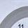
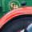
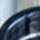
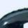

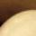
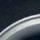

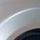
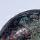
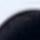
:::
:::
::: {.column width="52%"}
[2 · Visualización por optimización]{.titulo-tarjeta}

Partimos de **ruido** y cambiamos los **píxeles** con ascenso de gradiente para que la neurona se active al máximo (¡los pesos quedan fijos!):

$$
\mathbf{x} \leftarrow \mathbf{x} + \eta\,\frac{\partial\, a_{379}(\mathbf{x})}{\partial \mathbf{x}}
$$

:::: {.columns}
::: {.column width="40%"}
{width="230" .redondeada fig-alt="Visualización de la neurona 3b:379: curvas orientadas"}
:::
::: {.column width="60%"}
::: {.caja .pequeno}
Las dos maneras coinciden: es un **detector de curvas** con una orientación concreta. Los ejemplos reales muestran **qué** la activa en la práctica; la optimización muestra **lo que más** la activa, sin distracciones.
:::
:::
::::
:::
::::

::: {.credito}
Cammarata, N. *et al.* (2020). Curve Detectors. *Distill*. doi:10.23915/distill.00024.003. · Olah, C. *et al.* (2020). An Overview of Early Vision in InceptionV1. *Distill*. Imágenes CC BY 4.0.
:::

## Circuitos dentro de la red {.compacta}

[De bordes a círculos: cada capa combina las características de la anterior (neuronas reales de GoogLeNet)]{.titulo-tarjeta}

::: {.cadena-circuito}
::: {.etapa}
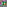 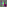

**Bordes** (capa 1)
:::
::: {.flecha-c}
→
:::
::: {.etapa}
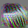 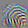

**Líneas y curvas pequeñas** (capa 3)
:::
::: {.flecha-c}
→
:::
::: {.etapa}
 

**Curvas** (capa 4)
:::
::: {.flecha-c}
→
:::
::: {.etapa}
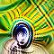 

**Círculos** (capa 5)
:::
:::

::: {style="height: 0.9em;"}
:::

:::: {.columns}
::: {.column width="47%"}
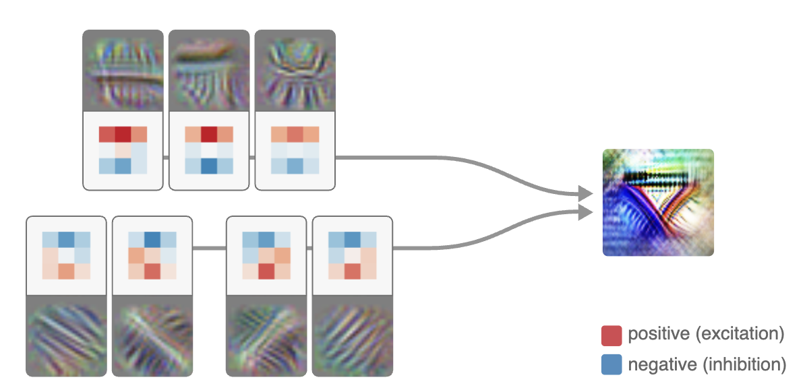{width="100%" fig-alt="Detectores de líneas horizontales y diagonales se combinan en un detector de triángulos"}

::: {.muy-pequeno}
Un **detector de triángulos** real: detectores de líneas **horizontales** (arriba) y **diagonales** (abajo) se conectan con pesos positivos (rojo) y negativos (azul).
:::
:::
::: {.column width="53%"}
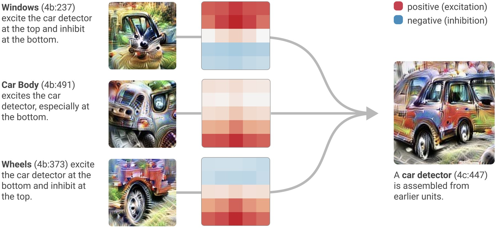{height="270"}

::: {.muy-pequeno}
**Hipótesis de los circuitos** (Olah *et al.*, 2020): las **características** se conectan mediante pesos formando **circuitos** que podemos leer, y los mismos circuitos aparecen en **distintas redes**.
:::
:::
::::

::: {.credito}
Olah, C. *et al.* (2020). Zoom In: An Introduction to Circuits; An Overview of Early Vision in InceptionV1. *Distill*. Figuras CC BY 4.0.
:::

## Neuronas multimodales {.compacta}

:::: {.columns}
::: {.column width="47%"}
[Neuronas de **emociones** en CLIP (imagen + texto)]{.titulo-tarjeta}

::: {.tabla-emociones}
| | cara | cuerpo | texto |
|---|:---:|:---:|:---:|
| **tristeza / llanto** |  |  | 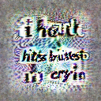 |
| **felicidad** | 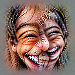 | 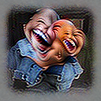 | 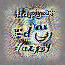 |
| **sorpresa** | 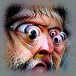 | 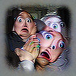 | 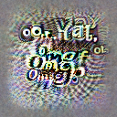 |
| **sueño** | 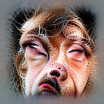 |  | 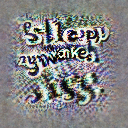 |
:::
:::
::: {.column width="53%"}
- **CLIP** (OpenAI, 2021) aprendió a relacionar imágenes con su texto. Una misma neurona responde a una emoción en **caras**, en **lenguaje corporal** y en **palabras escritas**
- Cada cuadro: la imagen que más activa la neurona, optimizada para parecerse a una cara, a una pose o a un texto

```{python}
# Esquema de una «neurona de concepto» del lóbulo temporal medial humano (Quiroga et al., 2005)
estimulos = [("fotos de<br>Halle Berry", 13), ("caricatura<br>de ella", 9), ("su nombre<br>escrito", 11), ("otras<br>personas", 1)]
fig = go.Figure()
rng_q = np.random.default_rng(8)
for k, (texto, n) in enumerate(estimulos):
    cx = k * 2.3
    color = ENCAJE if k < 3 else REJILLA
    fig.add_shape(type="rect", x0=cx - 0.95, x1=cx + 0.95, y0=0.2, y1=1.35, fillcolor=color, line=dict(color=ARTICO, width=2))
    fig.add_annotation(x=cx, y=0.78, text=f"<b>{texto}</b>" if k == 2 else texto, showarrow=False,
                       font=dict(size=15, color=PAVO_REAL, family="monospace" if k == 2 else None))
    for tt in np.sort(rng_q.uniform(cx - 0.9, cx + 0.9, n)):
        fig.add_shape(type="line", x0=tt, x1=tt, y0=-0.55, y1=-0.05, line=dict(color=PAVO_REAL, width=2))
    fig.add_shape(type="line", x0=cx - 1, x1=cx + 1, y0=-0.55, y1=-0.55, line=dict(color=ARTICO, width=1))
fig.add_annotation(x=-1.15, y=-0.3, text="pulsos de<br>la neurona", showarrow=False, xanchor="right", font=dict(size=13, color=GRIS))
fig.update_layout(xaxis=dict(visible=False, range=[-2.4, 8.0]), yaxis=dict(visible=False, range=[-0.8, 1.5]),
                  plot_bgcolor="rgba(0,0,0,0)", margin=dict(l=0, r=0, t=0, b=0))
mostrar(fig, 760, 230)
```

::: {.pequeno}
¡En el cerebro humano también! Registrando neuronas individuales en pacientes, Quiroga *et al.* (2005) hallaron **neuronas de concepto**: una respondía a distintas fotos de **Jennifer Aniston**, y otra a fotos de **Halle Berry**, a su caricatura **y a su nombre escrito** (esquema arriba). [Más en la sesión de neurociencia con **Joshua Lemus**]{.adelante}
:::
:::
::::

::: {.credito}
Goh, G. *et al.* (2021). Multimodal Neurons in Artificial Neural Networks. *Distill*. doi:10.23915/distill.00030. Imágenes CC BY 4.0. · Quiroga, R. Q. *et al.* (2005). Invariant visual representation by single neurons in the human brain. *Nature* 435, 1102–1107 (esquema propio, no son sus datos).
:::

## Una advertencia: ejemplos adversarios {.compacta}

```{python}
adv = cargar("adversario.json")
trad_imagenet = {"macaw": "guacamaya", "lorikeet": "lori", "bee eater": "abejaruco", "mushroom": "hongo",
                 "agaric": "agárico (hongo)", "bolete": "boleto (hongo)"}
def barras(pred, color):
    fig = go.Figure(go.Bar(x=[p for _, p in pred][::-1], y=[trad_imagenet.get(c, c) for c, _ in pred][::-1], orientation="h",
                           marker=dict(color=color), text=[f"{p:.0%}" for _, p in pred][::-1], textposition="outside",
                           textfont=dict(size=18), hovertemplate="%{y}: %{x:.1%}<extra></extra>"))
    fig.update_layout(xaxis=dict(range=[0, 1.25], visible=False), margin=dict(l=170, r=10, t=10, b=10), showlegend=False)
    mostrar(fig, 470, 200)
```

:::: {.columns}
::: {.column width="33%"}
**Foto original**

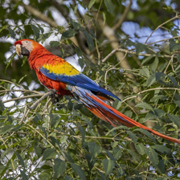{width="330"}

```{python}
barras(adv["pred_original"], ABETO)
```
:::
::: {.column width="33%"}
**\+ un "ruido" diminuto** (amplificado ×64 para verlo)

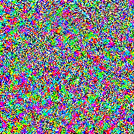{width="330"}

::: {.pequeno}
Cada píxel cambia como máximo **2/255**: invisible para nosotros.
:::
:::
::: {.column width="33%"}
**= imagen modificada**

{width="330"}

```{python}
barras(adv["pred_adversaria"], CORAL)
```
:::
::::

::: {.pequeno}
Cálculo propio con una ResNet-18 preentrenada en ImageNet y el método del gradiente (FGSM iterado; Goodfellow, Shlens y Szegedy, 2015): calculamos **hacia dónde** cambiar cada píxel para que la red diga "hongo". Las redes no "ven" como nosotros: esto importa en autos autónomos, medicina y seguridad.
:::

::: {.credito}
Foto: Charles J. Sharp, *Scarlet macaw (Ara macao cyanopterus), Copán*, Wikimedia Commons, CC BY-SA 4.0 (recortada y modificada).
:::

# Autocodificadores {background-color="#053229" .seccion}

Aprender a comprimir… y a reconstruir

## La idea {.compacta}

:::: {.columns}
::: {.column width="55%"}
```{python}
fig = go.Figure()
formas = [(0, 3.0, ARTICO, "entrada x<br>(28×28 = 784)"), (1.3, 2.0, ZAFIRO, "codificador"),
          (2.6, 0.6, CORAL, "código z<br>(¡2 números!)"), (3.9, 2.0, ZAFIRO, "decodificador"),
          (5.2, 3.0, ARTICO, "reconstrucción x̂")]
for x, h, color, t in formas:
    fig.add_shape(type="rect", x0=x - 0.4, x1=x + 0.4, y0=-h / 2, y1=h / 2, fillcolor=color, line=dict(color="white", width=2))
    fig.add_annotation(x=x, y=-h / 2 - 0.35, text=f"<b>{t}</b>", showarrow=False, font=dict(size=17), yanchor="top")
for x0, x1 in [(0.4, 0.9), (1.7, 2.2), (3.0, 3.5), (4.3, 4.8)]:
    fig.add_annotation(x=x1, y=0, ax=x0, ay=0, xref="x", yref="y", axref="x", ayref="y", showarrow=True,
                       arrowhead=3, arrowwidth=3, arrowcolor=GRIS, text="")
fig.update_layout(xaxis=dict(visible=False, range=[-0.6, 5.8]), yaxis=dict(visible=False, range=[-2.6, 1.8]),
                  plot_bgcolor="rgba(0,0,0,0)", margin=dict(l=0, r=0, t=0, b=0))
mostrar(fig, 860, 340)
```
$$
L = \lVert \mathbf{x} - \hat{\mathbf{x}} \rVert^2 \quad\text{(¡no necesita etiquetas!)}
$$
:::
::: {.column width="45%"}
- El **cuello de botella** obliga a la red a guardar solo lo **esencial**
- Es aprendizaje **no supervisado / autosupervisado**
- Usos:
  - **Comprimir** y reducir dimensionalidad (un "PCA no lineal")
  - **Quitar ruido** (*denoising*)
  - **Detectar anomalías**: lo que no se reconstruye bien es raro (¡búsqueda de física nueva en el LHC!)
  - **Generar** datos nuevos (autocodificadores variacionales, Kingma y Welling, 2013)
:::
::::

## El espacio latente de un autocodificador

```{python}
z = np.array(ae["z"])
etq = np.array(ae["etiquetas"])
rej = np.array(ae["rejilla"])
n = ae["n"]
g0, g1 = ae["rejilla_ejes"]
mosaico = np.zeros((n * 28, n * 28))
for idx in range(n * n):
    fila, col = divmod(idx, n)
    mosaico[(n - 1 - fila) * 28:(n - fila) * 28, col * 28:(col + 1) * 28] = rej[idx].reshape(28, 28)
fig = make_subplots(rows=1, cols=2, column_widths=[0.52, 0.48], horizontal_spacing=0.06,
                    subplot_titles=["Cada imagen de prueba, comprimida a 2 números (z₁, z₂)",
                                    "Lo que «imagina» el decodificador en cada punto"])
colores10 = [ABETO, CORAL, ZAFIRO, PISTACHO, PAVO_REAL, CORAL_OSCURO, SALVIA, GRIS, CHICLE, ARTICO]
for d in range(10):
    m = etq == d
    fig.add_trace(go.Scatter(x=z[m, 0], y=z[m, 1], mode="text", text=[str(d)] * m.sum(), name=str(d),
                             textfont=dict(size=12, color=colores10[d]), hovertemplate=f"dígito {d}<extra></extra>"), 1, 1)
fig.add_trace(go.Heatmap(z=mosaico[::-1], colorscale=GRISES, zmin=0, zmax=255, showscale=False, hoverinfo="skip"), 1, 2)
lo0, hi0, lo1, hi1 = g0[0], g0[-1], g1[0], g1[-1]
fig.add_shape(type="rect", x0=lo0, x1=hi0, y0=lo1, y1=hi1, line=dict(color=PAVO_REAL, width=2, dash="dot"), row=1, col=1)
fig.update_xaxes(title_text="z₁", row=1, col=1)
fig.update_yaxes(title_text="z₂", row=1, col=1)
fig.update_xaxes(visible=False, row=1, col=2)
fig.update_yaxes(visible=False, scaleanchor="x2", row=1, col=2)
fig.update_layout(showlegend=False, margin=dict(t=50, b=10))
fig.update_annotations(font_size=17)
mostrar(fig, 1500, 700)
```

::: {.pequeno}
Sin ver ninguna etiqueta, el autocodificador **agrupa** dígitos parecidos (¡como el *clustering* con Alex Rodriguez!). A la derecha: decodificamos una rejilla de puntos del recuadro punteado. Moverse en el espacio latente **transforma** un dígito en otro.
:::

## Reconstrucciones

```{python}
orig = ae["originales"]
rec = ae["reconstrucciones"]
fig = make_subplots(rows=2, cols=8, horizontal_spacing=0.01, vertical_spacing=0.06)
for k in range(8):
    fig.add_trace(go.Heatmap(z=orig[k], colorscale=GRISES, showscale=False, hoverinfo="skip"), 1, k + 1)
    fig.add_trace(go.Heatmap(z=rec[k], colorscale=GRISES, showscale=False, hoverinfo="skip"), 2, k + 1)
for i in range(1, 17):
    fig.layout[f"xaxis{'' if i == 1 else i}"].update(visible=False)
    fig.layout[f"yaxis{'' if i == 1 else i}"].update(visible=False, autorange="reversed", scaleanchor=f"x{'' if i == 1 else i}")
fig.add_annotation(x=-0.01, y=0.78, xref="paper", yref="paper", text="<b>original</b>", showarrow=False, xanchor="right", font=dict(size=18))
fig.add_annotation(x=-0.01, y=0.22, xref="paper", yref="paper", text="<b>reconstruida<br>desde 2 números</b>", showarrow=False,
                   xanchor="right", font=dict(size=18))
fig.update_layout(margin=dict(l=190, r=0, t=10, b=0))
mostrar(fig, 1450, 430)
```

::: {.caja .pequeno}
Con solo 2 números la reconstrucción es borrosa: hay un **compromiso** entre compresión y fidelidad. En la práctica se usan códigos de decenas o cientos de dimensiones. Los generadores de imágenes como Stable Diffusion o Z-Image trabajan en el **espacio latente** de un autocodificador.
:::

# Datos, ética y aplicaciones {background-color="#053229" .seccion}

Con qué se entrenan estas redes, y para qué se usan

## Conjuntos de datos abiertos para entrenar {.compacta}

::: {.rejilla-datos}
::: {.tarjeta-datos}
[MNIST]{.nombre-datos} [70 000]{.numero-datos}

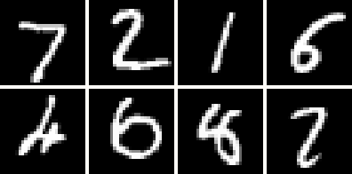{fig-alt="Ejemplos de MNIST"}

[dígitos escritos a mano]{.desc-datos}
:::
::: {.tarjeta-datos}
[EMNIST letras]{.nombre-datos} [145 600]{.numero-datos}

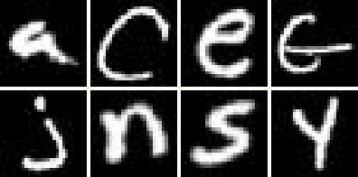{fig-alt="Ejemplos de EMNIST letras"}

[letras escritas a mano]{.desc-datos}
:::
::: {.tarjeta-datos}
[Fashion-MNIST]{.nombre-datos} [70 000]{.numero-datos}

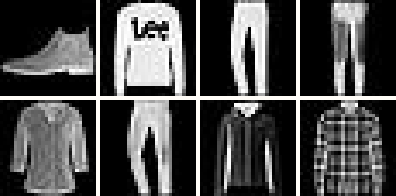{fig-alt="Ejemplos de Fashion-MNIST"}

[ropa y calzado]{.desc-datos}
:::
::: {.tarjeta-datos}
[MedMNIST v2]{.nombre-datos} [708 069]{.numero-datos}

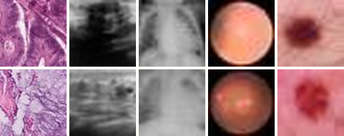{fig-alt="Ejemplos de MedMNIST v2"}

[imágenes médicas: histología, rayos X, mama, retina, piel]{.desc-datos}
:::
::: {.tarjeta-datos}
[CIFAR-10 / 100]{.nombre-datos} [60 000]{.numero-datos}

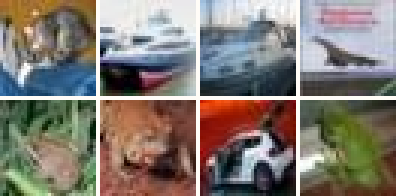{fig-alt="Ejemplos de CIFAR-10 / 100"}

[fotos pequeñas (32×32) de 10 o 100 clases]{.desc-datos}
:::
::: {.tarjeta-datos}
[ImageNet]{.nombre-datos} [1.3 millones]{.numero-datos}

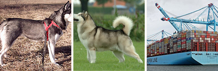{fig-alt="Ejemplos de ImageNet"}

[(14 millones en la versión completa) · 1000 categorías]{.desc-datos}
:::
::: {.tarjeta-datos}
[MS COCO]{.nombre-datos} [330 000]{.numero-datos}

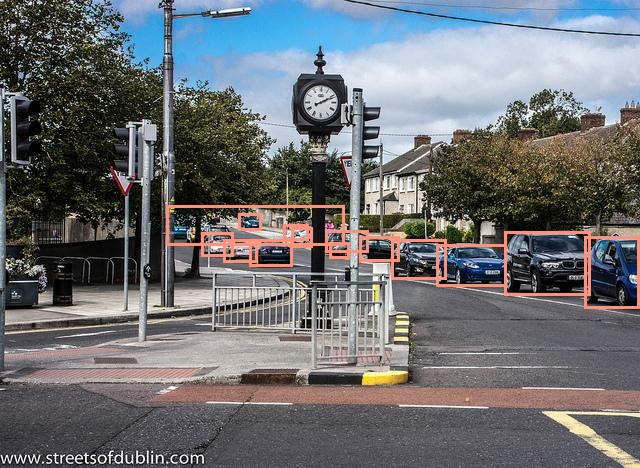{fig-alt="Foto de COCO con las cajas de los autos anotados"}

[detección y segmentación: 1.5 millones de objetos en 80 categorías (aquí, los **autos** anotados)]{.desc-datos}
:::
::: {.tarjeta-datos}
[LAION-5B]{.nombre-datos} [5 850 millones]{.numero-datos}

::: {.pares-laion}
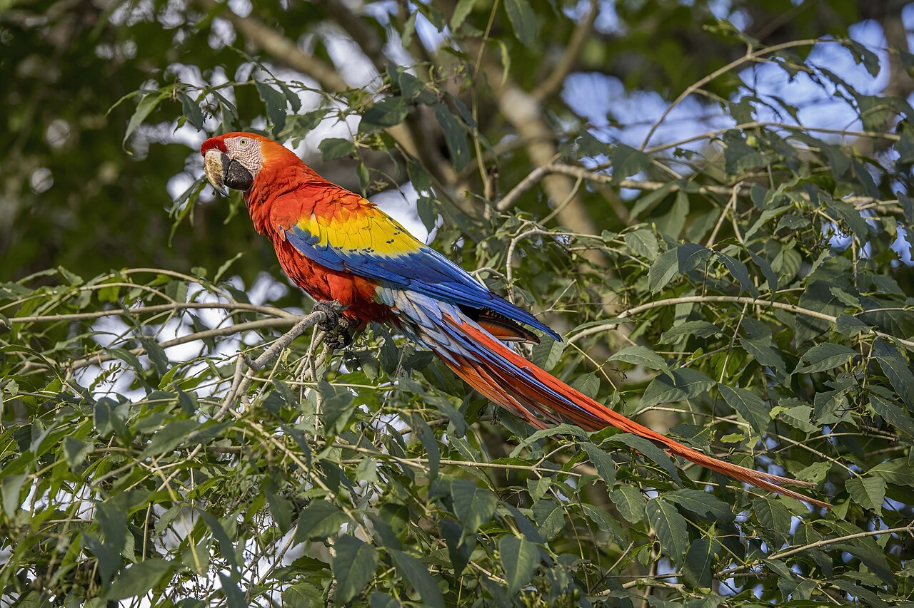{fig-alt="Foto de una guacamaya"}

«scarlet macaw perched on a branch, copán, honduras»

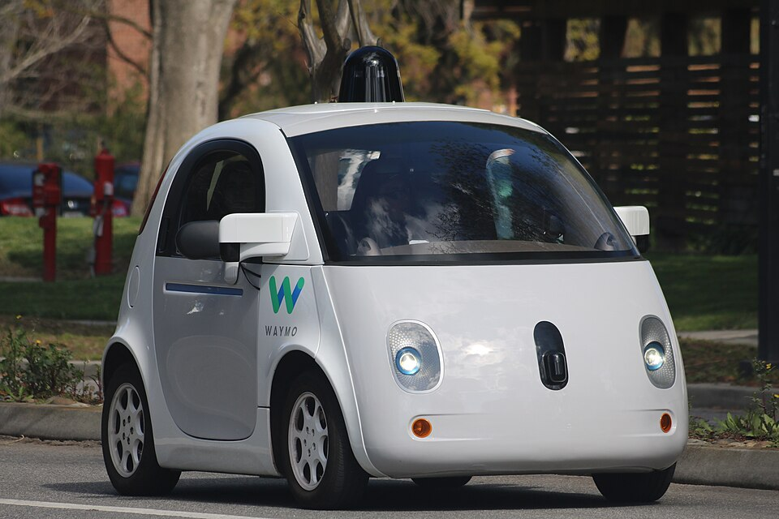{fig-alt="Foto de un auto autónomo"}

«white self-driving car parked on a city street»
:::

[pares **imagen + texto** extraídos de internet (ilustración del formato)]{.desc-datos}
:::
:::

::: {.credito}
LeCun *et al.* (1998); Cohen *et al.* (2017) EMNIST; Xiao *et al.* (2017); Yang *et al.* (2023) *Scientific Data* 10, 41; Krizhevsky (2009); Deng *et al.* (2009), Russakovsky *et al.* (2015); Lin *et al.* (2014) COCO, imagen 175438 con sus anotaciones; Schuhmann *et al.* (2022). Ejemplos de cada conjunto (muestras de validación o prueba); ImageNet y LAION ilustrados con fotos de Wikimedia Commons.
:::

## Ética: ¿de dónde salen las imágenes? {.compacta}

:::: {.columns}
::: {.column width="56%" .texto-etica}
[Artistas sin consentimiento]{.titulo-tarjeta}

- LAION-5B se armó **descargando imágenes de internet** sin pedir permiso: obras de artistas, fotos de bancos de imágenes, incluso fotos médicas privadas
- Los generadores de imágenes imitan el **estilo** de artistas vivos que nunca dieron su consentimiento ni reciben pago

[Demandas por derechos de autor]{.titulo-tarjeta}

- **Andersen y otros vs. Stability AI, Midjourney y DeviantArt** (EE. UU., 2023): demanda colectiva de artistas, sigue en curso
- **Getty Images vs. Stability AI** (EE. UU. y Reino Unido, 2023): millones de fotos usadas, ¡a veces con la marca de agua visible en las imágenes generadas!

[Tus fotos en redes sociales]{.titulo-tarjeta}

- **Clearview AI** extrajo decenas de miles de millones de fotos de redes sociales para un buscador de caras vendido a la policía; multas de 20–30 millones de euros en Europa
- Meta entrena sus modelos con publicaciones **públicas** de Facebook e Instagram
:::
::: {.column width="44%"}
[Sesgo en el reconocimiento facial]{.titulo-tarjeta}

```{python}
# Gender Shades (Buolamwini y Gebru, 2018): error al clasificar el género, por grupo
sistemas = ["Microsoft", "Face++", "IBM"]
mujeres_oscuras = [20.8, 34.5, 34.7]
hombres_claros = [0.0, 0.8, 0.3]
fig = go.Figure()
fig.add_trace(go.Bar(x=sistemas, y=hombres_claros, name="hombres de piel clara", marker_color=ARTICO,
                     text=[f"{v}%" for v in hombres_claros], textposition="outside", textfont=dict(size=17)))
fig.add_trace(go.Bar(x=sistemas, y=mujeres_oscuras, name="mujeres de piel oscura", marker_color=CORAL,
                     text=[f"{v}%" for v in mujeres_oscuras], textposition="outside", textfont=dict(size=17)))
fig.update_layout(yaxis=dict(title="error (%)", range=[0, 42]), barmode="group", legend=dict(x=0, y=1.12, orientation="h"),
                  margin=dict(l=10, r=10, t=40, b=10))
mostrar(fig, 660, 380)
```

::: {.pequeno}
Los datos de entrenamiento tenían **pocas** caras de piel oscura. En EE. UU., varias personas afroamericanas fueron **arrestadas por error** por un reconocimiento facial equivocado (p. ej. Robert Williams, Detroit, 2020).
:::
:::
::::

::: {.credito}
Buolamwini, J. & Gebru, T. (2018). Gender Shades. *FAT\**. · Grother, P. *et al.* (2019). NIST FRVT Part 3: Demographic Effects. · Andersen v. Stability AI, N.D. Cal. 3:23-cv-00201 · Getty Images v. Stability AI (D. Del. 2023; High Court of England and Wales 2023).
:::

## Aplicaciones {.compacta}

::: {.rejilla-apps}
::: {.tarjeta-app}
[Detección de objetos]{.titulo-tarjeta}

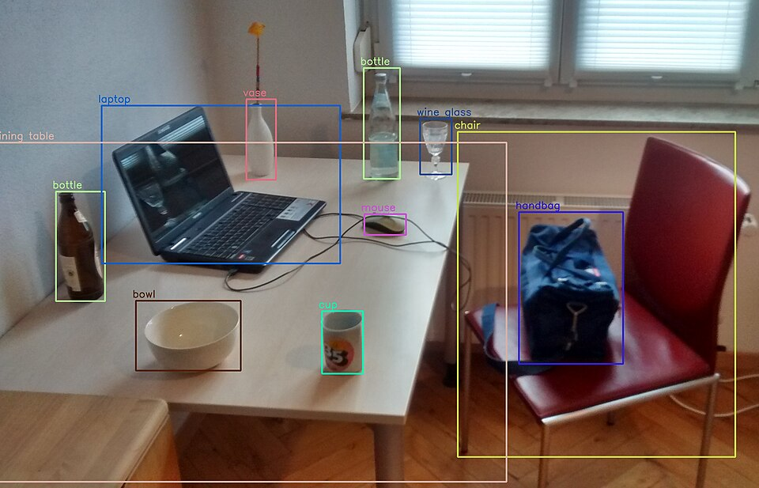{fig-alt="Detección de objetos"}
:::
::: {.tarjeta-app}
[Reconocimiento facial]{.titulo-tarjeta}

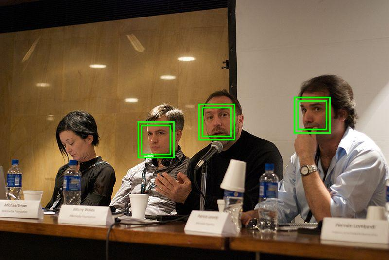{fig-alt="Reconocimiento facial"}
:::
::: {.tarjeta-app}
[Conducción autónoma]{.titulo-tarjeta}

{fig-alt="Conducción autónoma"}
:::
::: {.tarjeta-app}
[Segmentación de objetos]{.titulo-tarjeta}

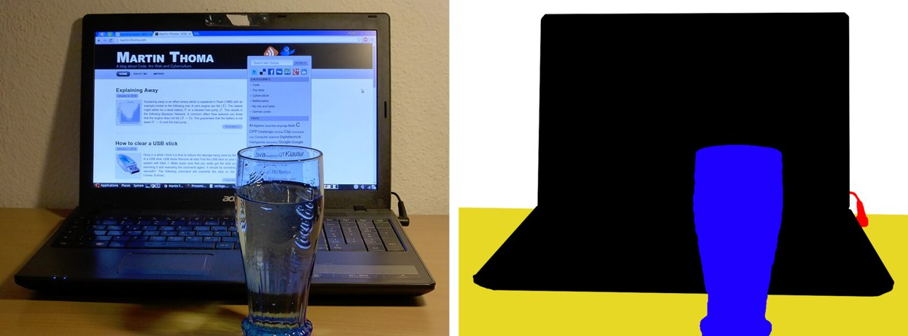{fig-alt="Foto de una mesa con laptop y vaso, junto a su máscara de segmentación por colores"}
:::
::: {.tarjeta-app}
[Medicina]{.titulo-tarjeta}

{fig-alt="Medicina"}
:::
::: {.tarjeta-app}
[Lectura de texto (OCR)]{.titulo-tarjeta}

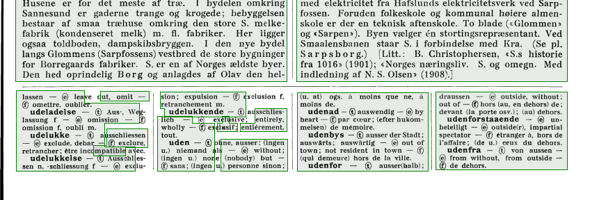{fig-alt="Lectura de texto (OCR)"}
:::
:::

::: {.credito}
Fotos (Wikimedia Commons): detección con YOLO, MTheiler, CC BY-SA 4.0; detección de caras, CC BY 3.0; auto de Waymo, Grendelkhan, CC BY-SA 4.0; segmentación (foto y máscara), MartinThoma, CC0; mamografía, National Cancer Institute, dominio público; segmentación de texto con OCR, LA2, CC0.
:::

## Para llevar a casa

::: {style="max-width: 78%;"}
::: {.incremental}
- Una **convolución** desliza un filtro pequeño sobre la imagen: conexiones **locales**, pesos **compartidos** y **muchos** filtros → muchos menos parámetros que un perceptrón multicapa
- Apilando convoluciones y *pooling*, la red aprende una **jerarquía**: bordes → texturas → partes → objetos
- Podemos **abrir la caja negra**: visualizar qué activa a cada neurona y leer los **circuitos** que forman
- Las redes **no ven como nosotros**: un ruido invisible (ejemplo adversario) puede engañarlas
- Los **autocodificadores** comprimen sin etiquetas y aprenden un **espacio latente** útil para generar
- Los **datos** importan: de dónde vienen, con qué permiso y a quién representan (¡o no!)
:::
:::

::: {.absolute bottom="0" right="0" width="200" style="text-align: center;"}
{width="180" fig-alt="Código QR que lleva a edithvillegas.github.io"}

::: {.qr-url style="font-size: 0.45em;"}
[edithvillegas.github.io](https://edithvillegas.github.io)
:::
:::
