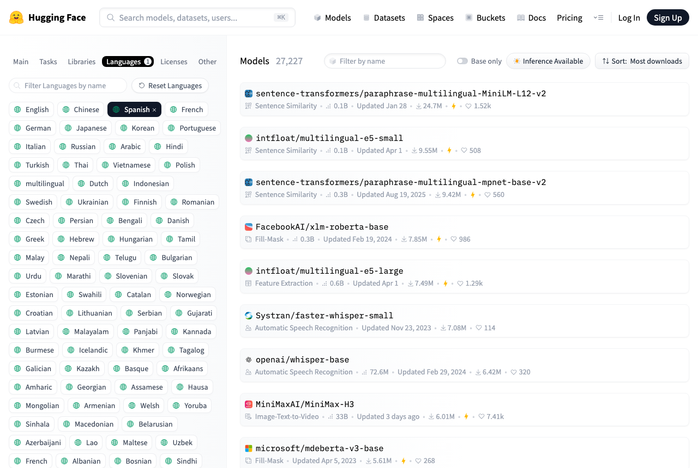

```{python}
from graficas import *
```

## Plan de la sesión

:::: {.columns}
::: {.column width="50%"}
1. Estas diapositivas
2. Notebook *06 · Hugging Face*:
   - Python en 5 minutos
   - PyTorch: tensores y *autograd*
   - Modelos listos para usar con `pipeline`
   - **Ajustar** BETO para clasificar reseñas en español
   - **Crear** un GPT diminuto que escribe como Cervantes
   - (Opcional) compartir tu modelo con una demo de Gradio
:::
::: {.column width="50%"}
::: {.definicion}
**Antes de empezar**

1. Abran el notebook desde la página del curso → **Abrir en Colab**
2. *Archivo → Guardar una copia en Drive*
3. *Entorno de ejecución → Cambiar tipo de entorno → GPU T4*
4. Ejecuten las celdas en orden. ¡Los errores son normales! Lean el mensaje: casi siempre dice qué pasó.
:::
:::
::::

## Python en una diapositiva

:::: {.columns}
::: {.column width="50%"}
```python
# Variables y tipos
nombre = "Tegucigalpa"        # str
altitud = 990                 # int (metros)
poblacion = 1.3e6             # float
es_capital = True             # bool

# Listas y diccionarios
dias = ["lunes", "martes", "miércoles"]
dias[0]                       # 'lunes'
dias[-1]                      # 'miércoles'
capitales = {"Honduras": "Tegucigalpa",
             "Perú": "Lima"}
capitales["Perú"]             # 'Lima'
```
:::
::: {.column width="50%"}
```python
# Control de flujo y funciones
def saludo(nombre, idioma="es"):
    if idioma == "es":
        return f"¡Hola, {nombre}!"
    return f"Hello, {nombre}!"

for d in dias:
    print(saludo(d))

# Comprensión de listas
largos = [len(d) for d in dias]          # [5, 6, 9]
pares = [n for n in range(10) if n % 2 == 0]
```
:::
::::

[Python a fondo: sesiones con **Daniela Pinto**]{.adelante}

## PyTorch: NumPy + GPU + derivadas automáticas

:::: {.columns}
::: {.column width="46%"}
```python
import torch

x = torch.tensor([[1., 2.], [3., 4.]])
x.shape                     # torch.Size([2, 2])
x @ x.T                     # producto de matrices
x.to("cuda")                # ¡a la GPU!

# Autograd: retropropagación automática
w = torch.tensor(1.0, requires_grad=True)
f = (3 * w - 6) ** 2
f.backward()
w.grad                      # df/dw = 6(3w − 6) = −18
```
:::
::: {.column width="54%"}
```{python}
fig = make_subplots(rows=1, cols=2, horizontal_spacing=0.08,
                    subplot_titles=["<b>CPU</b>: pocos núcleos muy capaces", "<b>GPU</b>: miles de núcleos sencillos"])
# CPU: 4 núcleos grandes + caché
for k, (x0, y0) in enumerate([(0, 0.55), (0.52, 0.55), (0, 0.1), (0.52, 0.1)]):
    fig.add_shape(type="rect", x0=x0, x1=x0 + 0.44, y0=y0, y1=y0 + 0.37, fillcolor=CORAL, line=dict(width=0), xref="x", yref="y")
    fig.add_annotation(x=x0 + 0.22, y=y0 + 0.185, text="núcleo", showarrow=False, font=dict(size=16, color=texto_sobre(CORAL)), xref="x", yref="y")
fig.add_shape(type="rect", x0=0, x1=0.96, y0=-0.3, y1=0.03, fillcolor=ARTICO, line=dict(width=0), xref="x", yref="y")
fig.add_annotation(x=0.48, y=-0.135, text="caché y control", showarrow=False, font=dict(size=16, color=ABETO), xref="x", yref="y")
# GPU: rejilla de núcleos pequeños
n = 16
for i in range(n):
    for j in range(n - 3):
        fig.add_shape(type="rect", x0=i / n, x1=i / n + 0.8 / n, y0=-0.3 + j * 1.22 / (n - 3), y1=-0.3 + j * 1.22 / (n - 3) + 0.75 / n,
                      fillcolor=ZAFIRO, line=dict(width=0), xref="x2", yref="y2")
for c in ["1", "2"]:
    fig.update_xaxes(visible=False, range=[-0.03, 1.0], row=1, col=int(c))
    fig.update_yaxes(visible=False, range=[-0.35, 0.97], row=1, col=int(c))
fig.update_annotations(selector=dict(text="<b>CPU</b>: pocos núcleos muy capaces"), font=dict(size=19))
fig.update_annotations(selector=dict(text="<b>GPU</b>: miles de núcleos sencillos"), font=dict(size=19))
fig.update_layout(plot_bgcolor="rgba(0,0,0,0)", margin=dict(l=5, r=5, t=40, b=5))
mostrar(fig, 800, 330)
```

::: {.pequeno}
- **CPU**: hace tareas distintas, una tras otra, muy rápido.
- **GPU**: hace la **misma operación sencilla** sobre miles de números **a la vez**. Una red neuronal es casi solo multiplicar matrices, así que en GPU entrena decenas de veces más rápido.
:::
:::
::::

## PyTorch: un modelo es una clase `nn.Module`

:::: {.columns}
::: {.column width="48%"}
```python
import torch.nn as nn

modelo = nn.Sequential(
    nn.Linear(784, 128), nn.ReLU(),
    nn.Linear(128, 10))

opt = torch.optim.Adam(modelo.parameters(), lr=1e-3)
for x, y in datos:
    perdida = nn.functional.cross_entropy(modelo(x), y)
    opt.zero_grad()
    perdida.backward()
    opt.step()
```

::: {.pequeno}
- `nn.Linear(784, 128)`: cada una de las 128 neuronas se conecta con los 784 píxeles (28 × 28) → 784 × 128 pesos + 128 sesgos
- `nn.ReLU()`: la activación entre capas
- 10 salidas: una por dígito (0–9)
:::
:::
::: {.column width="52%"}
```{python}
capas = [("Entrada", "784 píxeles", 9, ARTICO), ("Oculta + ReLU", "128 neuronas", 7, ZAFIRO), ("Salida", "10 dígitos", 10, CORAL)]
xs = [0, 1, 2]
fig = go.Figure()
pos = []
for (nom, sub, k, c), x in zip(capas, xs):
    ys = np.linspace(0.92, 0.08, k)
    pos.append(ys if k == 10 else np.delete(ys, k // 2))   # hueco para «⋮»
for a in range(2):
    for y0 in pos[a]:
        for y1 in pos[a + 1]:
            fig.add_trace(go.Scatter(x=[xs[a], xs[a + 1]], y=[y0, y1], mode="lines",
                                     line=dict(color=REJILLA if a == 0 else ARTICO, width=1), hoverinfo="skip", showlegend=False))
for (nom, sub, k, c), x, ys in zip(capas, xs, pos):
    fig.add_trace(go.Scatter(x=[x] * len(ys), y=ys, mode="markers", marker=dict(size=26, color=c, line=dict(color=ABETO, width=1.5)),
                             hoverinfo="skip", showlegend=False))
    fig.add_annotation(x=x, y=1.06, text=f"<b>{nom}</b>", showarrow=False, font=dict(size=19, color=ABETO))
    fig.add_annotation(x=x, y=-0.04, text=sub, showarrow=False, font=dict(size=17, color=GRIS))
# puntos suspensivos: capas que no caben enteras
for x in [0, 1]:
    fig.add_annotation(x=x, y=0.5, text="⋮", showarrow=False, font=dict(size=34, color=ABETO))
for i, y in enumerate(pos[2]):
    fig.add_annotation(x=2.13, y=y, text=str(i), showarrow=False, font=dict(size=15, color=GRIS), xanchor="left")
fig.add_annotation(x=0.5, y=-0.13, text="784 × 128 pesos", showarrow=False, font=dict(size=15, color=GRIS))
fig.add_annotation(x=1.5, y=-0.13, text="128 × 10 pesos", showarrow=False, font=dict(size=15, color=GRIS))
fig.update_layout(xaxis=dict(visible=False, range=[-0.25, 2.3]), yaxis=dict(visible=False, range=[-0.18, 1.12]),
                  plot_bgcolor="rgba(0,0,0,0)", margin=dict(l=0, r=0, t=0, b=0))
mostrar(fig, 760, 620)
```

::: {.credito}
Dibujo simplificado: solo se muestran algunas neuronas de la entrada y de la capa oculta (⋮).
:::
:::
::::

## Hugging Face: el "GitHub" de los modelos {.compacta}

:::: {.columns}
::: {.column width="50%"}
- **Hub**: millones de **modelos**, **datos** y **demos** (*Spaces*) abiertos. ¡Las demos de la primera clase eran Spaces!
- Bibliotecas: `transformers` (modelos), `datasets` (datos), `gradio` (demos web)
- Cada modelo tiene una **tarjeta**: datos de entrenamiento, uso, **licencia**, limitaciones y sesgos

::: {.caja}
**Modelos en español en el Hub**

- **BETO**: BERT en español (U. de Chile)
- **RoBERTuito**, **pysentimiento**: redes sociales en español (U. de Buenos Aires)
- **MarIA**: español (Barcelona Supercomputing Center)
:::
:::
::: {.column width="50%"}
::: {.ventana-web}
::: {.barra-web}
[●]{.punto-rojo} [●]{.punto-amarillo} [●]{.punto-verde} [huggingface.co/models?language=es]{.url-web}
:::
[](https://huggingface.co/models?language=es&sort=downloads){target="_blank"}
:::

::: {.credito}
Clic en la imagen para abrir el Hub en una pestaña nueva (huggingface.co no permite incrustarse dentro de otra página).
:::
:::
::::

## Modelos listos para usar: `pipeline`

:::: {.columns}
::: {.column width="55%"}
```python
from transformers import pipeline

sentimiento = pipeline("text-classification",
    model="nlptown/bert-base-multilingual-uncased-sentiment")
sentimiento("¡Me encantó la clase de redes neuronales!")
# [{'label': '5 stars', 'score': 0.89}]

clasificador = pipeline("zero-shot-classification",
    model="MoritzLaurer/mDeBERTa-v3-base-mnli-xnli")
clasificador("El equipo ganó el partido 3 a 1.",
             candidate_labels=["deportes", "política", "ciencia"])
# deportes: 0.67

vision = pipeline("image-classification",
                  model="google/vit-base-patch16-224")
vision("guacamaya.jpg")   # macaw: 0.99
```
:::
::: {.column width="45%"}
| Tarea | Ejemplo |
|---|---|
| `text-classification` | sentimiento, spam |
| `zero-shot-classification` | etiquetas que tú inventas |
| `fill-mask` | adivinar `[MASK]` (BETO) |
| `token-classification` | nombres de personas, lugares |
| `text-generation` | chat, traducción, resúmenes |
| `image-classification` | ¿qué hay en la foto? |
| `automatic-speech-recognition` | voz → texto (Whisper) |

::: {.credito}
Resultados reales de estos modelos (ejecutados al preparar el curso).
:::
:::
::::

## ¿Qué hace `pipeline` por dentro?

```{python}
pasos = [("Texto", "«¡Me encantó la clase!»", ENCAJE), ("Tokenizador", "AutoTokenizer →<br>ids [101, 1325, …]", ABETO),
         ("Modelo", "AutoModelFor… →<br>logits [−2.1, …, 3.4]", CORAL), ("Posprocesamiento", "softmax →<br>«5 estrellas»: 89 %", ZAFIRO)]
fig = go.Figure()
for i, (t, d, c) in enumerate(pasos):
    ct = texto_sobre(c)
    x = i * 1.0
    fig.add_shape(type="rect", x0=x, x1=x + 0.8, y0=0, y1=1, fillcolor=c, line=dict(width=0))
    fig.add_annotation(x=x + 0.4, y=0.72, text=f"<b>{t}</b>", showarrow=False, font=dict(size=21, color=ct))
    fig.add_annotation(x=x + 0.4, y=0.35, text=d, showarrow=False, font=dict(size=17, color=ct))
    if i < 3:
        fig.add_annotation(x=x + 0.98, y=0.5, ax=x + 0.82, ay=0.5, xref="x", yref="y", axref="x", ayref="y",
                           showarrow=True, arrowhead=3, arrowwidth=3, arrowcolor=GRIS, text="")
fig.update_layout(xaxis=dict(visible=False, range=[-0.05, 3.85]), yaxis=dict(visible=False, range=[-0.05, 1.05]),
                  plot_bgcolor="rgba(0,0,0,0)", margin=dict(l=0, r=0, t=0, b=0))
mostrar(fig, 1450, 260)
```

```python
from transformers import AutoTokenizer, AutoModelForSequenceClassification
nombre = "nlptown/bert-base-multilingual-uncased-sentiment"
tokenizador = AutoTokenizer.from_pretrained(nombre)
modelo = AutoModelForSequenceClassification.from_pretrained(nombre)

entrada = tokenizador("¡Me encantó la clase!", return_tensors="pt")
logits = modelo(**entrada).logits
probs = logits.softmax(dim=-1)          # ¡la misma softmax de antes!
```

## Crear tu propio modelo, opción 1: ajuste fino

:::: {.columns}
::: {.column width="50%"}
**Aprendizaje por transferencia** (*transfer learning*):

1. Partir de un modelo **preentrenado** (BETO ya "sabe" español)
2. Cambiar la última capa por una nueva **cabeza** para nuestra tarea
3. **Ajustar** todos los pesos con pocos datos etiquetados

```python
modelo = AutoModelForSequenceClassification.from_pretrained(
    "dccuchile/bert-base-spanish-wwm-cased", num_labels=2)
entrenador = Trainer(model=modelo, args=argumentos,
                     train_dataset=entreno, eval_dataset=prueba,
                     compute_metrics=exactitud)
entrenador.train()
```
:::
::: {.column width="50%"}
::: {.definicion}
**En el notebook:** reseñas de productos de Amazon en español (1–5 estrellas) → **positiva o negativa**.

Con ~4 000 ejemplos y ~2 minutos de GPU llegarán a más de 90 % de exactitud.
:::

::: {.caja-naranja .pequeno}
Pregúntense: ¿de dónde vienen los datos? ¿Funcionará igual con español de Honduras, con voseo, con regionalismos? ¿Con reseñas escritas por personas mayores? **Evalúen por grupo** cuando puedan.
:::
:::
::::

## Crear tu propio modelo, opción 2: un GPT desde cero

```{python}
import html
mg = cargar("minigpt_quijote.json")
curva = np.array(mg["curva"])
pasos_m = [int(k) for k in mg["muestras"]]
fig = make_subplots(rows=1, cols=2, column_widths=[0.42, 0.58], horizontal_spacing=0.06,
                    specs=[[{"type": "xy"}, {"type": "xy"}]],
                    subplot_titles=["Pérdida (entropía cruzada por carácter)", "Texto generado a partir de «En un lugar de la Mancha»"])
titulos_sub = [a.to_plotly_json() for a in fig.layout.annotations]
fig.add_trace(go.Scatter(x=curva[:, 0], y=curva[:, 1], name="entrenamiento", line=dict(color=ABETO, width=3)), 1, 1)
fig.add_trace(go.Scatter(x=curva[:, 0], y=curva[:, 2], name="validación", line=dict(color=CORAL, width=3)), 1, 1)
def texto_muestra(p):
    t = html.escape(mg["muestras"][str(p)]).replace("\n", " ⏎ ")
    lineas, linea = [], ""
    for palabra in t.split(" "):
        if len(linea) + len(palabra) > 52:
            lineas.append(linea)
            linea = ""
        linea += palabra + " "
    lineas.append(linea)
    return "<br>".join(lineas[:9])
pasos = []
for p in pasos_m:
    anot = [dict(x=0.6, y=0.95, xref="paper", yref="paper", text=f"<b>después de {p} pasos</b>", showarrow=False,
                 font=dict(size=18, color=GRIS), xanchor="left"),
            dict(x=0.6, y=0.84, xref="paper", yref="paper", text=texto_muestra(p), showarrow=False, align="left",
                 xanchor="left", yanchor="top", font=dict(size=17, family="JetBrains Mono, monospace", color=PAVO_REAL))]
    forma = [dict(type="line", xref="x", yref="paper", x0=p, x1=p, y0=0, y1=1, line=dict(color=GRIS, dash="dot", width=2))]
    pasos.append(dict(method="relayout", label=str(p), args=[{"annotations": titulos_sub + anot, "shapes": forma}]))
fig.update_layout(annotations=pasos[0]["args"][0]["annotations"],
                  shapes=pasos[0]["args"][0]["shapes"], sliders=deslizador(pasos, prefijo="paso de entrenamiento: "),
                  legend=dict(x=0.25, y=0.98, font=dict(size=15)), margin=dict(t=50))
fig.update_xaxes(title_text="paso", row=1, col=1)
fig.update_yaxes(range=[1, 5], row=1, col=1)
fig.update_xaxes(visible=False, row=1, col=2)
fig.update_yaxes(visible=False, row=1, col=2)
mostrar(fig, 1500, 640)
```

::: {.pequeno}
Entrenamos el mismo código del notebook (un transformer de **833 115** parámetros, 4 capas, 4 cabezas) con los ~2 millones de caracteres de *Don Quijote* (dominio público, Proyecto Gutenberg) en una laptop, sin GPU, durante ~5 minutos. ¡De ruido a algo que *suena* a Cervantes!
:::

## Compartir: demos con Gradio y el Hub

:::: {.columns}
::: {.column width="50%"}
```python
import gradio as gr

def clasificar(texto):
    probs = predecir(texto)            # tu modelo
    return {"negativa": probs[0], "positiva": probs[1]}

gr.Interface(fn=clasificar, inputs="text",
             outputs="label").launch(share=True)
```

Así se construyen los *Spaces* que usamos en la primera clase.

```python
# Subir tu modelo a tu cuenta (opcional)
from huggingface_hub import notebook_login
notebook_login()                       # tu token personal
entrenador.push_to_hub("mi-clasificador-resenas")
```
:::
::: {.column width="50%"}
::: {.caja-naranja}
**Seguridad:** su *token* de Hugging Face es como una contraseña. Nunca lo escriban en un notebook compartido ni lo suban a GitHub.
:::

::: {.definicion}
**Publicar de forma responsable**

- Escriban una **tarjeta del modelo**: datos, uso previsto, limitaciones, sesgos conocidos
- Elijan una **licencia**
- Revisen que los datos no tengan información personal
:::
:::
::::

## ¡A programar! {.compacta}

:::: {.columns}
::: {.column width="55%"}
**Notebook *06 · Python, PyTorch y Hugging Face***

| Sección | Tiempo sugerido |
|---|---|
| 1. Python en 5 minutos | 5 min |
| 2. PyTorch y *autograd* | 10 min |
| 3. Pipelines | 10 min |
| 4. Ajuste fino de BETO | 15 min |
| 5. Mini-GPT del Quijote | 15 min |
| 6. Retos y Gradio | el resto |
:::
::: {.column width="45%"}
::: {.definicion}
**Para seguir aprendiendo (gratis)**

- Curso de Hugging Face (*LLM Course*), con traducciones al español: huggingface.co/learn
- Andrej Karpathy, *Neural Networks: Zero to Hero* (videos; construye un GPT desde cero)
- Tutoriales oficiales de PyTorch: pytorch.org/tutorials
- *Dive into Deep Learning* (d2l.ai), libro interactivo
:::
:::
::::

::: {.fragment .center .grande}
¡Gracias por estas sesiones! Más adelante en la escuela: **aprendizaje en grafos** y **agentes de IA**
:::

::: {.absolute bottom="0" right="0" width="200" style="text-align: center;"}
{width="180" fig-alt="Código QR que lleva a edithvillegas.github.io"}

::: {.qr-url style="font-size: 0.45em;"}
[edithvillegas.github.io](https://edithvillegas.github.io)
:::
:::
