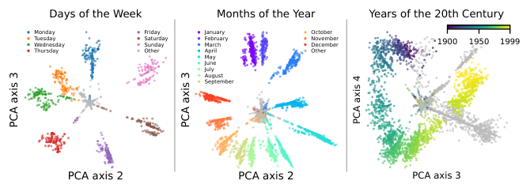

```{python}
from graficas import *
rng = np.random.default_rng(3)
```

## Plan de la sesión

:::: {.columns}
::: {.column width="50%"}
1. ¿Qué es un **modelo de lenguaje**?
2. **Tokens**: cómo lee el texto una red neuronal
3. **Palabras como vectores**: rey − hombre + mujer ≈ reina, y días de la semana en círculo
4. Entrenar sin etiquetas: **palabra enmascarada** y **siguiente palabra**
5. **Atención** y la arquitectura **transformer**
6. ¿Qué pasa **dentro**? Interpretabilidad
7. Antes y después: **RNN**, **Mamba** y otras alternativas
8. Práctica en Colab
:::
::: {.column width="50%"}
::: {.definicion}
**Recuerden:** las redes convolucionales explotan la estructura **espacial** de las imágenes.

**Hoy:** el lenguaje es una **secuencia**, donde el significado de cada palabra depende del **contexto**… a veces muy lejano.
:::
:::
::::

# ¿Qué es un modelo de lenguaje? {background-color="#053229" .seccion}

## Un modelo de lenguaje predice la siguiente palabra

:::: {.columns}
::: {.column width="40%"}
Un **modelo de lenguaje** asigna probabilidades a secuencias de texto:

$$
P(w_1, \dots, w_T) = \prod_{t=1}^{T} P\big(w_t \mid w_1, \dots, w_{t-1}\big)
$$

Para **generar** texto:

1. calcular $P(\text{siguiente} \mid \text{contexto})$
2. elegir un token
3. agregarlo al contexto y **repetir**

::: {.caja .pequeno}
El teclado de su celular hace esto con un modelo pequeño. ChatGPT, Claude y Gemini, con modelos de cientos de miles de millones de parámetros.
:::
:::
::: {.column width="60%"}
```{python}
gen = cargar("generacion_paso_a_paso.json")
fig = go.Figure()
titulos = []
for k, p in enumerate(gen["pasos"]):
    fig.add_trace(go.Bar(x=p["probs"][::-1], y=[c.replace(" ", "␣") for c in p["candidatos"]][::-1], orientation="h",
                         marker=dict(color=[ARTICO] * 4 + [CORAL]), visible=(k == 0),
                         text=[f"{v:.0%}" for v in p["probs"][::-1]], textposition="outside",
                         hovertemplate="«%{y}»: %{x:.1%}<extra></extra>"))
    titulos.append({"title.text": f"«{p['contexto']} <b>___</b>»"})
fig.update_layout(sliders=deslizador(pasos_visibilidad(1, list(range(1, len(gen["pasos"]) + 1)), extras=titulos), prefijo="paso "),
                  title=titulos[0]["title.text"], xaxis=dict(title="probabilidad", tickformat=".0%", range=[0, 1.1]),
                  showlegend=False, margin=dict(l=150, t=80))
mostrar(fig, 900, 600)
```
::: {.credito}
Probabilidades reales de Qwen2.5-0.5B (decodificación voraz: siempre el más probable, en coral).
:::
:::
::::

# Tokens {background-color="#053229" .seccion}

## El texto se corta en *tokens*

```{python}
tk = cargar("tokenizacion.json")
filas = []
for nombre, d in tk["tokenizadores"].items():
    filas.append(f"<tr><td style='width:22%'><b>{nombre}</b></td>"
                 f"<td>{tokens_coloreados(d['es']['piezas'])}<br><span style='font-size:0.6em;color:{GRIS}'>"
                 f"español: <b>{len(d['es']['piezas'])}</b> tokens · la misma frase en inglés: <b>{len(d['en']['piezas'])}</b> tokens</span></td></tr>")
display(HTML("<table style='font-size:0.95em;width:100%'>" + "".join(filas) + "</table>"))
```

::: {.pequeno}
- Los modelos no ven letras ni palabras: ven **tokens** (pedazos frecuentes de palabras), cada uno con un número (su *id*)
- Un tokenizador entrenado sobre todo en inglés necesita **más tokens para el español** → más costo, menos contexto, peor desempeño: un "impuesto" lingüístico (Petrov *et al.*, 2023)
- Por eso a los modelos les cuesta **contar letras**: ¿cuántas "r" hay en "ferrocarril"?
:::

## Pruébenlo: el *Tokenizer Playground*

<iframe class="demo" data-src="https://xenova-the-tokenizer-playground.static.hf.space/index.html" height="640" loading="lazy"></iframe>

::: {.credito}
Xenova, *The Tokenizer Playground* (Hugging Face Spaces, corre en el navegador). Escriban una frase en español y en inglés y comparen tokenizadores.
:::

# Palabras como vectores {background-color="#053229" .seccion}

"Conocerás una palabra por la compañía que mantiene" — J. R. Firth (1957)

## De identificadores a vectores

:::: {.columns}
::: {.column width="50%"}
**Codificación *one-hot*:** cada palabra es un vector de ceros con un 1

```
perro → [0, 0, 1, 0, 0, …, 0]   (50 000 dimensiones)
gato  → [0, 0, 0, 0, 1, …, 0]
```

Todas las palabras están **igual de lejos** entre sí.
:::
::: {.column width="50%"}
**Vectores densos (*embeddings*):** cada palabra es un punto en un espacio de ~100–10 000 dimensiones, **aprendido** de los datos

```
perro → [0.21, −0.43, 0.88, …]
gato  → [0.19, −0.40, 0.91, …]   ← ¡cerca!
```

**Hipótesis distribucional:** palabras que aparecen en contextos parecidos tienen significados parecidos.
:::
::::

::: {.caja .fragment}
**word2vec** (Mikolov *et al.*, 2013) y **GloVe** (Pennington *et al.*, 2014) aprenden estos vectores prediciendo qué palabras aparecen juntas en miles de millones de palabras de texto.
:::

## Rey − hombre + mujer ≈ reina

```{python}
an = cargar("analogias_glove.json")
grupos = an["grupos"]
fig = go.Figure()
info = []
for gi, (gnombre, g) in enumerate(grupos.items()):
    xyz = np.array(g["xyz"])
    palabras = g["palabras"]
    es = g["es"]
    idx = {w: i for i, w in enumerate(palabras)}
    trazas = 0
    for a, b in g["pares"]:
        pa, pb = xyz[idx[a]], xyz[idx[b]]
        fig.add_trace(go.Scatter(x=[pa[0], pb[0]], y=[pa[1], pb[1]], mode="lines", line=dict(color=ARTICO, width=3),
                                 showlegend=False, hoverinfo="skip", visible=(gi == 0)))
        fig.add_annotation(x=pb[0], y=pb[1], ax=pa[0], ay=pa[1], xref="x", yref="y", axref="x", ayref="y",
                           showarrow=True, arrowhead=3, arrowsize=1.4, arrowwidth=2.5, arrowcolor=CORAL, text="",
                           visible=(gi == 0), name=gnombre)
        trazas += 1
    primeros = [idx[a] for a, _ in g["pares"]]
    segundos = [idx[b] for _, b in g["pares"]]
    for sel, color in [(primeros, ABETO), (segundos, CORAL)]:
        fig.add_trace(go.Scatter(x=xyz[sel, 0], y=xyz[sel, 1], mode="markers+text", text=[es[i] for i in sel],
                                 textposition="top center", textfont=dict(size=19), showlegend=False,
                                 customdata=[palabras[i] for i in sel], hovertemplate="%{text} (%{customdata})<extra></extra>",
                                 marker=dict(size=14, color=color, line=dict(color="white", width=2)), visible=(gi == 0)))
        trazas += 1
    info.append((gnombre, trazas))
total = sum(t for _, t in info)
botones = []
inicio = 0
n_anot = len(fig.layout.annotations)
for gnombre, t in info:
    vis = [False] * total
    vis[inicio:inicio + t] = [True] * t
    anot_vis = [a.name == gnombre for a in fig.layout.annotations]
    botones.append(dict(label=gnombre, method="update",
                        args=[{"visible": vis}, {f"annotations[{k}].visible": anot_vis[k] for k in range(n_anot)}]))
    inicio += t
fig.update_layout(updatemenus=[dict(type="buttons", direction="right", buttons=botones, x=0, y=1.12, xanchor="left",
                                    font=dict(size=18), bgcolor="white")],
                  xaxis=dict(title="componente principal 1", zeroline=False), yaxis=dict(title="componente principal 2", zeroline=False),
                  margin=dict(t=80))
mostrar(fig, 1300, 640)
```

::: {.pequeno}
Vectores reales de GloVe (100 dimensiones, entrenados con texto en inglés; etiquetas traducidas) proyectados con PCA. Las flechas **paralelas** muestran que una relación (género, país→capital, presente→pasado) es aproximadamente **una dirección** en el espacio: $\vec{\text{rey}} - \vec{\text{hombre}} + \vec{\text{mujer}} \approx \vec{\text{reina}}$ (Mikolov, Yih y Zweig, 2013).
:::

## Aritmética con palabras {.compacta}

:::: {.columns}
::: {.column width="45%"}
```{python}
trad = {"king": "rey", "woman": "mujer", "man": "hombre", "queen": "reina", "paris": "París", "italy": "Italia",
        "france": "Francia", "rome": "Roma", "tokyo": "Tokio", "spain": "España", "japan": "Japón", "madrid": "Madrid",
        "walked": "caminó", "swim": "nadar", "walk": "caminar", "swam": "nadó", "doctor": "médico", "nurse": "enfermera",
        "programmer": "programador", "educator": "educadora", "monarch": "monarca", "milan": "Milán", "physician": "médico",
        "swimming": "nadando", "officer": "oficial", "hospital": "hospital", "throne": "trono", "daughter": "hija",
        "princess": "princesa", "naples": "Nápoles", "venice": "Venecia", "santiago": "Santiago", "doctors": "médicos",
        "patient": "paciente", "dentist": "dentista", "surgeon": "cirujano", "drowned": "se ahogó", "programmers": "programadores",
        "linguist": "lingüista", "technician": "técnica", "freelance": "independiente", "turin": "Turín", "aires": "Aires",
        "buenos": "Buenos", "overboard": "por la borda", "rowed": "remó"}
filas = []
for q in an["consultas"]:
    (a, b), c = q["positivo"], q["negativo"][0]
    top = ", ".join(trad.get(w, w) for w, _ in q["resultado"][:3])
    filas.append(f"<tr><td>{trad.get(a, a)} − {trad.get(c, c)} + {trad.get(b, b)}</td><td>{top}</td></tr>")
display(HTML("<table style='font-size:0.8em'><tr><th>Operación</th><th>Vecinos más cercanos</th></tr>" + "".join(filas) + "</table>"))
```
:::
::: {.column width="55%"}
```{python}
nube = an["nube"]
xyz = np.array(nube["xyz"])
cats = list(dict.fromkeys(nube["categoria"]))
fig = go.Figure()
for i, c in enumerate(cats):
    m = np.array(nube["categoria"]) == c
    fig.add_trace(go.Scatter3d(x=xyz[m, 0], y=xyz[m, 1], z=xyz[m, 2], mode="markers+text", name=c,
                               text=np.array(nube["es"])[m], textfont=dict(size=11, color=PAVO_REAL),
                               marker=dict(size=5, color=CATEGORICOS[i]), hovertemplate="%{text}<extra></extra>"))
fig.update_layout(scene=dict(xaxis=dict(showticklabels=False, title=""), yaxis=dict(showticklabels=False, title=""),
                             zaxis=dict(showticklabels=False, title="")),
                  legend=dict(x=0, y=1, font=dict(size=15)), margin=dict(l=0, r=0, t=0, b=0))
mostrar(fig, 820, 620)
```
::: {.credito}
60 palabras de 6 categorías en 3D (PCA de GloVe). ¡Gírenlo! Las categorías forman regiones.
:::
:::
::::

::: {.caja-naranja .pequeno}
Fíjense en la última fila: los vectores también aprenden **estereotipos** (médico − hombre + mujer → enfermera). Lo vimos en la sesión de ética.
:::

## Los días de la semana y los meses forman **círculos**

```{python}
circ = cargar("circulos_dias_meses.json")
def dibujar_circulo(fig, d, col, visible, color_puntos):
    medias = np.array(d["medias"])
    puntos = np.array(d["puntos"])
    n = len(d["palabras"])
    for k in range(n):
        fig.add_trace(go.Scatter(x=puntos[k, :, 0], y=puntos[k, :, 1], mode="markers", showlegend=False, visible=visible,
                                 marker=dict(size=6, color=color_puntos, opacity=0.25), hoverinfo="skip"), 1, col)
    cerrado = np.vstack([medias, medias[:1]])
    fig.add_trace(go.Scatter(x=cerrado[:, 0], y=cerrado[:, 1], mode="lines", line=dict(color=GRIS, width=2, dash="dot"),
                             showlegend=False, visible=visible, hoverinfo="skip"), 1, col)
    fig.add_trace(go.Scatter(x=medias[:, 0], y=medias[:, 1], mode="markers+text", text=d["palabras"], textposition="top center",
                             textfont=dict(size=18), showlegend=False, visible=visible,
                             marker=dict(size=16, color=color_puntos, line=dict(color="white", width=2)),
                             hovertemplate="%{text}<extra></extra>"), 1, col)
    return n + 2

fig = make_subplots(rows=1, cols=2, horizontal_spacing=0.1,
                    subplot_titles=["Días de la semana", "Meses del año"])
conteos = []
for idioma, visible in [("es", True), ("en", False)]:
    c1 = dibujar_circulo(fig, circ[f"dias_{idioma}"], 1, visible, ABETO)
    c2 = dibujar_circulo(fig, circ[f"meses_{idioma}"], 2, visible, CORAL)
    conteos.append(c1 + c2)
botones = [dict(label="Qwen2.5-0.5B, en español", method="update",
                args=[{"visible": [True] * conteos[0] + [False] * conteos[1]}]),
           dict(label="GPT-2, en inglés", method="update",
                args=[{"visible": [False] * conteos[0] + [True] * conteos[1]}])]
fig.update_layout(updatemenus=[dict(type="buttons", direction="right", buttons=botones, x=0, y=1.26, xanchor="left",
                                    font=dict(size=17), bgcolor="white")], margin=dict(t=130))
fig.update_xaxes(title_text="componente principal 1", showticklabels=False)
fig.update_yaxes(title_text="componente principal 2", showticklabels=False)
fig.update_yaxes(scaleanchor="x", row=1, col=1)
fig.update_yaxes(scaleanchor="x2", row=1, col=2)
mostrar(fig, 1450, 620)
```

::: {.pequeno}
Cálculo propio: estado interno del modelo en la palabra (p. ej. "martes") dentro de 16 frases distintas; puntos grandes = promedio, puntos pequeños = cada frase; proyección con PCA. ¡El modelo representa el **orden cíclico** sin que nadie se lo enseñara! Y lo **usa** para razonar ("¿qué día es dos días después del viernes?").
:::

::: aside
Engels, J., Michaud, E. J., Liao, I., Gurnee, W. & Tegmark, M. (2025). Not All Language Model Features Are One-Dimensionally Linear. *ICLR 2025*. arXiv:2405.14860. · Ver también Gurnee, W. & Tegmark, M. (2024). Language Models Represent Space and Time. *ICLR 2024*.
:::

## El resultado original {.compacta}

:::: {.columns}
::: {.column width="55%"}
{width="100%"}
:::
::: {.column width="45%"}
- Engels *et al.* buscaron **grupos** de características de un autocodificador disperso (¡otra vez autocodificadores!) que se activan juntas
- Encontraron estructuras **circulares** e irreducibles a una dimensión: días, meses, años
- En Mistral 7B y Llama 3 8B, los modelos **usan** esos círculos para resolver aritmética modular: "dos días después del lunes es…"

::: {.caja .pequeno}
Nuestra figura anterior es una **reproducción simplificada** (promedios + PCA) con modelos pequeños, sin autocodificadores.
:::
:::
::::

::: {.credito}
Figura: Engels, J., Michaud, E. J., Liao, I., Gurnee, W. & Tegmark, M. (2025). Not All Language Model Features Are One-Dimensionally Linear. *ICLR 2025*. arXiv:2405.14860, CC BY 4.0.
:::

# Entrenar sin etiquetas {background-color="#053229" .seccion}

Aprendizaje autosupervisado

## Tarea 1: adivinar la palabra tapada (BERT)

:::: {.columns}
::: {.column width="40%"}
**Modelado de lenguaje enmascarado** (*masked language modeling*):

- Se tapa el ~15 % de los tokens con `[MASK]`
- El modelo debe adivinarlos usando el contexto **de ambos lados**
- Así se entrenaron **BERT** (Google, 2018) y **BETO** (U. de Chile, 2020), entre otros

::: {.caja .pequeno}
Útil para **entender** texto: clasificar, buscar, extraer información.
:::
:::
::: {.column width="60%"}
```{python}
mlm = cargar("mlm_beto.json")
fig = go.Figure()
for i, e in enumerate(mlm["ejemplos"]):
    fig.add_trace(go.Bar(x=e["probs"][::-1], y=e["tokens"][::-1], orientation="h", visible=(i == 0),
                         marker=dict(color=ABETO), text=[f"{p:.0%}" for p in e["probs"][::-1]], textposition="outside",
                         hovertemplate="%{y}: %{x:.1%}<extra></extra>"))
botones = [dict(label=e["frase"].replace("[MASK]", "____"), method="update",
                args=[{"visible": [j == i for j in range(len(mlm["ejemplos"]))]}]) for i, e in enumerate(mlm["ejemplos"])]
fig.update_layout(updatemenus=[dict(buttons=botones, direction="down", x=0, y=1.15, xanchor="left", font=dict(size=17),
                                    bgcolor="white")], xaxis=dict(title="probabilidad", tickformat=".0%", range=[0, 1.1]),
                  margin=dict(t=100, l=140), showlegend=False)
mostrar(fig, 880, 580)
```
::: {.credito}
Cañete, J. *et al.* (2020). Spanish Pre-Trained BERT Model and Evaluation Data. *PML4DC @ ICLR 2020*. · Devlin, J. *et al.* (2019). BERT. *NAACL*.
:::
:::
::::

## Tarea 2: predecir el siguiente token (GPT) {.compacta}

:::: {.columns}
::: {.column width="40%"}
- El modelo solo ve el **pasado** (contexto a la izquierda)
- Cada posición de cada texto es un ejemplo de entrenamiento: ¡billones de ejemplos "gratis"!
- Así se entrenan **GPT**, **Claude**, **Gemini**, **Llama**, **Qwen**…

**Temperatura** $T$ al muestrear:
$$
p_i = \frac{e^{z_i/T}}{\sum_j e^{z_j/T}}
$$
$T\to0$: siempre el más probable · $T$ grande: más aleatorio
:::
::: {.column width="60%"}
```{python}
sig = cargar("siguiente_token.json")
temps = [0.2, 0.5, 1.0, 1.5, 3.0]
fig = make_subplots(rows=1, cols=1)
n_ej = len(sig["ejemplos"])
for e in sig["ejemplos"]:
    logits = np.array(e["logits"])
    for T in temps:
        p = np.exp((logits - logits.max()) / T)
        p /= p.sum()
        fig.add_trace(go.Bar(x=[t.replace(" ", "␣") for t in e["tokens"]], y=p, marker=dict(color=ABETO),
                             visible=False, hovertemplate="«%{x}»: %{y:.1%}<extra></extra>"))
# Un deslizador por combinación (frase, temperatura): se elige la frase con los botones
pasos_por_frase = []
for i, e in enumerate(sig["ejemplos"]):
    pasos = []
    for j, T in enumerate(temps):
        vis = [False] * (n_ej * len(temps))
        vis[i * len(temps) + j] = True
        pasos.append(dict(method="update", label=str(T), args=[{"visible": vis}, {"title.text": f"«{e['frase']} ___»"}]))
    pasos_por_frase.append(pasos)
i0, j0 = 1, 2
fig.data[i0 * len(temps) + j0].visible = True
botones = [dict(label=e["frase"][:28] + ("…" if len(e["frase"]) > 28 else ""), method="update",
                args=[{"visible": [k == i * len(temps) + 2 for k in range(n_ej * len(temps))]},
                      {"title.text": f"«{e['frase']} ___»", "sliders": deslizador(pasos_por_frase[i], prefijo="temperatura: ", activo=2)}])
           for i, e in enumerate(sig["ejemplos"])]
fig.update_layout(updatemenus=[dict(buttons=botones, direction="down", x=1, y=1.2, xanchor="right", font=dict(size=16), bgcolor="white",
                                    active=i0)],
                  sliders=deslizador(pasos_por_frase[i0], prefijo="temperatura: ", activo=2),
                  title=dict(text=f"«{sig['ejemplos'][i0]['frase']} ___»", y=0.86), yaxis=dict(title="probabilidad", tickformat=".0%"),
                  xaxis=dict(tickangle=-40), showlegend=False, margin=dict(t=130, b=110))
mostrar(fig, 900, 660)
```
::: {.credito}
Probabilidades reales de Qwen2.5-0.5B. ¡Ojo! Para «La capital de Honduras es la ciudad de» da 34 % a «␣San» y 32 % a «␣T» (de *T*egucigalpa): un modelo pequeño se equivoca, y los tokens son pedazos de palabras.
:::
:::
::::

# Atención y el transformer {background-color="#053229" .seccion}

"Attention is all you need" (Vaswani *et al.*, 2017)

## El problema: el significado depende del contexto

::: {.grande}
"Me senté en el **banco** del parque."

"Saqué dinero del **banco**."

"El gato no cruzó la calle porque **estaba muy cansado**." → ¿quién estaba cansado?
:::

::: {.fragment .caja}
Al principio, "banco" tiene **el mismo vector** (*embedding*) en las dos frases. Necesitamos que cada palabra pueda **mirar** a las demás e **incorporar información de su contexto**. Eso hace la **atención**.
:::

## Atención: cada palabra mira a su contexto

```{=html}
<svg class="arcos-atencion" viewBox="0 0 1460 470" width="1460" height="470" xmlns="http://www.w3.org/2000/svg" role="img"
     aria-label="En «el banco del parque», banco presta atención a parque y se interpreta como un asiento; en «el dinero del banco», banco presta atención a dinero y se interpreta como una institución financiera.">
  <defs>
    <symbol id="ico-banca" viewBox="0 0 100 80">
      <g fill="none" stroke="#355E58" stroke-width="5" stroke-linecap="round" stroke-linejoin="round">
        <path d="M12 14 H88 M12 28 H88 M20 14 V46 M80 14 V46 M16 46 L12 74 M84 46 L88 74"/>
        <path d="M6 46 H94" stroke-width="8"/>
      </g>
    </symbol>
    <symbol id="ico-parque" viewBox="0 0 100 80">
      <g fill="none" stroke="#355E58" stroke-width="5" stroke-linecap="round" stroke-linejoin="round">
        <circle cx="38" cy="30" r="22"/><path d="M38 52 V74"/>
        <circle cx="76" cy="46" r="13"/><path d="M76 59 V74"/>
        <path d="M8 74 H94"/>
      </g>
    </symbol>
    <symbol id="ico-edificio" viewBox="0 0 100 80">
      <g fill="none" stroke="#355E58" stroke-width="5" stroke-linecap="round" stroke-linejoin="round">
        <path d="M10 26 L50 6 L90 26 Z"/>
        <path d="M14 32 H86 M24 38 V61 M41 38 V61 M59 38 V61 M76 38 V61 M14 67 H86 M8 74 H92"/>
      </g>
    </symbol>
    <symbol id="ico-billete" viewBox="0 0 100 80">
      <g fill="none" stroke="#355E58" stroke-width="5" stroke-linecap="round" stroke-linejoin="round">
        <rect x="6" y="16" width="88" height="50" rx="6"/>
        <circle cx="50" cy="41" r="12"/>
        <path d="M16 26 H26 M74 56 H84"/>
      </g>
    </symbol>
  </defs>

  <line x1="730" y1="40" x2="730" y2="450" stroke="#BCDDDC" stroke-width="3" stroke-dasharray="8 10"/>

  <!-- Las dos frases -->
  <g font-size="56" text-anchor="middle" fill="#053229">
    <text x="143" y="260">el</text>
    <text x="262" y="260" fill="#355E58" font-weight="700">banco</text>
    <text x="392" y="260">del</text>
    <text x="531" y="260">parque</text>
    <text x="880" y="260">el</text>
    <text x="1000" y="260">dinero</text>
    <text x="1133" y="260">del</text>
    <text x="1263" y="260" fill="#355E58" font-weight="700">banco</text>
  </g>

  <!-- Íconos de las palabras que no son ambiguas -->
  <use href="#ico-parque" x="476" y="318" width="110" height="88"/>
  <use href="#ico-billete" x="945" y="318" width="110" height="88"/>

  <!-- 1: «banco» mira a su contexto -->
  <g class="fragment" data-fragment-index="1">
    <rect x="446" y="206" width="170" height="72" rx="12" fill="none" stroke="#B89D47" stroke-width="4"/>
    <circle cx="262" cy="188" r="10" fill="#355E58"/>
    <path d="M262 178 V118 H531 V206" fill="none" stroke="#5E7A75" stroke-width="4" stroke-dasharray="2 10" stroke-linecap="round"/>
    <text x="396" y="104" font-size="28" text-anchor="middle" fill="#5E7A75">atención</text>
    <rect x="924" y="206" width="152" height="72" rx="12" fill="none" stroke="#FE9179" stroke-width="4"/>
    <circle cx="1263" cy="188" r="10" fill="#355E58"/>
    <path d="M1263 178 V118 H1000 V206" fill="none" stroke="#5E7A75" stroke-width="4" stroke-dasharray="2 10" stroke-linecap="round"/>
    <text x="1131" y="104" font-size="28" text-anchor="middle" fill="#5E7A75">atención</text>
  </g>

  <!-- 2: el significado de «banco» se resuelve -->
  <g class="fragment fade-out" data-fragment-index="2">
    <g opacity="0.45">
      <use href="#ico-banca" x="178" y="334" width="70" height="56"/>
      <text x="262" y="378" font-size="40" text-anchor="middle" fill="#5E7A75">?</text>
      <use href="#ico-edificio" x="276" y="334" width="70" height="56"/>
      <use href="#ico-banca" x="1179" y="334" width="70" height="56"/>
      <text x="1263" y="378" font-size="40" text-anchor="middle" fill="#5E7A75">?</text>
      <use href="#ico-edificio" x="1277" y="334" width="70" height="56"/>
    </g>
  </g>
  <g class="fragment" data-fragment-index="2" font-size="27" text-anchor="middle" fill="#5E7A75">
    <use href="#ico-banca" x="207" y="318" width="110" height="88"/>
    <text x="262" y="446">un asiento</text>
    <use href="#ico-edificio" x="1208" y="318" width="110" height="88"/>
    <text x="1263" y="446">una institución financiera</text>
  </g>
</svg>
```

::: {.fragment .caja}
Con la atención, cada palabra **incorpora información de las demás**: junto a "parque", "banco" se vuelve un asiento; junto a "dinero", un lugar donde se guarda dinero.
:::

## El mapa de atención: ¿cuánto mira cada palabra a las demás? {.compacta}

```{python}
s1, s2 = ["el", "banco", "del", "parque"], ["el", "dinero", "del", "banco"]
# Pesos ilustrativos (cada fila suma 1, como después de un softmax)
A1 = np.array([[0.85, 0.05, 0.05, 0.05],
               [0.05, 0.50, 0.05, 0.40],
               [0.05, 0.05, 0.85, 0.05],
               [0.05, 0.30, 0.05, 0.60]])
A2 = np.array([[0.85, 0.05, 0.05, 0.05],
               [0.05, 0.60, 0.05, 0.30],
               [0.05, 0.05, 0.85, 0.05],
               [0.05, 0.40, 0.05, 0.50]])
fig = make_subplots(rows=1, cols=2, horizontal_spacing=0.16)
for col, (toks, A, fila, frase) in enumerate([(s1, A1, 1, "«el banco del parque»"), (s2, A2, 3, "«el dinero del banco»")], start=1):
    fig.add_trace(go.Heatmap(z=A, x=toks, y=toks, colorscale=SECUENCIAL, zmin=0, zmax=0.9, showscale=False,
                             xgap=4, ygap=4, texttemplate="%{z:.2f}", textfont=dict(size=22),
                             hovertemplate="«%{y}» mira a «%{x}»: %{z:.2f}<extra></extra>"), row=1, col=col)
    fig.add_shape(type="rect", x0=-0.52, x1=3.52, y0=fila - 0.52, y1=fila + 0.52, line=dict(color=CORAL_OSCURO, width=5),
                  row=1, col=col)
    dominio = fig.layout[f"xaxis{'' if col == 1 else col}"].domain
    fig.add_annotation(x=(dominio[0] + dominio[1]) / 2, y=-0.04, xref="paper", yref="paper", xanchor="center", yanchor="top", showarrow=False,
                       text=f"<b>{frase}</b>", font=dict(size=22, color=ABETO))
fig.update_xaxes(side="top", tickfont=dict(size=22), showgrid=False, title=dict(text="mira a…", font=dict(size=18, color=GRIS)))
fig.update_yaxes(autorange="reversed", tickfont=dict(size=22), showgrid=False)
fig.update_yaxes(title=dict(text="palabra que pregunta", font=dict(size=18, color=GRIS)), col=1)
fig.update_layout(plot_bgcolor="rgba(0,0,0,0)", margin=dict(l=110, r=20, t=80, b=60))
mostrar(fig, 1300, 430)
```

:::: {.columns}
::: {.column width="42%"}
- Cada **fila**: una palabra que "pregunta"; cada **columna**: a quién mira
- Cada fila **suma 1**: la palabra reparte su atención
- "el" y "del" casi solo se miran a sí mismas
:::
::: {.column width="58%"}
::: {.fragment .caja}
La nueva versión de cada palabra es una **mezcla** ponderada por su fila:

- *banco* junto a *parque* → 0.05 el + 0.50 banco + 0.05 del + **0.40 parque**
- *banco* junto a *dinero* → 0.05 el + **0.40 dinero** + 0.05 del + 0.50 banco
:::
:::
::::

## Cada palabra absorbe información de su contexto {auto-animate="true"}

::: {.frase-atencion}
[Frase original]{.etiqueta-frase data-id="et1"} [el]{.tok .tok-func data-id="a1"} [banco]{.tok .tok-banco data-id="a2"} [del]{.tok .tok-func data-id="a3"} [parque]{.tok .tok-parque data-id="a4"}
:::

::: {.frase-atencion}
[Frase original]{.etiqueta-frase data-id="et2"} [el]{.tok .tok-func data-id="b1"} [dinero]{.tok .tok-dinero data-id="b2"} [del]{.tok .tok-func data-id="b3"} [banco]{.tok .tok-banco data-id="b4"}
:::

::: {.caja .pequeno}
Cada color representa la información que lleva cada palabra. Avancen para aplicar la atención con los pesos del mapa.
:::

## Cada palabra absorbe información de su contexto {auto-animate="true"}

::: {.frase-atencion}
[Después de la atención]{.etiqueta-frase data-id="et1"} [el]{.tok .tok-func data-id="a1"} [[0.5 banco]{.seg .tok-banco}[+ 0.4 parque]{.seg .tok-parque}[+ …]{.seg .tok-func}]{.tok .tok-mezcla data-id="a2"} [del]{.tok .tok-func data-id="a3"} [[0.6 parque]{.seg .tok-parque}[+ 0.3 banco]{.seg .tok-banco}[+ …]{.seg .tok-func}]{.tok .tok-mezcla data-id="a4"}
:::

::: {.frase-atencion}
[Después de la atención]{.etiqueta-frase data-id="et2"} [el]{.tok .tok-func data-id="b1"} [[0.6 dinero]{.seg .tok-dinero}[+ 0.3 banco]{.seg .tok-banco}[+ …]{.seg .tok-func}]{.tok .tok-mezcla data-id="b2"} [del]{.tok .tok-func data-id="b3"} [[0.5 banco]{.seg .tok-banco}[+ 0.4 dinero]{.seg .tok-dinero}[+ …]{.seg .tok-func}]{.tok .tok-mezcla data-id="b4"}
:::

::: {.caja .pequeno}
Ahora el vector de "banco" **ya no es ambiguo**: lleva algo de "parque" o algo de "dinero". Las palabras se **contextualizan** unas a otras, y un transformer repite esto en cada una de sus capas.
:::

## El significado de "banco" se mueve {.compacta}

:::: {.columns}
::: {.column width="63%"}
```{python}
vec = {"parque": (-3.2, 2.0), "árbol": (-3.9, 0.9), "silla": (-2.4, 3.1), "jardín": (-4.1, 2.9),
       "dinero": (3.2, 2.0), "cheque": (3.9, 0.9), "préstamo": (2.4, 3.1), "cuenta": (4.1, 2.9),
       "el": (-0.5, -2.4), "del": (0.5, -2.6), "banco": (0.0, 1.0)}
vec = {p: np.array(v) for p, v in vec.items()}
fig = go.Figure()
fig.add_shape(type="circle", x0=-5.1, x1=-1.6, y0=-0.1, y1=4.1, fillcolor=mezclar(SALVIA, 0.6), line=dict(width=0), layer="below")
fig.add_shape(type="circle", x0=1.6, x1=5.1, y0=-0.1, y1=4.1, fillcolor=mezclar(CORAL, 0.72), line=dict(width=0), layer="below")
fig.add_annotation(x=-3.35, y=4.45, text="<b>asientos y parques</b>", showarrow=False, font=dict(size=19, color=oscurecer(PISTACHO)))
fig.add_annotation(x=3.35, y=4.45, text="<b>dinero y finanzas</b>", showarrow=False, font=dict(size=19, color=CORAL_OSCURO))
for palabras, color in [(["parque", "árbol", "silla", "jardín"], PISTACHO),
                        (["dinero", "cheque", "préstamo", "cuenta"], CORAL), (["el", "del"], GRIS)]:
    fig.add_trace(go.Scatter(x=[vec[p][0] for p in palabras], y=[vec[p][1] for p in palabras], mode="markers+text",
                             text=palabras, textposition="bottom center", marker=dict(size=13, color=color),
                             textfont=dict(size=19, color=oscurecer(color, 0.4)), hoverinfo="skip", showlegend=False))
fig.add_trace(go.Scatter(x=[0], y=[1], mode="markers", marker=dict(size=24, color="rgba(0,0,0,0)", line=dict(color=ZAFIRO, width=3)),
                         hovertemplate="«banco» sin contexto<extra></extra>", showlegend=False))

def estado(contexto):
    """Posición de «banco» después de la atención y segmentos hacia las palabras que mira."""
    b0 = vec["banco"]
    if contexto is None:
        fuentes, nuevo = [b0] * 4, b0
    else:
        fuentes = [vec["el"], b0, vec["del"], vec[contexto]]
        nuevo = 0.05 * fuentes[0] + 0.50 * fuentes[1] + 0.05 * fuentes[2] + 0.40 * fuentes[3]
    trazas = []
    for f, ancho, color, guion in zip(fuentes, [1.5, 3, 1.5, 5], [GRIS, ZAFIRO, GRIS, ABETO], ["dot", "solid", "dot", "solid"]):
        trazas.append(go.Scatter(x=[nuevo[0], f[0]], y=[nuevo[1], f[1]], mode="lines",
                                 line=dict(width=ancho, color=color, dash=guion), hoverinfo="skip", showlegend=False))
    trazas.append(go.Scatter(x=[nuevo[0]], y=[nuevo[1]], mode="markers+text", text=["<b>banco</b>"], textposition="top center",
                             marker=dict(size=26, color=ZAFIRO, line=dict(color=PAVO_REAL, width=2)),
                             textfont=dict(size=24, color=PAVO_REAL), showlegend=False,
                             hovertemplate="«banco» con contexto: (%{x:.2f}, %{y:.2f})<extra></extra>"))
    return trazas

n_fijas = len(fig.data)
for t in estado(None):
    fig.add_trace(t)
pasos, cuadros = [], []
for nombre, contexto in [("sin contexto", None), ("«el banco del parque»", "parque"), ("«el dinero del banco»", "dinero")]:
    cuadros.append(go.Frame(name=nombre, data=estado(contexto), traces=list(range(n_fijas, n_fijas + 5))))
    pasos.append(dict(method="animate", label=nombre,
                      args=[[nombre], dict(mode="immediate", frame=dict(duration=700, redraw=False),
                                           transition=dict(duration=700, easing="cubic-in-out"))]))
fig.frames = cuadros
fig.update_layout(xaxis=dict(visible=False, range=[-5.3, 5.3]), yaxis=dict(visible=False, range=[-3.3, 4.8]),
                  plot_bgcolor="rgba(0,0,0,0)", margin=dict(l=10, r=10, t=10, b=10),
                  sliders=deslizador(pasos, prefijo="Contexto: ", y=0.0, x=0.08, largo=0.84))
mostrar(fig, 920, 680)
```
:::
::: {.column width="37%"}
- Cada palabra es un **vector**; aquí, en 2D para poder dibujarlo
- Sin contexto, "banco" queda **entre** los dos significados

::: {.fragment}
- La atención lo reemplaza por un **promedio ponderado** de los vectores de su frase, con los pesos del mapa
- Así "banco" se **desplaza** hacia el significado que indica su contexto
:::

::: {.fragment .definicion .pequeno}
Un transformer real hace esto con cientos de dimensiones (768 en BETO), en paralelo para todas las palabras, con muchas cabezas y en cada capa.
:::

::: {.pequeno .gris}
Muevan el deslizador. (Simplificación: aquí la mezcla usa los propios *embeddings*.)
:::
:::
::::

## ¿Cómo se calculan los pesos? Consultas, claves y valores {.compacta}

:::: {.columns}
::: {.column width="55%"}
$$
\text{Atención}(Q, K, V) = \text{softmax}\!\left(\frac{QK^\top}{\sqrt{d_k}}\right) V
$$

::: {.fragment .fade-in-then-semi-out}
**① Proyecciones lineales de la entrada:** cada *embedding* $x_i$ se multiplica por tres matrices **aprendidas**

$$
q_i = x_i W_Q \qquad k_i = x_i W_K \qquad v_i = x_i W_V
$$
:::

::: {.fragment .fade-in-then-semi-out}
**② Mapa de atención:** se compara cada consulta con cada clave; el softmax convierte cada fila en pesos que suman 1 (la tabla de antes)

$$
A = \text{softmax}\!\left(\frac{QK^\top}{\sqrt{d_k}}\right)
$$
:::

::: {.fragment .fade-in-then-semi-out}
**③ Mezcla:** cada palabra nueva es el promedio de los valores, ponderado por su fila del mapa (la "frase modificada")

$$
y_i = \sum_j A_{ij}\, v_j \qquad\Longleftrightarrow\qquad Y = A\,V
$$
:::
:::
::: {.column width="45%"}
::: {.definicion}
**Consulta** $q$ (*query*): "¿qué estoy buscando?"<br>
[→ "banco": *¿alguna palabra me dice qué tipo de banco soy?*]{.gris}

**Clave** $k$ (*key*): "¿qué ofrezco?"<br>
[→ "parque": *soy un lugar con árboles y asientos*]{.gris}

**Valor** $v$ (*value*): "¿qué información llevo?"<br>
[→ lo que "banco" absorbe de "parque"]{.gris}
:::

::: {.fragment .caja .pequeno}
**Analogía:** un buscador. La consulta es lo que escriben; las claves, los títulos de las páginas; los valores, su contenido. El resultado mezcla contenidos según qué tan bien coincide cada título.
:::
:::
::::

## Atención real en BETO

```{python}
att = cargar("atencion_beto.json")
toks = att["tokens"]
fig = go.Figure()
for i, c in enumerate(att["cabezas"]):
    fig.add_trace(go.Heatmap(z=c["pesos"], x=toks, y=toks, colorscale=SECUENCIAL, zmin=0, zmax=max(0.5, np.max(c["pesos"]) * 0.8),
                             visible=(i == 0), colorbar=dict(title="peso"), xgap=1, ygap=1,
                             hovertemplate="«%{y}» mira a «%{x}»: %{z:.2f}<extra></extra>"))
botones = [dict(label=c["nombre"], method="update", args=[{"visible": [j == i for j in range(len(att["cabezas"]))]}])
           for i, c in enumerate(att["cabezas"])]
fig.update_layout(updatemenus=[dict(buttons=botones, direction="down", x=0, y=1.13, xanchor="left", font=dict(size=17), bgcolor="white")],
                  xaxis=dict(title="…a qué token mira", tickangle=-45, side="bottom"), yaxis=dict(title="token que pregunta", autorange="reversed"),
                  margin=dict(t=90, l=120, b=130))
mostrar(fig, 1100, 700)
```

::: {.pequeno}
Cada fila suma 1: cómo reparte su atención cada token. BETO tiene **12 cabezas** de atención en cada una de sus 12 capas, calculadas en paralelo (ideal para GPU); cada cabeza aprende a buscar algo distinto. Algunas aprenden patrones simples (mirar la palabra anterior), otras relaciones de significado: en una cabeza, "cansado" mira sobre todo a "gato". ¡Nadie programó esto!
:::

## La arquitectura transformer

:::: {.columns}
::: {.column width="45%"}
```{python}
bloques = [("tokens de entrada", 0, ENCAJE), ("embeddings + posición", 1, ARTICO),
           ("atención multi-cabeza", 2.3, CORAL), ("suma + normalización", 3.1, CHICLE),
           ("red densa (MLP)", 4.1, ABETO), ("suma + normalización", 4.9, ARTICO),
           ("desembedding + softmax", 6.2, ENCAJE), ("P(siguiente token)", 7.1, ZAFIRO)]
fig = go.Figure()
for t, y, c in bloques:
    fig.add_shape(type="rect", x0=-1.6, x1=1.6, y0=y - 0.32, y1=y + 0.32, fillcolor=c, line=dict(width=0))
    fig.add_annotation(x=0, y=y, text=f"<b>{t}</b>", showarrow=False, font=dict(size=18, color=texto_sobre(c)))
fig.add_shape(type="rect", x0=-1.9, x1=1.9, y0=1.75, y1=5.45, line=dict(color=GRIS, width=2, dash="dash"))
fig.add_annotation(x=2.0, y=3.6, text="<b>× N capas</b><br>(12 en GPT-2,<br>96 en GPT-3)", showarrow=False, xanchor="left",
                   font=dict(size=17, color=GRIS))
for y0, y1 in [(0.32, 0.68), (1.32, 1.98), (2.62, 2.78), (3.42, 3.78), (4.42, 4.58), (5.22, 5.88), (6.52, 6.78)]:
    fig.add_annotation(x=0, y=y1, ax=0, ay=y0, xref="x", yref="y", axref="x", ayref="y", showarrow=True, arrowhead=3,
                       arrowwidth=2.5, arrowcolor=GRIS, text="")
fig.add_annotation(x=-2.6, y=4.9, ax=-2.6, ay=1.5, xref="x", yref="y", axref="x", ayref="y", showarrow=True, arrowhead=3,
                   arrowwidth=4, arrowcolor=PISTACHO, text="")
fig.add_annotation(x=-2.75, y=3.2, text="<b>flujo<br>residual</b>", showarrow=False, xanchor="right", font=dict(size=16, color=oscurecer(PISTACHO)))
fig.update_layout(xaxis=dict(visible=False, range=[-3.9, 3.6]), yaxis=dict(visible=False, range=[-0.5, 7.6]),
                  plot_bgcolor="rgba(0,0,0,0)", margin=dict(l=0, r=0, t=0, b=0))
mostrar(fig, 680, 700)
```
:::
::: {.column width="55%"}
- Cada capa **lee y escribe** en el *flujo residual* (*residual stream*): un vector por token que se va enriqueciendo
- **Atención**: mueve información **entre** tokens
- **MLP**: procesa la información **dentro** de cada token (¡ahí se guardan muchos "datos" del mundo!)
- La **posición** se codifica explícitamente (la atención por sí sola no sabe el orden)

| Tipo | Ejemplo | Para qué |
|---|---|---|
| Codificador | BERT, BETO | entender, clasificar |
| Decodificador | GPT, Claude, Llama | generar texto |
| Codificador-decodificador | T5, el original de 2017 | traducir, resumir |
:::
::::

## Juega con GPT-2 en el navegador: *Transformer Explainer*

<iframe class="demo" data-src="https://poloclub.github.io/transformer-explainer/" height="640" loading="lazy"></iframe>

::: {.credito}
Cho, A. *et al.* (2024). Transformer Explainer: Interactive Learning of Text-Generative Models. *IEEE VIS*. [Abrir en otra pestaña](https://poloclub.github.io/transformer-explainer/).
:::

## Más grande = mejor (por ahora): leyes de escala

:::: {.columns}
::: {.column width="55%"}
```{python}
N = np.logspace(6, 12, 200)
L = (8.8e13 / N) ** 0.076
modelos = [("GPT-2 pequeño", 1.24e8), ("GPT-2", 1.5e9), ("GPT-3", 1.75e11), ("Llama 3.1 405B", 4.05e11)]
fig = go.Figure(go.Scatter(x=N, y=L, mode="lines", line=dict(color=ABETO, width=4), name="ley de potencia",
                           hovertemplate="%{x:.2s} parámetros → pérdida %{y:.2f}<extra></extra>"))
for nombre, n in modelos:
    fig.add_trace(go.Scatter(x=[n], y=[(8.8e13 / n) ** 0.076], mode="markers+text", text=[nombre],
                             textposition="bottom left" if nombre.startswith("Llama") else "top right",
                             marker=dict(size=14, color=CORAL), textfont=dict(size=16), showlegend=False,
                             hovertemplate=f"{nombre}<extra></extra>"))
fig.update_layout(xaxis=dict(type="log", title="parámetros del modelo (sin embeddings)", exponentformat="SI"),
                  yaxis=dict(type="log", title="pérdida en datos de prueba"), showlegend=False,
                  title="L(N) ≈ (N꜀ / N)^0.076")
mostrar(fig, 860, 560)
```
:::
::: {.column width="45%"}
- La pérdida baja como una **ley de potencia** al aumentar parámetros, datos y cómputo (Kaplan *et al.*, 2020)
- Para un presupuesto fijo, conviene crecer modelo y datos **juntos**: ~20 tokens por parámetro (Hoffmann *et al.*, 2022, "Chinchilla")
- Con la escala aparecen capacidades nuevas… y también costos enormes (energía, agua, concentración de poder)

::: {.credito}
Curva ilustrativa con los parámetros publicados por Kaplan *et al.* (2020), arXiv:2001.08361.
:::
:::
::::

## De modelo de lenguaje a asistente

```{python}
etapas = [("1. Preentrenamiento", "predecir el siguiente token en<br>billones de tokens de internet,<br>libros y código", ABETO),
          ("2. Ajuste con instrucciones", "ejemplos de preguntas y buenas<br>respuestas escritas por personas", ZAFIRO),
          ("3. Aprendizaje por refuerzo", "con preferencias humanas (RLHF)<br>o con principios escritos<br>(IA constitucional)", CORAL),
          ("4. Herramientas y agentes", "buscar en la web, ejecutar<br>código, usar programas", PISTACHO)]
fig = go.Figure()
for i, (t, d, c) in enumerate(etapas):
    x = i * 1.0
    fig.add_shape(type="rect", x0=x, x1=x + 0.92, y0=0, y1=1, fillcolor=c, line=dict(width=0))
    fig.add_annotation(x=x + 0.46, y=0.78, text=f"<b>{t}</b>", showarrow=False, font=dict(size=19, color=texto_sobre(c)))
    fig.add_annotation(x=x + 0.46, y=0.38, text=d, showarrow=False, font=dict(size=16, color=texto_sobre(c)))
fig.update_layout(xaxis=dict(visible=False, range=[-0.05, 4]), yaxis=dict(visible=False, range=[-0.05, 1.05]),
                  plot_bgcolor="rgba(0,0,0,0)", margin=dict(l=0, r=0, t=0, b=0))
mostrar(fig, 1450, 300)
```

:::: {.columns .pequeno}
::: {.column width="50%"}
- Un modelo **solo preentrenado** continúa texto, pero no "conversa" ni sigue instrucciones
- RLHF: Ouyang *et al.* (2022), *Training language models to follow instructions with human feedback*. IA constitucional: Bai *et al.* (2022), Anthropic
:::
::: {.column width="50%"}
- Los transformers **no son solo para texto**: imágenes (Vision Transformer), audio (Whisper), proteínas (AlphaFold, ESM), física de partículas…

[Más en la sesión de agentes de IA con **Daniela Pinto**]{.adelante}
:::
::::

# ¿Qué pasa dentro? Interpretabilidad {background-color="#053229" .seccion}

## Superposición: más conceptos que neuronas

:::: {.columns}
::: {.column width="50%"}
- Esperaríamos "una neurona = un concepto"… pero las neuronas suelen ser **polisemánticas**: responden a cosas sin relación
- Hipótesis de **superposición**: el modelo representa **muchos más conceptos que neuronas**, como **direcciones** casi perpendiculares en un espacio de alta dimensión (Elhage *et al.*, 2022)
- Solución: un **autocodificador disperso** (*sparse autoencoder*, ¡como los de la sesión de autocodificadores!) descompone cada activación en una suma de pocas **características** interpretables
:::
::: {.column width="50%"}
```{python}
d_ocultas = 2
n_conceptos = 5
ang = np.linspace(0, 2 * np.pi, n_conceptos, endpoint=False) + 0.3
fig = go.Figure()
nombres_conc = ["«perro»", "«código Python»", "«Tegucigalpa»", "«ironía»", "«ADN»"]
for k, (a, nombre) in enumerate(zip(ang, nombres_conc)):
    fig.add_annotation(x=np.cos(a), y=np.sin(a), ax=0, ay=0, xref="x", yref="y", axref="x", ayref="y", showarrow=True,
                       arrowhead=3, arrowwidth=4, arrowcolor=CATEGORICOS[k], text="")
    fig.add_annotation(x=1.22 * np.cos(a), y=1.22 * np.sin(a), text=f"<b>{nombre}</b>", showarrow=False,
                       font=dict(size=18, color=PAVO_REAL))
fig.add_shape(type="circle", x0=-1, x1=1, y0=-1, y1=1, line=dict(color=ARTICO, width=2, dash="dot"))
fig.update_layout(xaxis=dict(visible=False, range=[-1.6, 1.6]), yaxis=dict(visible=False, range=[-1.5, 1.5], scaleanchor="x"),
                  plot_bgcolor="rgba(0,0,0,0)", margin=dict(l=0, r=0, t=40, b=0),
                  title="5 conceptos guardados en solo 2 neuronas (como direcciones)")
mostrar(fig, 760, 560)
```
:::
::::

::: aside
Elhage, N. *et al.* (2022). Toy Models of Superposition. *Transformer Circuits Thread*. · Bricken, T. *et al.* (2023). Towards Monosemanticity: Decomposing Language Models With Dictionary Learning. *Transformer Circuits Thread*.
:::

## Características dentro de Claude {.compacta}

:::: {.columns}
::: {.column width="45%"}
```{python}
fig = go.Figure()
def caja(x, y, w, h, color, texto, color_texto="white", tam=17):
    fig.add_shape(type="rect", x0=x - w / 2, x1=x + w / 2, y0=y - h / 2, y1=y + h / 2, fillcolor=color, line=dict(width=0))
    fig.add_annotation(x=x, y=y, text=texto, showarrow=False, font=dict(size=tam, color=color_texto))
def flecha(x0, y0, x1, y1):
    fig.add_annotation(x=x1, y=y1, ax=x0, ay=y0, xref="x", yref="y", axref="x", ayref="y", showarrow=True,
                       arrowhead=3, arrowwidth=2.5, arrowcolor=GRIS, text="")
caja(0, 0, 1.4, 3.2, ABETO, "<b>activación</b><br>del modelo<br>(miles de<br>números)", "white", 15)
caja(2.0, 0, 1.1, 0.9, ARTICO, "<b>codificador</b>", PAVO_REAL, 14)
activas = {2: "puente Golden Gate", 6: "ciudades de EE. UU.", 10: "bahías y mar"}
for k in range(13):
    y = 3 - k * 0.5
    activo = k in activas
    fig.add_shape(type="rect", x0=3.0, x1=3.0 + (1.3 if activo else 0.08), y0=y - 0.17, y1=y + 0.17,
                  fillcolor=CORAL if activo else ARTICO, line=dict(width=0))
    if activo:
        fig.add_annotation(x=4.45, y=y, text=activas[k], showarrow=False, xanchor="left", font=dict(size=15, color=PAVO_REAL))
fig.add_annotation(x=3.9, y=3.75, text="<b>millones de características,<br>casi todas en cero</b>", showarrow=False, font=dict(size=14, color=GRIS))
caja(2.0, -2.6, 1.1, 0.9, ARTICO, "<b>decodificador</b>", PAVO_REAL, 14)
caja(0, -2.6, 1.4, 0.9, ZAFIRO, "<b>reconstrucción</b>", PAVO_REAL, 14)
flecha(0.72, 0, 1.43, 0); flecha(2.57, 0, 2.95, 0); flecha(3.0, -3.2, 2.57, -2.6); flecha(1.43, -2.6, 0.72, -2.6)
fig.update_layout(xaxis=dict(visible=False, range=[-0.8, 7.9]), yaxis=dict(visible=False, range=[-3.4, 4.2]),
                  plot_bgcolor="rgba(0,0,0,0)", margin=dict(l=0, r=0, t=0, b=0))
mostrar(fig, 700, 470)
```
::: {.credito}
Esquema de un **autocodificador disperso**: reconstruye la activación usando muy pocas características activas a la vez, y cada una suele ser **interpretable**.
:::
:::
::: {.column width="55%"}
Algunas de las características encontradas en **Claude 3 Sonnet** (Templeton *et al.*, 2024):

| Característica | Qué se observó |
|---|---|
| **Puente Golden Gate** | se activa con el nombre en varios idiomas **y con fotos**; al amplificarla 10×, Claude respondía que **él era el puente** ("Golden Gate Claude") |
| **Elogios aduladores** | al amplificarla 5×, Claude elogiaba de forma exagerada a quien decía haber inventado una frase común |
| **Empatía / "a mí también"** | expresiones de empatía o de identificarse con la experiencia de otra persona (relacionada con la adulación) |
| **Tristeza** | se usa causalmente para completar "Juan dice: 'quiero estar solo'. Juan se siente → triste" |
| **Seguridad** | código con vulnerabilidades, engaño, manipulación, sesgos, búsqueda de poder |
:::
::::

::: {.caja .pequeno}
Que exista una característica de "engaño" **no** significa que el modelo engañe: significa que **representa** ese concepto. La utilidad es poder **vigilar** y **entender** al modelo desde adentro.
:::

::: aside
Templeton, A., Conerly, T. *et al.* (2024). Scaling Monosemanticity: Extracting Interpretable Features from Claude 3 Sonnet. *Transformer Circuits Thread*. transformer-circuits.pub/2024/scaling-monosemanticity
:::

## Rastrear el "pensamiento": circuitos en Claude

:::: {.columns}
::: {.column width="50%"}
**Razonamiento en dos pasos**

"¿Cuál es la capital del estado donde está Dallas?"

`Dallas` → **[Texas]** → `Austin`

Los investigadores ven el paso intermedio "Texas" **dentro** del modelo… y si lo cambian por "California", el modelo responde "Sacramento".

**Planificar rimas**

*He saw a carrot and had to grab it, / His hunger was like a starving* **rabbit**

El modelo elige "rabbit" (conejo) **antes** de escribir la segunda línea, y luego escribe la línea para llegar ahí.
:::
::: {.column width="50%"}
**Conceptos compartidos entre idiomas**

"Lo contrario de pequeño" en inglés, francés o chino activa **las mismas** características internas de "pequeño" y "opuesto"; solo la entrada y la salida dependen del idioma. Los modelos más grandes comparten más.

→ Lo que un modelo aprende en un idioma puede **transferirse** a otros (¡buena noticia para el español!).

**Aritmética mental:** para 36 + 59, un camino estima "≈ 90" y otro calcula el último dígito exacto… pero si le preguntan cómo lo hizo, describe el método escolar de "llevar uno".
:::
::::

::: aside
Lindsey, J. *et al.* (2025). On the Biology of a Large Language Model. · Ameisen, E. *et al.* (2025). Circuit Tracing: Revealing Computational Graphs in Language Models. *Transformer Circuits Thread* (Anthropic). Modelo estudiado: Claude 3.5 Haiku.
:::

## Personalidad, emociones y adulación {.compacta}

:::: {.columns}
::: {.column width="50%"}
**Vectores de persona** (Chen *et al.*, 2025)

- Direcciones internas para rasgos como **adulación** (*sycophancy*: decir lo que el usuario quiere oír), **maldad** o **alucinación**
- Sirven para **vigilar** al modelo y para **"vacunarlo"** durante el entrenamiento

**¿El modelo sabe lo que piensa?** (Lindsey, 2025)

- Si se "inyecta" un concepto en sus activaciones, Claude a veces lo **detecta y lo nombra**… pero solo ~20 % de las veces: una introspección **muy poco confiable**
:::
::: {.column width="50%"}
**Conceptos de emociones en Claude** (Anthropic, 2026)

- 171 **direcciones de emociones** (alegría, miedo, empatía, desesperación…) en Claude Sonnet 4.5
- Se organizan como en la psicología humana: un eje de **valencia** (agradable–desagradable) y otro de **activación**
- Las de "amoroso" y "empático" se activan cuando el usuario está en una situación vulnerable
- **Influyen en la conducta**: empujar hacia "desesperación" aumenta conductas indebidas en pruebas; empujar hacia "feliz" o "amoroso" aumenta la **adulación**

::: {.caja .pequeno}
No son "neuronas" individuales sino **direcciones** en el espacio de activaciones, y los autores no afirman que el modelo **sienta** nada: son emociones "funcionales".
:::
:::
::::

::: aside
Chen, R. *et al.* (2025). Persona Vectors: Monitoring and Controlling Character Traits in Language Models. arXiv:2507.21509. · Lindsey, J. (2025). Emergent Introspective Awareness in Large Language Models. · Sofroniew, N. *et al.* (2026). Emotion Concepts and their Function in a Large Language Model. *Transformer Circuits Thread*.
:::

# Antes y después del transformer {background-color="#053229" .seccion}

## Antes: redes neuronales recurrentes {.compacta}

:::: {.columns}
::: {.column width="55%"}
```{python}
palabras_rnn = ["El", "gato", "no", "cruzó", "…", "cansado"]
fig = go.Figure()
for i, w in enumerate(palabras_rnn):
    x = i * 1.25
    fig.add_shape(type="rect", x0=x - 0.4, x1=x + 0.4, y0=-0.35, y1=0.35, fillcolor=ABETO, line=dict(width=0))
    fig.add_annotation(x=x, y=0, text=f"<b>h<sub>{i + 1}</sub></b>", showarrow=False, font=dict(size=20, color="white"))
    fig.add_annotation(x=x, y=-1.15, text=f"«{w}»", showarrow=False, font=dict(size=19, color=PAVO_REAL))
    fig.add_annotation(x=x, y=-0.4, ax=x, ay=-0.95, xref="x", yref="y", axref="x", ayref="y", showarrow=True, arrowhead=3,
                       arrowwidth=2.5, arrowcolor=GRIS, text="")
    if i < len(palabras_rnn) - 1:
        fig.add_annotation(x=x + 0.83, y=0, ax=x + 0.42, ay=0, xref="x", yref="y", axref="x", ayref="y", showarrow=True,
                           arrowhead=3, arrowwidth=3, arrowcolor=CORAL, text="")
fig.add_annotation(x=3.1, y=0.8, text="la «memoria» h se actualiza palabra por palabra", showarrow=False,
                   font=dict(size=19, color=CORAL_OSCURO))
fig.update_layout(xaxis=dict(visible=False, range=[-0.6, 6.9]), yaxis=dict(visible=False, range=[-1.5, 1.2]),
                  plot_bgcolor="rgba(0,0,0,0)", margin=dict(l=0, r=0, t=0, b=0))
mostrar(fig, 860, 270)
```
$$
\mathbf{h}_t = \tanh\big(W\mathbf{h}_{t-1} + U\mathbf{x}_t + \mathbf{b}\big)
$$
:::
::: {.column width="45%"}
- **RNN** (Elman, 1990): una memoria que se actualiza en cada paso
- **LSTM** (Hochreiter y Schmidhuber, 1997) y **GRU** (Cho *et al.*, 2014): "compuertas" que deciden qué recordar y qué olvidar
- **seq2seq** (Sutskever *et al.*, 2014) + **atención** (Bahdanau *et al.*, 2014): traducción automática neuronal (Google Translate, 2016)

**Problemas:**

- Procesan **una palabra a la vez** → lentas de entrenar, no se aprovechan bien las GPU
- Les cuesta recordar información **lejana** (gradientes que se desvanecen)
:::
::::

## El costo de la atención y las alternativas {.compacta}

:::: {.columns}
::: {.column width="45%"}
```{python}
n = np.logspace(2, 6, 100)
fig = go.Figure()
fig.add_trace(go.Scatter(x=n, y=n ** 2, name="atención: ∝ n²", line=dict(color=CORAL, width=4)))
fig.add_trace(go.Scatter(x=n, y=n * 1000, name="recurrente / espacio de estados: ∝ n", line=dict(color=ABETO, width=4)))
fig.update_layout(xaxis=dict(type="log", title="longitud del contexto (tokens)", exponentformat="SI"),
                  yaxis=dict(type="log", title="operaciones (escala arbitraria)", exponentformat="power"),
                  legend=dict(x=0.02, y=0.98, font=dict(size=16)))
mostrar(fig, 700, 520)
```
:::
::: {.column width="55%"}
**Modelos de espacio de estados y recurrentes "modernos"** — costo **lineal**:

- **S4** (Gu *et al.*, 2021) → **Mamba** (Gu y Dao, 2023): un estado que se actualiza de forma **selectiva** según la entrada; **Mamba-2** (2024)
- **RWKV** (2023), **RetNet** (2023), **xLSTM** (2024, ¡el regreso del LSTM!), **Gated DeltaNet** (2025)

**Híbridos en producción** (2024–2026): Jamba (AI21), Nemotron-H (NVIDIA), Granite 4.0 (IBM), Qwen3-Next (Alibaba), MiniMax-01: la mayoría de las capas son recurrentes/lineales y unas pocas de atención

**Modelos de lenguaje por difusión**: generan muchos tokens en paralelo (LLaDA, Mercury, Gemini Diffusion, 2025)
:::
::::

::: aside
Gu, A. & Dao, T. (2023). Mamba: Linear-Time Sequence Modeling with Selective State Spaces. arXiv:2312.00752. · Peng, B. *et al.* (2023). RWKV. arXiv:2305.13048. · Beck, M. *et al.* (2024). xLSTM. arXiv:2405.04517. · Lieber, O. *et al.* (2024). Jamba. arXiv:2403.19887. · Nie, S. *et al.* (2025). Large Language Diffusion Models. arXiv:2502.09992.
:::

## Práctica: notebook 07 {.compacta}

:::: {.columns}
::: {.column width="55%"}
**Notebook *07 · Transformers y modelos de lenguaje*** (Colab)

1. **Tokenizar** en español e inglés con distintos modelos
2. **Vectores de palabras**: analogías y sesgos con GloVe
3. **Palabra enmascarada** con BETO
4. **Siguiente token** con Qwen2.5: temperatura y generación paso a paso
5. **Visualizar la atención** de BETO
6. Reto: encontrar el **círculo** de los días de la semana dentro de un modelo de lenguaje
:::
::: {.column width="45%"}
::: {.definicion}
**Para profundizar**

- Jay Alammar, *The Illustrated Transformer* (blog)
- 3Blue1Brown, serie *Neural Networks* (videos con subtítulos en español)
- Jurafsky y Martin, *Speech and Language Processing* (gratis en línea)
- transformer-circuits.pub (investigación de interpretabilidad de Anthropic)
- Neuronpedia (neuronpedia.org): explorar características de modelos abiertos
:::
:::
::::

::: {.absolute bottom="0" right="0" width="200" style="text-align: center;"}
{width="180" fig-alt="Código QR que lleva a edithvillegas.github.io"}

::: {.qr-url style="font-size: 0.45em;"}
[edithvillegas.github.io](https://edithvillegas.github.io)
:::
:::
